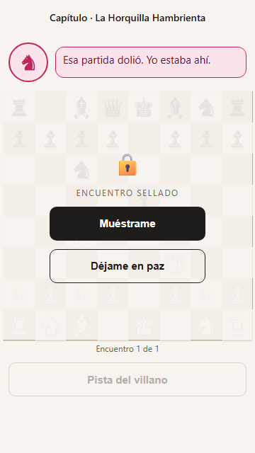
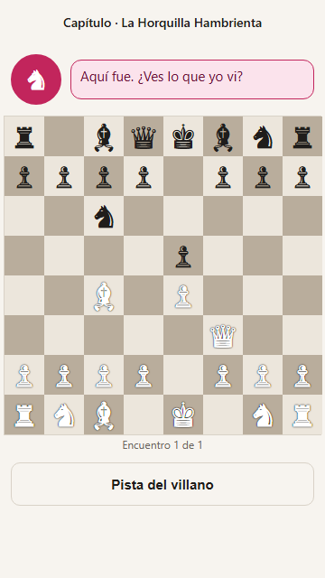

# Semana 8 — Prototipado y diseño para manufactura

## 1) Resumen

- **Nombre de la actividad:** _Plan de prototipado, prueba con usuarios y revisión DFM_
- **Curso:** _Proyecto de Ingeniería IV_
- **Equipo:** _David López Ramírez_
- **Fecha:** _15/10/2026_
- **Descripción breve:** _Con el concepto **Ghost Engine** elegido (semana 6) y su modelo económico (semana 7), esta semana se formuló la pregunta más riesgosa de **Zaqora** —si un jugador que acaba de perder abre el capítulo de su villano— y se construyó el prototipo mínimo para responderla: un prototipo de experiencia de baja resolución, en modo «mago de Oz», con avisos push de la app en dos tonos. El prototipo se probó de punta a punta con el equipo; la prueba con usuarios del segmento no se realizó. En paralelo, el concepto pasa por una revisión de diseño para manufactura (DFM) adaptada a un producto de software._

---

## 2) Punto de partida

**Concepto (semana 6):** **Ghost Engine**, una PWA en formato de novela visual: tras perder en Lichess, el villano que encarna el error del jugador le escribe y lo invita a un capítulo construido sobre esa misma partida.

**Lo que dejaron abierto las semanas anteriores:**

- **El tono del villano decide el concepto.** En la Matriz de Pugh (semana 6), el +39 de Ghost Engine depende de que el villano valide en lugar de burlarse; si suena a burla, baja a +15. Las dos críticas del boceto marcaron la misma duda.
- **Sin uso no hay conversión.** El modelo económico (semana 7) muestra que el año 1 solo cierra si al menos 2 de cada 20 usuarios pagan, y nadie paga por un capítulo que no abre.
- **Costo actual:** \$18.83 MXN por usuario activo al mes a 10 usuarios y \$14.84 a 100; el componente más caro es la infraestructura *cloud* (71 % del costo directo a 10 usuarios).

**Prototipo de exploración vs. producto:** el prototipo de esta semana no es el *first-iteration product*. Sirve para responder una pregunta concreta antes de programar el motor, el cron y el narrador.

- **Objetivo de la semana:** Validar con comportamiento real el supuesto más riesgoso de Zaqora y rediseñar el concepto para que sea más barato y simple de construir y mantener.

!!! note "Adaptación a un producto de software"
    La semana está pensada para un producto físico (carcasa, ensamble, JLCPCB). Como en las semanas 5 a 7, en Zaqora la «carcasa» son los servicios que hay que integrar, el «ensamble» es el trabajo de integrarlos más los pasos que da el usuario para empezar, y la «manufactura» es construir y desplegar el software.

---

## 3) Proceso — Prototipo y DFM

### Paso 1 — El supuesto más riesgoso

Los supuestos se priorizaron por riesgo, indefinición y controversia:

| Supuesto | Riesgo si es falso | ¿Qué tan definido está? | ¿Hay controversia? | Prioridad |
| :--- | :--- | :--- | :--- | :---: |
| **El jugador que acaba de perder abre el capítulo del villano** | El concepto entero no sirve: sin apertura no hay producto ni cobro | Nada: nunca se ha probado | Sí: la propuesta de valor lo da por hecho | **1** |
| El tono validante retiene más que el burlón | El margen de Ghost Engine en la Matriz de Pugh baja de +39 a +15 | Poco: el boceto usa el tono burlón | Sí: Pugh y las dos críticas lo cuestionan | **1** (se prueba junto con el anterior) |
| Al menos 2 de cada 20 usuarios pagan \$59 MXN al mes | El año 1 no cierra | Nada | Sí: el usuario usa Lichess porque es gratis | 2 (depende del 1) |
| El narrador no inventa jugadas | Se rompe la confianza en la ficción | Parcial: hay validador en el diseño | No | 3 |

El supuesto de pago va después: antes de saber si alguien paga, hay que saber si alguien abre.

### Paso 2 — Plan de prototipado

| Campo | Plan |
| :--- | :--- |
| **Equipo** | David López Ramírez |
| **Concepto** | Zaqora — Ghost Engine |
| **Supuesto a validar** | Un jugador que acaba de perder en Lichess abre el capítulo que le envía el villano, en lugar de cerrar todo; y el tono validante retiene más que el burlón. |
| **Pregunta precisa** | ¿Puede un jugador de Lichess que acaba de perder **abrir y terminar** el capítulo de su villano **sin** que nadie se lo pida ni le explique qué es? |
| **Tipo de prototipo** | **Experiencia** (forma / función / experiencia / negocio) |
| **Resolución** | **Baja**, en modo «mago de Oz»: el aviso sale de la app de Zaqora como notificación push, igual que en el producto, pero lo dispara un script del equipo en lugar del sistema real (no hay cron, motor ni LLM). |
| **Por qué esta resolución** | La pregunta es si el aviso y la escena hacen actuar al jugador; para eso no hacen falta el motor ni el narrador, pero sí el canal real. |
| **Qué vamos a construir** | Una PWA mínima (página para activar los avisos y escena con la posición real del error), un script que detecta las derrotas en Lichess y envía el aviso push del villano, y un registro de eventos en Supabase. Un día de preparación y una ventana de prueba de 3 a 5 días. |
| **Cómo capturamos la evidencia** | Cuántos participantes activan los avisos cuando se les pide. Hora de la derrota (API de Lichess), del aviso (script) y de la apertura (Supabase) → minutos hasta abrir. Qué elige en la escena («Muéstrame» o «Déjame en paz»), cuántos intentos hace y si termina el encuentro, registrado por la escena. Si se atasca, una sola pregunta al final: «¿Qué esperabas que pasara aquí?». |
| **Umbral de éxito** | **Al menos 3 de 5** participantes abren el aviso **en menos de 30 minutos** tras perder y **al menos 2 de 5** terminan el encuentro. Se prefiere el tono con mayor tasa de apertura en las mismas personas. |

**Diseño de la observación** (Paso 3 del curso: definir antes de prototipar):

| Pregunta del Paso 3 | Respuesta |
| :--- | :--- |
| ¿Cuántos usuarios? | 5 jugadores amateur de Lichess (mínimo 3), mayores de edad, que juegan al menos 3 veces por semana. |
| ¿Qué comportamientos observaremos? | Si activa los avisos; minutos desde la derrota hasta abrir el aviso; si elige «Muéstrame» o «Déjame en paz»; si pide la pista; cuántos intentos hace; si termina el encuentro. |
| ¿Cómo los registraremos? | Automáticamente: la escena guarda cada evento con la hora en Supabase, y el script registra la hora de la derrota y del aviso. No hace falta video ni grabación de pantalla. |
| ¿Qué preguntaremos si se atasca? | Una sola pregunta, al final de la prueba: «¿Qué esperabas que pasara aquí?». Y en el cierre: «La última vez que perdiste, ¿qué hiciste justo después?». |

**Diseño de la prueba:**

- **Participantes:** 5 jugadores amateur de Lichess, mayores de edad, que juegan al menos 3 veces por semana.
- **Dos variantes por persona, sin detalle de la jugada (diseño principal):** cada participante recibe el tono validante en una derrota y el burlón en otra. Tres empiezan por el validante y dos por el burlón, para que el orden no decida el resultado. Los mensajes no citan la jugada exacta porque, tras la revisión DFM (Paso 4), el análisis corre en el teléfono y el producto solo podrá avisar que hubo una derrota; el error se revela al abrir la escena.
- **Alternativa con tres variantes:** sumar un mensaje validante **con** la jugada exacta (C), que el producto solo podrá enviar cuando Lichess ya tenga el análisis de la partida. Cada participante recibiría las tres en orden rotado. Solo conviene si los participantes pierden al menos 3 veces en la ventana de prueba; si no, los resultados quedan demasiado repartidos.
- **Un solo mensaje por derrota y ningún recordatorio:** si no abre, no se insiste. También es una regla del producto (tecnología calmada).
- **Detección de derrotas:** consultar cada 15–30 minutos las partidas nuevas de cada participante en la API pública de Lichess y enviar el mensaje en menos de 10 minutos tras la derrota.

**Mensajes** (los avisos salen de la app como notificación push: el título es el nombre del villano y, al tocarlo, se abre la escena; los textos entre llaves los llena el script con la partida real; no se menciona al rival porque es un tercero):

| Momento | Mensaje |
| :--- | :--- |
| **Invitación y consentimiento** | «Hola, {nombre}. Soy David, estudiante de Ingeniería. Estoy probando Zaqora, un juego que convierte tus derrotas de ajedrez en capítulos de una historia. Durante los próximos 5 días revisaría tus partidas públicas de Lichess y, cuando pierdas, te llegaría un mensaje con un enlace. No necesitas instalar nada ni crear cuenta. No guardo tus datos fuera de esta prueba, y puedes salirte cuando quieras escribiendo ALTO. ¿Aceptas? Si sí, mándame tu usuario de Lichess.» |
| **A · Validante, sin detalle** | «Esa partida dolió. Te vi caer con {color} en {n} jugadas, y yo estaba ahí. Soy {villano}. Ya sé dónde fue; cuando quieras, te lo enseño.» |
| **B · Burlona, sin detalle** (tono del boceto actual) | «Te estaba esperando. {n} jugadas con {color} y caíste justo donde yo sabía. ¿Vienes a ver dónde fue?» |
| **C · Validante, con detalle** (solo en la alternativa de tres variantes) | «Esa partida dolió. Yo estaba ahí, en la jugada {jugada}: moviste {pieza} a {casilla}. Soy {villano}, y no es la primera vez que nos vemos. Cuando quieras, te enseño dónde te encontré.» |
| **Cierre de la prueba** | «Gracias por participar, {nombre}. Una última pregunta: la última vez que perdiste esta semana, ¿qué hiciste justo después? Cuéntame lo que hiciste, no lo que pensaste.» |

!!! warning "Cuidados de la prueba"
    Solo participa quien acepta el mensaje de invitación, y quien escriba ALTO sale de inmediato. No participan menores de edad (el PDS exige consentimiento de tutor). Se usa solo el nombre de usuario de Lichess y la hora de las partidas; en Supabase cada participante aparece solo con un alias, y los registros se borran al terminar el reporte. WhatsApp se usa solo para la invitación y el cierre. En iPhone, los avisos web solo funcionan con la app agregada a la pantalla de inicio (iOS 16.4 o más reciente).

### Paso 3 — Construcción y prueba con usuarios

**Cómo se construyó el prototipo** (un día de trabajo):

| Pieza | Qué hace | Herramienta |
| :--- | :--- | :--- |
| **Escena web** | La página que se abre al tocar el aviso: villano, tablero sellado con la posición real de su error, «Muéstrame» / «Déjame en paz», pista del villano y jugada clave. Sigue el presupuesto vertical de la semana 6 (encabezado de 48 px, franja del villano de 80, tablero de 352 con casillas de 44, pie de 64). | Una sola página HTML, sin instalar nada; [ver la escena de ejemplo](prototipo/escena.html) |
| **Detector de derrotas** | Revisa cada 15 minutos las partidas públicas de Lichess de cada participante. Por cada derrota nueva toma la posición antes de su peor error (del análisis de Lichess) y la mejor jugada, y envía el aviso push del villano en la variante que le toca, con el enlace a la escena. | Script en Python con la API pública de Lichess, python-chess y pywebpush |
| **Registro de comportamiento** | Guarda, con la hora, quién activa los avisos y qué hace cada participante en la escena (abrir, «Muéstrame», «Déjame en paz», pista, intento fallido, resuelto), identificado solo con un alias (P1…P5). | Tablas en Supabase Free con permiso de solo inserción |
| **Avisos de la app** | La escena y la página de activación forman una PWA instalable; su *service worker* muestra el aviso del villano y abre la escena al tocarlo. Un solo aviso por derrota: no se acumulan. | Web Push con claves VAPID; [página de activación](prototipo/activar.html) |

{ width="300" }

{ width="300" }

*Capturas de la escena de ejemplo a 360 px de ancho. En la prueba, cada enlace lleva la posición real de la derrota del participante.*

**Prueba de funcionamiento (15/10/2026).** El prototipo se probó de punta a punta con un celular real y partidas reales del propio equipo:

| Paso | Qué se comprobó | Resultado |
| :--- | :--- | :---: |
| Publicación | La PWA responde en una dirección https (necesaria para los avisos) | ✅ |
| Activación de avisos | La página de activación pide el permiso y guarda la suscripción en Supabase | ✅ |
| Aviso de prueba | El script envía la notificación y llega al celular | ✅ |
| Escena | Tocar el aviso abre la escena; «Muéstrame» revela el tablero | ✅ |
| Registro | Supabase guarda los eventos de la escena con la hora | ✅ |
| Detección de derrotas | El script detecta una derrota real en Lichess, toma la posición antes del error y arma el aviso | ✅ |

!!! warning "Prueba con usuarios: no realizada"
    La prueba con jugadores del segmento estaba programada para el 16, 17 y 18 de octubre de 2026, pero **no se realizó**. La única prueba hecha es la de funcionamiento del equipo (tabla de arriba). Por eso no hay evidencia de comportamiento de usuarios: el supuesto más riesgoso sigue **sin validar**, y el reporte de prototipo lo indica así en lugar de llenar resultados que no existen. El prototipo quedó publicado y listo para correr la prueba en cuanto haya participantes.

### Paso 4 — Revisión DFM del concepto

**Herramienta:** Claude.

??? quote "Prompt completo — Prompt del profesor adaptado a Zaqora (Claude, revisión DFM)"
    Actúa como un ingeniero de manufactura con experiencia en diseño para manufactura y ensamble (DFM/DFA), aplicado a productos de software en etapa temprana. Sigues el método de 5 pasos de Ulrich & Eppinger y prefieres soluciones viables con recursos universitarios y servicios de plan gratuito. Como el producto no tiene hardware, tradúcelo así: la «carcasa» son los servicios que hay que integrar, el «ensamble» es el trabajo de integrar y desplegar esos servicios más los pasos que da el usuario para empezar, y la «manufactura» es construir y desplegar el software. Cuando una mejora tenga un costo oculto, dilo directamente.

    **NUESTRO CONCEPTO:**
    Nombre: Zaqora — concepto Ghost Engine
    Descripción del artefacto: PWA web en formato de novela visual que convierte el aprendizaje de ajedrez en un videojuego de un solo jugador. Tras perder en Lichess, el villano que encarna el error recurrente del jugador le escribe y lo invita a un capítulo construido sobre esa misma partida. Pantalla de referencia de 360 × 640 px útiles: encabezado de 48 px, franja del villano de 80 px, tablero de 352 px (casillas de 44 px), progreso de 24 px y pie de 64 px. Lenguaje visual: ilustración vectorial SVG y piezas en SVG.
    Método de instalación: se abre desde una URL, sin cuenta; el usuario escribe su nombre de usuario de Lichess, ve la primera escena y después se le ofrece instalar la PWA («Guarda a tu villano»). También se publica en Google Play (cuenta de desarrollador incluida en el piloto).
    «Carcasa» (servicios integrados): 7 partes — (1) PWA y landing en Cloudflare Pages (plan gratuito); (2) base de datos y autenticación en Supabase (plan Free; pausa tras 1 semana sin actividad); (3) worker en Python con Stockfish en Railway (plan Hobby); (4) API de Anthropic como narrador (Claude Haiku 4.5); (5) API pública de Lichess (partidas en NDJSON, por nombre de usuario); (6) Stripe México para los cobros; (7) Google Play (cuenta de desarrollador). Se unen por APIs HTTPS y un cron que consulta partidas nuevas.

    **BOM** (componentes principales, precios verificados el 08/10/2026, tipo de cambio de 18.5 MXN/USD):

    - Claude Haiku 4.5: US\$1 por millón de tokens de entrada y US\$5 de salida; ~20 capítulos al mes por usuario, 3,000 tokens de entrada y 1,000 de salida por capítulo, +30 % por el español → \$3.85 MXN por usuario al mes
    - Worker con Stockfish (Railway Hobby): US\$5 al mes con US\$5 de uso incluido (≈ \$92.50 MXN)
    - Supabase: Free US\$0 en la beta; Pro US\$25 al mes a partir de ~100 usuarios
    - Cloudflare Pages: US\$0
    - Dominio .com: US\$11.08 al año
    - Google Play: US\$25, pago único
    - Stripe México: 3.6 % + \$3 MXN por cobro, más IVA sobre la comisión

    Proceso planeado: desarrollo propio en 8 semanas; despliegue continuo en Cloudflare Pages y Railway; análisis con Stockfish en el servidor y narración con el LLM; cobro por la web con Stripe.
    Volumen objetivo: 20 usuarios beta en la prueba de mercado y 100 usuarios en la escala inicial.
    Costo unitario actual (de nuestro modelo económico): \$18.83 MXN por usuario activo al mes a 10 usuarios y \$14.84 a 100, con 15 % de overhead y 25 % de contingencia. Precio recomendado: \$59 MXN al mes con IVA (\$44.92 netos).

    Aplica los 5 pasos:

    1. **ESTIMAR EL COSTO:** desglosa el costo unitario por usuario activo al mes a 20 y a 100 usuarios: cloud, IA, overhead (15 %) y contingencia (25 %). Señala el componente de mayor costo.
    2. **REDUCIR EL COSTO DE LOS COMPONENTES:** revisa los 3 componentes más caros y propone para cada uno una alternativa estándar (otro modelo de IA, Batch API, prompt caching, mover Stockfish al navegador con WASM, otro plan de hosting), con el ahorro estimado.
    3. **REDUCIR EL COSTO DE «ENSAMBLE» (DFA):** compara antes y después de las mejoras: número de servicios que hay que integrar y mantener, horas estimadas de integración y número de pasos y minutos que el usuario tarda en recibir el primer valor.
    4. **REDUCIR EL COSTO DE SOPORTE:** revisa monitoreo, control de calidad (validar que el narrador no invente jugadas), documentación y qué habilidades especializadas exige cada servicio.
    5. **OTROS FACTORES:** para cada mejora, señala el trade-off en calidad de la experiencia, tiempo al mercado y costo de desarrollo.

    **FORMATO DE SALIDA:** REVISIÓN DFM (concepto · volumen) → COSTO UNITARIO ACTUAL (a 20 y a 100, componente de mayor costo) → OPORTUNIDADES DE REDUCCIÓN (3: problema, alternativa, ahorro) → «ENSAMBLE» (DFA) antes y después → COSTO CON MEJORAS → TRADE-OFFS → COMPATIBILIDAD CON EL PDS Y PLANES GRATUITOS (✅ / ⚠️ / ❌).

??? abstract "Respuesta completa — Prompt del profesor adaptado (Claude)"
    **Revisión DFM/DFA de Zaqora (Ghost Engine)**

    *Concepto:* PWA de novela visual con un villano que encarna el error recurrente del jugador. Se integran 7 servicios (Cloudflare Pages, Supabase, worker de Python con Stockfish en Railway, Claude Haiku 4.5, API de Lichess, Stripe México y Google Play). *Volumen:* 20 usuarios en la beta (prueba de mercado) y 100 en la escala inicial.

    Antes de empezar, dos hallazgos que cambian el análisis:

    - **Ya existe Claude Haiku 5.5.** Cuesta US\$0.10 por millón de tokens de entrada y US\$0.50 de salida (en prompts de hasta 100 mil tokens). Es una décima parte del precio de Haiku 4.5.
    - **El prompt caching no funciona con su diseño actual.** Haiku 4.5 solo guarda en caché prompts de 4,096 tokens o más, y su capítulo usa 3,000 tokens de entrada. Si marcan el prompt para caché, la API lo procesa sin caché y no avisa con ningún error.

    ---

    **1. COSTO UNITARIO ACTUAL**

    Reconstruí su modelo para comprobar que entendí los supuestos. Con overhead y contingencia compuestos (×1.15 × 1.25 = ×1.4375), su cifra de \$14.84 a 100 usuarios solo cuadra si Railway cuesta US\$10 a esa escala (US\$5 de uso extra). Usé ese supuesto. Además, su modelo deja fuera el dominio y Google Play, así que los agregué con Play amortizado en 12 meses.

    | MXN por usuario activo al mes | 20 usuarios | 100 usuarios |
    | :--- | ---: | ---: |
    | Railway (US\$5 / US\$10) | 4.63 | 1.85 |
    | Supabase (Free / Pro) | 0.00 | 4.63 |
    | Cloudflare Pages | 0.00 | 0.00 |
    | Dominio (\$17.08 al mes) | 0.85 | 0.17 |
    | Google Play (amortizado en 12 meses) | 1.93 | 0.39 |
    | Cloud, subtotal | 7.41 | 7.04 |
    | IA (Haiku 4.5) | 3.85 | 3.85 |
    | Costo directo | 11.26 | 10.89 |
    | Overhead (15 %) | 1.69 | 1.63 |
    | Contingencia (25 %) | 3.24 | 3.13 |
    | **Total** | **\$16.18** | **\$15.64** |
    | Total con el método de su modelo (sin dominio ni Play) | \$12.18 | \$14.84 |

    - **Componente de mayor costo:** a 20 usuarios, Railway (\$4.63); a 100 usuarios, Supabase Pro (\$4.63). La IA (\$3.85) es el único costo que no se reparte al crecer. Con más usuarios, pasará a ser el mayor.
    - **Costo oculto: Stripe cuesta más que cualquier partida de cloud.** Cada cobro de \$59 paga una comisión de \$2.12 (3.6 %) más \$3, más IVA sobre la comisión, que suma \$5.94 por usuario de pago al mes. Ya está restado en su precio neto de \$44.92, pero conviene verlo como lo que es: el costo más grande por usuario.

    ---

    **2. OPORTUNIDADES DE REDUCCIÓN**

    **A. IA: el narrador**

    - *Problema:* es el costo que crece en proporción a los usuarios. Las dos palancas habituales tampoco sirven aquí: el caché no se activa con Haiku 4.5, porque el prompt es demasiado corto; y aun con un modelo que sí lo active, un caché que dura 5 minutos casi nunca se reutilizaría con 20 a 100 usuarios repartidos a lo largo del día.
    - *Alternativa:* cambiar a Claude Haiku 5.5 con los mismos tokens. Entrada: 60 mil tokens × US\$0.10/M = US\$0.006. Salida: 20 mil tokens × US\$0.50/M = US\$0.010. Con +30 % por el español: \$0.39 MXN por usuario al mes.
    - *Ahorro:* \$3.46 directos, que con overhead y contingencia son ≈ \$4.98 por usuario al mes, unos 90 % menos en IA.
    - *Lo que no recomiendo:* el Batch API daría otro 50 %, pero solo unos \$0.19 más. No compensa la complejidad de procesar en asíncrono.
    - *Costo oculto:* hay que volver a calibrar la voz del villano y el formato de salida con el modelo nuevo. Calculen de 3 a 5 horas y un conjunto de partidas de prueba (ver paso 4).

    **B. Railway: el worker de Python con Stockfish**

    - *Problema:* es un servicio de pago aparte, en otro lenguaje y en un contenedor, solo para analizar partidas.
    - *Alternativa:* dos cambios. Stockfish WASM en un Web Worker del navegador, que es lo mismo que hace Lichess en su tablero de análisis; y el cron que consulta partidas nuevas pasa a pg_cron más una Edge Function de Supabase, incluidas en el plan Free. *Mejora adicional:* pedir las partidas a Lichess con `evals=true`. Si el jugador ya pidió el análisis en Lichess, las evaluaciones llegan hechas y no hay que calcular nada.
    - *Ahorro:* \$92.50 a \$185 al mes, que equivalen a ≈ \$6.65 por usuario a 20 usuarios y ≈ \$2.66 a 100, ya con overhead y contingencia.
    - *Costos ocultos:*
        - **Licencia GPL-3 de Stockfish.** En el servidor no distribuyen Stockfish. Al mandarlo al navegador y a la app de Play, sí lo distribuyen, y deben ofrecer su código fuente y aclarar la licencia. Es manejable, pero se documenta desde el día uno.
        - **Tiempo de análisis en el teléfono.** En un Android de gama media, analizar una partida completa toma decenas de segundos y gasta batería.
        - **Peso del motor.** La compilación «lite» pesa unos megas y la completa, decenas.
        - **Multihilo.** Para usar varios hilos hacen falta las cabeceras COOP/COEP, que se configuran en el archivo `_headers` de Pages.
        - **El mensaje del villano cambia de momento.** Ya no puede llegar con el error exacto, porque el análisis ocurre cuando el usuario abre la app. Lo que sí puede llegar es algo como «Te vi caer contra X en 23 jugadas. Ya sé dónde fue», y el detalle se revela al abrir.

    **C. Supabase Pro a partir de ~100 usuarios**

    - *Problema:* con 100 usuarios no rebasan ningún límite del plan Free (500 MB de base de datos, 50 mil usuarios activos al mes). Pasar a Pro sería por el riesgo de pausa y por los respaldos, no por capacidad.
    - *Alternativa:* quedarse en Free. El cron horario de pg_cron mantiene actividad real en la base de datos; un `pg_dump` semanal con GitHub Actions (gratuito) sustituye los respaldos; un monitor de disponibilidad avisa si el proyecto se pausa.
    - *Ahorro:* \$462.50 al mes, ≈ \$6.65 por usuario a 100 usuarios con overhead y contingencia.
    - *Costos ocultos:* no hay respaldos diarios ni acuerdo de nivel de servicio. Si se pausa, la landing sigue cargando pero el villano deja de responder. Verifiquen qué cuenta como «actividad» para la regla de pausa vigente. Planeen pasar a Pro cuando lleguen ingresos reales.

    ---

    **3. «ENSAMBLE» (DFA): ANTES Y DESPUÉS**

    | | Antes | Después |
    | :--- | :--- | :--- |
    | Servicios que se integran y mantienen | 7 | 6 (sale Railway) |
    | Cuentas de pago con tarjeta | 3 (Railway, Anthropic, Supabase Pro) | 1 (Anthropic) |
    | Lenguajes y entornos de ejecución | Python, TypeScript y Docker | Solo TypeScript (el navegador y Deno en las Edge Functions) |
    | Horas de integración | ≈ 64 h | ≈ 64 h |
    | Mantenimiento mensual | ≈ 4 h | ≈ 2 h |
    | Pasos del usuario hasta el primer valor | 3: abrir la URL, escribir su usuario, confirmar | 3, sin cambio |
    | Tiempo hasta la primera escena | 20 a 40 s de espera (servidor más LLM) | 5 s si Lichess ya tiene evaluaciones; 20 a 60 s en gama media si no |

    *Desglose de horas de integración:*

    | Tarea | Antes | Después |
    | :--- | ---: | ---: |
    | PWA y CI | 6 h | 7 h |
    | Supabase | 8 h | 10 h |
    | Análisis con Stockfish | 16 h (worker en Docker con cola) | 12 h (WASM en Web Worker) |
    | Lichess | 6 h | 6 h |
    | Narrador | 12 h | 13 h |
    | Stripe | 8 h | 8 h |
    | Google Play | 8 h | 8 h |
    | **Total** | **≈ 64 h** | **≈ 64 h** |

    **Lectura directa:** el rediseño no ahorra horas de construcción. Lo que ahorra es dinero y mantenimiento. Para el usuario, la espera puede empeorar en teléfonos lentos.

    *Cómo disimular la espera:* la escena de presentación del villano se muestra mientras el análisis corre; la franja de progreso de 24 px enseña el avance del análisis; se analizan primero las jugadas donde se perdió material, a poca profundidad.

    *Dos costos ocultos de ensamble que ya existen y que el plan de 8 semanas no menciona:*

    - **Prueba cerrada de Google Play.** Las cuentas personales de desarrollador nuevas deben hacer una prueba cerrada con al menos 12 testers durante 14 días seguidos antes de publicar en producción. Sus 20 usuarios beta alcanzan, pero son 2 semanas de calendario que hay que reservar.
    - **Pagos dentro de Google Play.** Una app de Play que vende contenido digital normalmente debe usar el sistema de facturación de Google, con 15 % de comisión en suscripciones (≈ \$8.85 por cobro de \$59), en lugar de Stripe. Revisen la política vigente para México antes de decidir. Si aplica, la app de Play no debe tener flujo de compra y el cobro con Stripe se queda solo en la web.

    ---

    **4. COSTO DE SOPORTE**

    *Monitoreo:* un monitor de disponibilidad gratuito sobre un endpoint `/health` que consulte la base de datos (así detectan una pausa de Supabase y además generan actividad); un tope de gasto en la consola de Anthropic; una alerta si un webhook de Stripe falla. En la versión actual, añadan también el límite de uso de Railway.

    *Control de calidad del narrador (que no invente jugadas):*

    - El LLM no recibe el PGN «para que lo lea». Recibe una lista cerrada de momentos clave: número de media jugada, jugada en notación algebraica, evaluación antes y después, y la mejor jugada según Stockfish.
    - La salida es JSON estructurado. Las jugadas se citan como marcadores (`{p23}`) y no como texto libre.
    - Un validador con chess.js comprueba tres cosas: que cada referencia exista en la partida; que la jugada en notación algebraica coincida; que la jugada sugerida sea legal en esa posición. Además, una expresión regular rechaza cualquier jugada escrita fuera de los marcadores.
    - Si falla, se regenera una vez. Si vuelve a fallar, se usa un texto de plantilla. El costo de reintentos es de ~5 % más tokens, insignificante con Haiku 5.5.
    - Conjunto de prueba: 30 partidas con sus momentos esperados. Se corren cada vez que cambien el modelo o el prompt.

    *Documentación mínima:* diagrama de la arquitectura y lista de variables de entorno; guía de incidentes (Supabase pausado, error 429 de Lichess —esperar un minuto y no hacer peticiones en paralelo—, cuota de Anthropic agotada, webhook de Stripe caído); checklist de publicación en Play; nota sobre la licencia GPL de Stockfish.

    *Habilidades especializadas por servicio:*

    | Servicio | Antes | Después |
    | :--- | :--- | :--- |
    | Análisis | Python, protocolo UCI de Stockfish, Docker, colas | WASM y Web Workers, cabeceras COOP/COEP |
    | Supabase | SQL y políticas RLS | SQL, RLS, pg_cron y Deno |
    | Anthropic | Diseño de prompts y JSON estructurado | Igual |
    | Stripe | Webhooks y facturación con IVA | Igual |
    | Google Play | TWA con Bubblewrap, assetlinks y Play Console | Igual |

    ---

    **5. COSTO CON MEJORAS**

    | MXN por usuario al mes | 20 usuarios | 100 usuarios |
    | :--- | ---: | ---: |
    | Cloud (dominio y Play amortizados) | 2.78 | 0.56 |
    | IA (Haiku 5.5) | 0.39 | 0.39 |
    | Overhead y contingencia | 1.38 | 0.40 |
    | **Total** | **\$4.55 (−72 %)** | **\$1.35 (−91 %)** |
    | Margen sobre \$44.92 netos | \$40.37 | \$43.57 |

    Con las mejoras, Stripe (\$5.94 por cobro) pesa más de 4 veces el costo de operación. La siguiente palanca está en el cobro, no en la nube. Por ejemplo, un plan anual de \$590 baja la comisión a ≈ \$2.34 por usuario al mes, porque los \$3 fijos se cobran una sola vez al año.

    ---

    **6. TRADE-OFFS**

    | Mejora | Calidad de la experiencia | Tiempo al mercado | Costo de desarrollo |
    | :--- | :--- | :--- | :--- |
    | Haiku 5.5 | Neutral, o mejor si el modelo nuevo narra mejor. Requiere validarlo con el conjunto de prueba | Más medio día | 3 a 5 h |
    | Stockfish en el navegador | Peor en teléfonos lentos: espera y batería. El mensaje push es menos específico | Neutral (se quita Docker y se suma WASM) | ≈ igual, más el trámite de la GPL |
    | Supabase Free con respaldos | Riesgo de caída por pausa y sin respaldos diarios | Neutral | 2 a 3 h (respaldo y monitor) |
    | Validador del narrador | Mucho mejor: el villano nunca cita una jugada falsa | Más 1 a 2 días | 8 a 10 h (incluidas en el narrador) |
    | Cobro solo en la web (por la política de Play) | Un paso más para pagar desde la app de Android | Neutral | Bajo |

    ---

    **7. COMPATIBILIDAD CON EL PDS Y LOS PLANES GRATUITOS**

    No tengo su PDS a la mano, así que tomé los requisitos de la descripción del concepto.

    | Requisito | Estado | Nota |
    | :--- | :---: | :--- |
    | Se abre desde una URL, sin cuenta | ✅ | Autenticación anónima en Supabase, sin cambio |
    | Pantalla de 360 × 640 px y tablero de 352 px con casillas de 44 px | ✅ | El análisis no ocupa espacio. La franja de 24 px muestra su progreso |
    | Primera escena antes de ofrecer la instalación | ⚠️ | 20 a 60 s en gama media si Lichess no tiene evaluaciones |
    | Ilustración y piezas en SVG | ✅ | Sin impacto |
    | Cloudflare Pages en plan gratuito | ✅ | Las Pages Functions sirven de proxy al LLM y reciben el webhook de Stripe |
    | Supabase en plan Free | ⚠️ | Pausa, sin respaldos y sin acuerdo de servicio |
    | Railway | ✅ | Desaparece; era el único hosting de pago |
    | Anthropic | ⚠️ | No tiene plan gratuito, pero cuesta ≈ \$8 al mes en total a 20 usuarios |
    | Lichess | ✅ | Gratuito. Respetar una petición a la vez y esperar un minuto tras un error 429 |
    | Stripe México | ✅ | Sin cuota fija; pagan solo por cobro |
    | Google Play: cuota única de US\$25 y prueba cerrada de 14 días | ⚠️ | Reservar las 2 semanas en el calendario |
    | Google Play: cobro con Stripe dentro de la app | ❌ | Probable conflicto con la política de pagos; verificar para México |
    | Licencia de Stockfish al distribuirlo | ⚠️ | GPL-3: ofrecer el código fuente en la web y en Play |
    | Precio de \$59 con IVA | ✅ | Margen de \$40 a \$44 por usuario |

    *Fuentes citadas en la respuesta:* Prompt caching y precios — Claude Platform Docs.

**Lectura del resultado**

- **El costo baja hasta 91 %, pero no las horas de construcción.** Las mejoras (Haiku 5.5, Stockfish en el navegador y Supabase Free) llevan el costo de ~\$16 a ~\$4.55 por usuario a 20 usuarios. El trabajo de integración sigue en ~64 horas: lo que se ahorra es dinero y mantenimiento.
- **Quitar el servidor de análisis cambia la experiencia.** Con Stockfish en el teléfono, el villano ya no puede escribir con el error exacto en el momento de la derrota, porque el análisis ocurre al abrir la app. Eso afecta justo al prototipo de esta semana: la variante del mensaje tendría que ser «Te vi caer en 23 jugadas. Ya sé dónde fue», y el detalle aparecería en la escena. Por eso los mensajes de la prueba (Paso 2) se ajustaron a esa versión.
- **El costo más grande ya no es la nube, es el cobro.** Stripe se lleva \$5.94 de cada \$59, más de 4 veces el costo de operación. El plan anual es la siguiente palanca.
- **Dos riesgos de calendario que no estaban en ningún plan:** la prueba cerrada obligatoria de Google Play (12 testers durante 14 días) y la probable obligación de cobrar con la facturación de Google (15 %) dentro de la app. Los dos chocan con la decisión de incluir Google Play en el piloto.
- **Datos verificados (15/10/2026).** En la documentación oficial: el caché de Haiku 4.5 exige prompts de al menos 4,096 tokens y no avisa si no se aplica (el de Haiku 5.5 empieza en 512, pero dura 5 minutos, así que con pocos usuarios casi no se reutilizaría); las cuentas personales nuevas de Google Play deben hacer una prueba cerrada con al menos 12 testers durante 14 días seguidos; y las apps de Play que venden contenido digital o suscripciones deben usar la facturación de Google, que en México cobra 15 % en suscripciones, salvo que el país esté en sus programas de facturación alternativa (la página no lo menciona). Además, su costo de Haiku 5.5 (\$0.39) no incluye el ~30 % de tokens extra del tokenizador de los modelos nuevos que indica la documentación de Anthropic; con ese ajuste sale en \$0.50, que es lo que usa el BOM actualizado.

---

## 4) Entregable — Prototipo y DFM de Zaqora

**Equipo:** _David López Ramírez_ · **Concepto:** _Zaqora — Ghost Engine_ · **Fecha:** _15/10/2026_

### 1. Plan de prototipado

El plan completo está en el Paso 2: supuesto, pregunta precisa, prototipo de experiencia de baja resolución en modo «mago de Oz», evidencia de comportamiento y umbral de éxito de 3 de 5 que abren en menos de 30 minutos y 2 de 5 que terminan.

### 2. Reporte de prototipo

| Campo | Resultado |
| :--- | :--- |
| **Equipo** | David López Ramírez |
| **Concepto** | Zaqora — Ghost Engine |
| **Tipo de prototipo** | Experiencia |
| **Resolución** | Baja (mago de Oz) |
| **Materiales y tiempo** | PWA mínima (activación de avisos y escena), script en Python con la API de Lichess, python-chess y Web Push, y Supabase Free. Construcción, configuración y prueba de funcionamiento en un día (15/10/2026). |
| **Pregunta que respondía** | ¿Puede un jugador de Lichess que acaba de perder abrir y terminar el capítulo de su villano sin que nadie se lo pida ni le explique qué es? |
| **Evidencia recolectada — usuario 1** | No hay: la prueba con usuarios del segmento no se realizó. La única prueba fue la de funcionamiento del equipo, que no cuenta como evidencia de usuario: el equipo ya sabía qué esperaba encontrar. |
| **Evidencia recolectada — usuario 2** | No hay (prueba con usuarios no realizada). |
| **Evidencia recolectada — usuario 3** | No hay (prueba con usuarios no realizada). |
| **¿Se validó el supuesto?** | **No se puede determinar.** |
| **Por qué** | Sin jugadores del segmento no hay comportamiento que medir. La prueba del equipo solo demuestra que el prototipo funciona técnicamente: el aviso llega, la escena se abre, los eventos se registran y la derrota se detecta. No dice nada sobre si un jugador que acaba de perder abriría el aviso. |
| **Aprendizaje clave** | El canal real es factible y barato: un aviso push de la PWA llega al celular en el momento de la derrota sin servidor propio de análisis, con servicios gratuitos. Y el momento clave depende del análisis: en la prueba hubo que pedir a mano el análisis de la partida en Lichess; sin él, no hay posición del error que mostrar. |
| **Cambio al diseño** | El análisis de la partida debe ocurrir dentro de Zaqora (Stockfish en el navegador, como propuso la revisión DFM) y no depender de que el jugador pida el análisis en Lichess. Además, el aviso sale de la app y no por WhatsApp, para medir el canal real. |
| **Siguiente hipótesis a prototipar** | La misma, todavía sin validar: un jugador que acaba de perder abre el aviso del villano y termina el encuentro, y el tono validante retiene más que el burlón. Se prueba con el prototipo ya publicado. Después: que al menos 2 de cada 20 usuarios paguen \$59 al mes. |

### 3. Revisión DFM y BOM actualizado

[Descargar el modelo con las mejoras DFM (Excel)](recursos/archivos/PI4_S8/Zaqora_Modelo_Economico_S8_DFM.xlsx)

Se adoptaron las tres mejoras de la revisión DFM. El libro es una copia del modelo de la semana 7 con los supuestos cambiados en naranja; todo lo demás se recalcula con las mismas fórmulas.

**BOM actualizado**

| Componente | Antes (semana 7) | Después (semana 8) | Cambio |
| :--- | :--- | :--- | :--- |
| Narrador | Claude Haiku 4.5: US\$1 / US\$5 por millón de tokens | **Claude Haiku 5.5:** US\$0.10 / US\$0.50 por millón | Mismo consumo de tokens; +30 % por el español y +30 % por el tokenizador nuevo |
| Análisis de partidas | Worker de Python con Stockfish en Railway, US\$5 al mes | **Stockfish WASM en el navegador**; cron en pg_cron + Edge Function de Supabase | Sale Railway; se aprovechan las evaluaciones de Lichess (`evals=true`) |
| Base de datos a 100 usuarios | Supabase Pro, US\$25 al mes | **Supabase Free** con `pg_dump` semanal y monitor de disponibilidad | Se pasa a Pro cuando haya ingresos |
| Dominio, Google Play, Cloudflare Pages, Stripe | Sin cambio | Sin cambio | Dominio y Play se amortizan en 12 meses en el costo unitario |

**Nuevo costo unitario** (MXN por usuario activo al mes, con 15 % de overhead y 25 % de contingencia):

| Concepto | 20 usuarios | 100 usuarios |
| :--- | ---: | ---: |
| Cloud y fijos amortizados (dominio y Google Play) | \$2.78 | \$0.56 |
| IA (Haiku 5.5) | \$0.50 | \$0.50 |
| Overhead y contingencia | \$1.44 | \$0.46 |
| **Costo unitario** | **\$4.72** | **\$1.52** |
| Antes, mismo método (con dominio y Play amortizados) | \$16.18 | \$15.64 |
| Ingreso neto por suscriptor / costo unitario | 9.5 veces | 29.6 veces |

La diferencia con la revisión (\$4.55 y \$1.35) se debe a que el libro suma el ~30 % de tokens del tokenizador nuevo al costo de Haiku 5.5.

**Efecto en el año 1** (mismo plan de 20 usuarios beta, 5 % de conversión y cuenta de Google Play):

| | Semana 7 | Con mejoras DFM |
| :--- | ---: | ---: |
| Inversión inicial | \$1,222.48 | \$1,037.48 (sin worker prepagado) |
| Flujo mensual desde el mes 4 | −\$88 a −\$199 | **+\$44.92** (ya no hay costos de operación en efectivo) |
| Primer mes con flujo positivo | Ninguno | **Mes 4** |
| VPN a 12 meses (15 %) | −\$2,636 | **−\$669** |
| Suscriptores necesarios todo el año | 8 | **3** (15 % de conversión) |

Las mejoras no vuelven viable el año 1 por sí solas, pero cambian la escala del problema: el negocio pasa de perder dinero cada mes a recuperar la inversión con 3 suscriptores en lugar de 8. Con una academia piloto (semana 7), el VPN ya era positivo antes de las mejoras.

### 4. Economía circular

La página del curso plantea cuatro preguntas de circularidad pensadas para hardware. Traducidas a Zaqora:

| Pregunta del curso | Principio | Equivalente en Zaqora | Respuesta |
| :--- | :--- | :--- | :--- |
| ¿Los componentes son accesibles para reparación? | Reparabilidad | ¿Se puede cambiar una pieza sin rehacer el producto? | Sí: cada servicio se conecta por una API. Cambiar el narrador de Claude Haiku 4.5 a Haiku 5.5, o el hosting, es cambiar un proveedor, no reescribir la app. |
| ¿Los módulos se pueden reemplazar por separado? | Modularidad | ¿El contenido y los servicios son independientes? | Sí: villanos y capítulos son plantillas de datos (guion en JSON), y cada servicio se reemplaza por separado. |
| ¿Los materiales se pueden identificar para reciclaje? | Ciclo de vida | ¿Los datos del usuario se pueden identificar, llevar y borrar? | Parcialmente: el PDS ya exige derechos ARCO y borrado en 20 días hábiles; falta permitir exportar el progreso y las partidas. |
| ¿El producto se puede actualizar sin reemplazarse? | Atemporalidad | ¿Se actualiza solo y funciona en equipos viejos? | Sí: la PWA se actualiza sola con su *service worker* (el equivalente a una actualización OTA) y el PDS fija un celular de 4 GB de RAM como mínimo, así que no obliga a cambiar de equipo. |

### 5. Pendientes del entregable

- [x] **Plan de prototipado** (Paso 2).
- [x] **Mensajes de la prueba** en las dos variantes de tono.
- [x] **Prototipo construido:** escena web, detector de derrotas y registro opcional de comportamiento (Paso 3).
- [x] **Prototipo publicado y probado de punta a punta** con un celular real y una partida real (15/10/2026).
- [ ] **Probar con al menos 3 usuarios** (idealmente 5): no se realizó en la fecha programada (16–18 de octubre). El prototipo está listo para correrla.
- [x] **Revisión DFM** (Paso 4).
- [x] **Mejoras DFM aplicadas:** BOM actualizado y nuevo costo unitario (sección 3).
- [x] **Mensajes ajustados a la revisión DFM:** los dos tonos sin detalle de la jugada, y una tercera variante con detalle como alternativa.
- [x] **Políticas de Google Play verificadas:** prueba cerrada de 12 testers durante 14 días y facturación de Google obligatoria (15 % en suscripciones).
- [ ] **Decidir cómo cobrar en la versión de Google Play:** con la facturación de Google (15 %) o sin compras dentro de la app, cobrando solo en la PWA web.
- [x] **Reporte de prototipo** con lo que hay: prueba de funcionamiento del equipo y supuesto sin validar.
- [x] **Reflexión.**

---

## 5) Reflexión

- **Construí el prototipo, pero no hice la pregunta.** La semana pedía responder el supuesto más riesgoso con comportamiento real, y lo único que sé al cierre es que el prototipo funciona. Construir resultó más fácil que conseguir a cinco personas durante tres días seguidos. El supuesto que decide todo el concepto sigue sin respuesta.
- **Probar el prototipo uno mismo no es evidencia.** Abrí el aviso porque yo lo había mandado y sabía qué contenía. La prueba de funcionamiento sirve para saber que la prueba con usuarios puede correr, no para sustituirla.
- **Cambiar WhatsApp por la notificación de la app fue la mejor decisión de la semana.** Un mensaje personal se abre más que un aviso de una app desconocida; con WhatsApp habría obtenido un resultado inflado. Ahora el prototipo mide el canal que tendrá el producto, incluida la fricción de activar los avisos.
- **La revisión DFM cambió el producto, no solo el costo.** Sacar el análisis del servidor bajó el costo de ~\$16 a ~\$4.72 por usuario, pero obligó a que el villano ya no cite el error exacto en el aviso. Y en la prueba de funcionamiento hubo que pedir a mano el análisis de la partida en Lichess para que hubiera escena: en el producto, ese análisis tiene que vivir en Zaqora.
- **Lo siguiente es la prueba, no más diseño.** Todo lo demás de Zaqora —tono, precio, academias— depende de que alguien abra el aviso después de perder.

### Preguntas de cierre

| Pregunta | Respuesta |
| :--- | :--- |
| ¿Cuál es el supuesto más riesgoso y qué prototipo lo validará? | Que un jugador que acaba de perder abra el capítulo de su villano; sigue sin validar porque la prueba con usuarios no se realizó. Lo valida un prototipo de experiencia de baja resolución en modo «mago de Oz»: avisos push de la app, disparados por un script tras derrotas reales, en dos tonos, con una escena armada sobre la posición de cada partida. |
| ¿Qué evidencia de comportamiento capturarán? | Cuántos activan los avisos, minutos desde la derrota hasta abrir la escena, la elección en la escena («Muéstrame» o «Déjame en paz») y si termina el encuentro. No se pregunta si les gustó. El registro automático en Supabase ya se comprobó en la prueba de funcionamiento. |
| ¿Cuál es el componente de mayor costo del BOM y qué alternativa DFM lo reduce? | A 20 usuarios, el worker de Stockfish en Railway (\$4.63 por usuario); a 100, Supabase Pro (\$4.63). Stockfish en el navegador elimina el primero y quedarse en Supabase Free el segundo; cambiar a Claude Haiku 5.5 baja el narrador de \$3.85 a \$0.50. El costo unitario pasa de \$16.18 a \$4.72 a 20 usuarios. Por usuario de pago, el costo más grande ya es la comisión de Stripe (\$5.94 por cobro). |
| ¿Cuántas partes tiene la «carcasa» y cómo reducirlas? | Siete servicios integrados. Mover Stockfish al navegador y el cron a Supabase quita Railway: quedan seis servicios, una sola cuenta de pago (Anthropic) en lugar de tres y un solo lenguaje (TypeScript). Las horas de integración no bajan (~64 h), pero el mantenimiento pasa de ~4 h a ~2 h al mes. |
