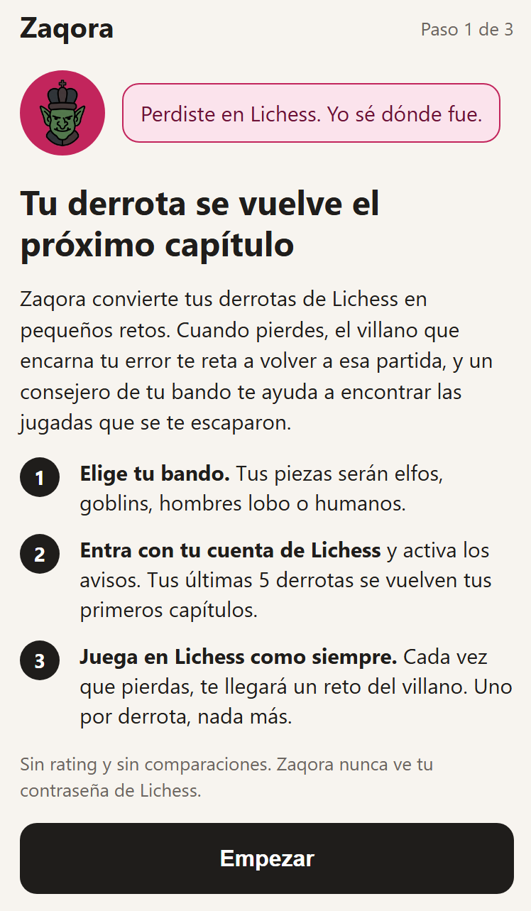
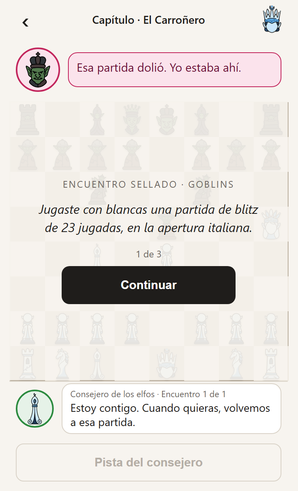
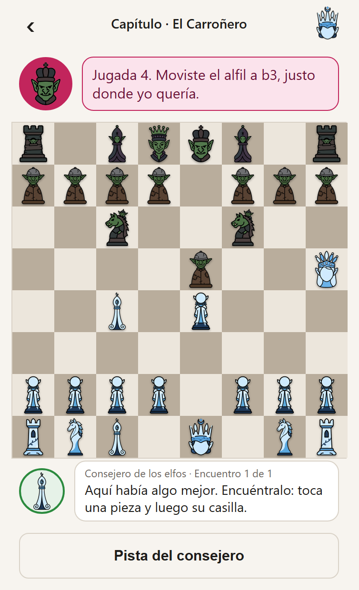

# Semana 9 — Integración, go-to-market y pitch

## 1) Resumen

- **Nombre de la actividad:** _Integración del sistema, pruebas con usuarios, economía unitaria, regulación, pitch y demo_
- **Curso:** _Proyecto de Ingeniería IV_
- **Equipo:** _David López Ramírez_
- **Fecha:** _23/11/2026 (actualizada el 24/11/2026)_
- **Descripción breve:** _Última clase de contenido. Con el prototipo de la semana 8 funcionando y el modelo económico actualizado, esta semana se preparó todo lo que **Zaqora** necesita para la evaluación final: las fronteras del sistema y sus seis pruebas, el protocolo de pruebas con usuarios, la economía unitaria de lanzamiento (CAC, churn, LTV y payback), el checklist regulatorio con fuentes oficiales, el guion del pitch de 3 minutos, el guion de la demo de 7 minutos y la ruta de las dos semanas de trabajo. El trabajo se hizo con Claude a partir de los prompts del curso, con los datos de Zaqora. **El 24/11/2026**, después de la primera sesión de prueba con un jugador, el prototipo cambió de fondo: entrada con la cuenta de Lichess, primer contacto con las últimas 5 derrotas, capítulos de varios encuentros con historia de IA, un consejero del bando del jugador, pantalla de inicio y un detector que corre en la nube sin la laptop del equipo._

---

## 2) Punto de partida

**Concepto (semana 6):** **Ghost Engine**, una PWA en formato de novela visual: tras perder en Lichess, el villano que encarna el error del jugador le escribe y lo invita a un capítulo construido sobre esa misma partida.

**Lo que ya hay:**

- **Prototipo publicado y probado de punta a punta** (semana 8): aviso push de la app, escena con la posición real del error y registro de eventos en Supabase. La prueba con usuarios del segmento **no se ha hecho**.
- **Modelo económico vigente** (semana 8, actualización del 23/11/2026): \$59 MXN al mes con IVA (\$44.92 netos), costo de \$0.80 por usuario activo a 100 usuarios, narrador en la capa gratuita de Cloudflare Workers AI, VPN a 5 años de +\$9,281 y recuperación en el mes 21.
- **Producto de software**, sin componente físico: así se acordó con el profesor desde el inicio del curso. Por eso cada bloque de la clase, pensado para hardware, se traduce a su equivalente de software.

- **Objetivo de la semana:** Dejar decidido cómo se integra, se prueba, se lanza y se cuenta Zaqora, con números propios y con cada pendiente marcado.

!!! note "Actualización del 24/11/2026: cómo es Zaqora ahora"
    | | Semana 8 (prototipo «mago de Oz») | Ahora |
    | :--- | :--- | :--- |
    | **Entrada** | Enlace con código de participante (P1…P5) que el equipo anotaba a mano en un CSV | **Entrar con Lichess** (OAuth con PKCE, sin contraseña ni permisos extra). El jugador queda registrado solo, con su código J1, J2… |
    | **Primer contacto** | Esperar a la siguiente derrota | Al activar los avisos, Zaqora analiza sus **últimas 5 derrotas** y crea **un capítulo por cada una**; llega un solo aviso que abre Inicio |
    | **Análisis** | El de Lichess, que alguien tenía que pedir a mano | **Stockfish 19** analiza cada derrota en unos 3 s; nadie tiene que pedir nada |
    | **Capítulo** | Un ejercicio con frases de plantilla | **Hasta 3 encuentros** (los errores más grandes de la partida) con una **historia de 3 partes** y diálogos escritos por IA (Mistral Small 3.1 en la capa gratuita de Cloudflare Workers AI) |
    | **Personajes** | El villano daba las pistas | **El villano reta y reacciona**; un **consejero del bando del jugador** (su alfil) guía, da las pistas y enseña la jugada tras 3 intentos fallidos |
    | **Villanos** | Uno fijo | Uno por patrón de error: El Reloj de Arena (tiempo), El Carroñero (pieza sin defensa), La Niebla (apertura), El Último Peón (final) y La Horquilla Hambrienta (medio juego) |
    | **Bandos** | Glifos de ajedrez | Elfos, goblins, hombres lobo o humanos (assets propios); el rival cambia en cada derrota |
    | **Navegación** | Solo se llegaba a la escena por el aviso | **Inicio**: último capítulo con su avance, capítulos anteriores, «Revisar mis partidas ahora» y «Jugar en Lichess» |
    | **Detector** | Script en la laptop del equipo | **GitHub Actions** cada 10 minutos, con las claves en secretos del repositorio; el estado vive en Supabase |
    | **Datos** | Solo alias en Supabase | Capítulos y avance ligados a la cuenta de Lichess (tabla `capitulos`), leídos solo a través de una función que confirma la identidad con Lichess; [aviso de privacidad de la app](prototipo/privacidad.html) publicado |

<div class="grid" markdown>

{ width="230" }

{ width="230" }

{ width="230" }

</div>

*Activación, historia del capítulo y encuentro (24/11/2026). El capítulo es un ejemplo armado para la captura; no es la partida de ningún participante.*

---

## 3) Proceso — Integración, lanzamiento y pitch

### Paso 1 — Integración del sistema

**Las cuatro fronteras de Zaqora** (la clase usa sensor → microcontrolador → red → IA → app; en Zaqora la «lectura» es la partida de Lichess):

| # | Frontera | Lado A → lado B | Protocolo | Pregunta |
| :---: | :--- | :--- | :--- | :--- |
| **F1** | Partida → detector | API de Lichess → detector de derrotas | HTTPS, NDJSON (`/api/games/user`, `evals=true`) | ¿La derrota se detecta y trae análisis? |
| **F2** | Detector → celular | Detector → servicio push del navegador → *service worker* | Web Push con VAPID | ¿El aviso sale y llega? |
| **F3** | Motor → narrador | Hechos del motor (JSON) → LLM → validador | HTTPS (Workers AI) | ¿La frase del villano es utilizable? |
| **F4** | Escena → usuario y registro | PWA → jugador; PWA → Supabase | HTTPS / REST | ¿El jugador ve la posición correcta y queda registrado lo que hace? |
| **F5** *(nueva, 24/11)* | Cuenta → capítulos | Lichess (OAuth) → función `capitulos` de Supabase → Inicio | HTTPS; token de Lichess solo para confirmar quién es | ¿Cada jugador ve sus capítulos y solo los suyos? |

Con la actualización del 24/11/2026, F1 la corre el detector en **GitHub Actions** (ya no la laptop) y F3 usa **Stockfish 19** para el análisis y **Mistral Small 3.1** para la narración.

**Seis pruebas del sistema**, de la más barata a la más cara. Los criterios salen del PDS (semana 5) y del plan de la semana 8:

| # | Prueba (adaptada) | Qué se mide | Aprobado si | Estado y evidencia |
| :---: | :--- | :--- | :--- | :--- |
| **T1** | Activación sin ayuda | Tiempo y errores de alguien que no conoce Zaqora al abrir el enlace y activar los avisos | < 5 minutos sin intervención (en iPhone, incluida la instalación) | ⚠️ **No cumplió en la primera sesión (24/11/2026).** El participante la encontró «complicada de seguir» y las instrucciones de iPhone «no intuitivas» (no se midió el tiempo). Se rehízo la activación por pasos. **En la segunda sesión (P2), ya con la activación nueva, el participante tampoco pudo usar la app solo**: falta ubicar en qué paso se atora. |
| **T2** | Latencia derrota → aviso | Minutos entre el fin de la partida (Lichess) y el aviso (registro del script) | ≤ 10 minutos (plan de la semana 8) | ⚠️ **Parcial.** El detector corre en GitHub Actions cada 10 minutos (GitHub puede retrasarlo) y el botón «Revisar mis partidas ahora» lo lanza al momento: la corrida del 24/11/2026 tardó **31 s** de la petición al final (17:38:23 → 17:38:54). Falta medir el camino completo con una derrota nueva. |
| **T3** | Celular sin conexión | Se apaga la red del celular mientras sale el aviso y se vuelve a encender | El aviso llega al reconectar | ⏳ **Pendiente.** Hallazgo de diseño: el aviso se envía con `ttl=3600`, así que **si el celular pasa más de 1 hora sin red, el aviso se pierde**. Es aceptable (un aviso tardío ya no llega «justo después de perder»), pero hay que declararlo. |
| **T4** | Autonomía de la capa gratuita (equivalente de la batería) | Capítulos al mes que caben en la capa gratuita de Workers AI | Alcanza para el piloto de 20 usuarios | ✅ **Cumple (cálculo).** Con Mistral Small 3.1: unos **190 capítulos al día** ≈ 5,700 al mes → **unos 285 usuarios activos** a 20 capítulos al mes. Ver el cálculo abajo. |
| **T5** | Falla de la API de IA | Qué ve el jugador si el LLM no responde | Sale una plantilla; nunca un texto vacío ni inválido (RD-04) | ✅ **Cumple, con una falla real.** El 24/11/2026 Cloudflare retiró Llama 3.1 8B (HTTP 410, «deprecated on 2026-11-20»): el detector siguió armando capítulos con plantilla, sin romperse. Además, el validador rechaza la respuesta de la IA si inventa casillas o revela la solución. |
| **T6** | Operación continua | El detector corre 48 h seguidas con los participantes | Sin caídas ni derrotas sin aviso; los HTTP 429 de Lichess se esperan 60 s | ⏳ **Pendiente.** Ya no depende de la laptop: corre en GitHub Actions. Se mide durante la prueba de campo. |

**Cómo se calcula T4**, con números (igual que la autonomía de batería del ejemplo de la clase):

```text
Capa gratuita de Cloudflare Workers AI     = 10,000 neurons al día ≈ US$0.11 al día
Precio de Mistral Small 3.1 en Workers AI  = US$0.351 por millón de tokens de entrada, US$0.555 de salida
Un capítulo (historia + 3 encuentros)      ≈ 900 tokens de entrada + 450 de salida ≈ US$0.00057
Capítulos al día                           ≈ 0.11 / 0.00057 ≈ 190
Capítulos al mes                           ≈ 190 × 30 = 5,700
Uso supuesto por usuario activo            = 20 capítulos al mes (semana 7)
Usuarios activos que caben                 ≈ 5,700 / 20 ≈ 285  →  cumple (piloto de 20)
```

Es una estimación con los precios que da la cuenta de Cloudflare, no una medición. El primer contacto gasta 5 capítulos de golpe por jugador nuevo. Llama 3.1 8B (el modelo del cálculo anterior) se retiró el 20/11/2026.

**Falla encontrada al revisar F1 (23/11/2026).** Si una derrota no tenía análisis, el detector la marcaba como revisada y enviaba el aviso con una **posición de ejemplo**; el consejo de «pide el análisis y vuelve a correr el script» no servía, porque la partida ya no se volvía a leer. Se encontró leyendo el código frontera por frontera, no en una prueba. Corrección: la derrota sin análisis no se marca como revisada y se reintenta en cada vuelta hasta 30 minutos. *(El 24/11/2026 la espera dejó de hacer falta: Stockfish analiza la partida si Lichess no la tiene analizada.)*

**Fallas encontradas en la integración del 24/11/2026:**

| Falla | Frontera | Cómo se encontró | Corrección |
| :--- | :--- | :--- | :--- |
| El modelo de IA dejó de existir (HTTP 410) | F3 | Al probar la historia con IA | Cambio a Mistral Small 3.1, elegido tras probar 5 modelos con la misma partida; la plantilla cubrió mientras tanto (T5) |
| GitHub no pudo leer la clave VAPID del secreto | F2 | Registro de la corrida: «Could not deserialize key data» | Clave en una sola línea y una revisión de formato en el flujo, que avisa sin mostrar la clave |
| En iPhone el ícono abría la activación sin el código y el permiso se pedía tarde | F2 | Prueba en iPhone del equipo | El ícono conserva la dirección con la que se instaló y el permiso se pide al tocar el botón |
| Revisar sin `--enviar` gastaba la derrota y la variante | F1 | P1 aparecía con sus variantes «ya recibidas» | Revisar ya no toca el estado |
| `--historia` no dejaba marcado el primer contacto | F1 | Revisando Supabase: el siguiente ciclo iba a reenviar los 5 capítulos | El comando marca el primer contacto en `estado_detector` |
| «Salir» dejaba capítulos de pruebas anteriores y el teléfono mostraba versiones viejas | F5 | Prueba del equipo en su celular | Sin sesión Inicio limpia el teléfono; el *service worker* pide siempre la versión más reciente (GitHub Pages permite guardar 10 minutos) |

**Cómo debe degradarse Zaqora:**

| Si falla… | Qué pasa | Qué ve el jugador |
| :--- | :--- | :--- |
| **Internet del jugador** | El aviso espera en el servicio push hasta 1 hora | Nada; si vuelve a tiempo, el aviso llega. La escena abierta ya no necesita red para jugarse; el registro del evento se pierde sin romper nada. |
| **Lichess (o un 429)** | El detector espera 60 s y reintenta | Nada: el aviso llega más tarde. |
| **El análisis de Lichess** (partida sin evaluar) | Stockfish analiza la partida en el detector (unos 3 s) | Nada: el capítulo llega con la posición real. |
| **La API de IA** (lenta, caída o modelo retirado) | Se usa la plantilla del villano y del consejero | Una historia de plantilla, sin aviso de error (pasó de verdad el 24/11/2026) |
| **GitHub Actions** (retrasa o no corre) | El capítulo llega más tarde | «Revisar mis partidas ahora» lanza el detector al momento |
| **La función de cuentas** | Inicio muestra los capítulos guardados en el teléfono y explica el error | Un aviso: «No pude traer tus capítulos guardados» |

**Definición de listo:**

| Condición (adaptada) | Estado |
| :--- | :---: |
| Funciona sin la laptop del equipo | ✅ El detector corre en GitHub Actions cada 10 minutos (24/11/2026) |
| La app está desplegada, no en el entorno de desarrollo | ✅ [Publicada en GitHub Pages](prototipo/activar.html) con https |
| La landing está publicada en internet | ✅ Publicada el 24/11/2026: [landing](landing/index.html); la tabla `preregistros` responde en Supabase (Paso 3) |
| El dato fluye de la partida a la pantalla sin intervención | ✅ Registro con Lichess, análisis con Stockfish y envío automáticos; nadie del equipo interviene |

??? quote "Prompt 1 del curso — plan de integración y pruebas (adaptado a Zaqora)"
    Actúa como ingeniero de pruebas de sistemas conectados, con experiencia en productos con componentes de IA. Tu método es la bisección por fronteras: probar cada interfaz entre componentes con evidencia (log, medición, captura) antes de culpar al sistema completo. No propones pruebas que el equipo no pueda ejecutar con sus medios: laptop y teléfonos.

    Somos un equipo de ingeniería en México. Nuestro producto:  
    Nombre y qué hace: Zaqora. Cuando un jugador pierde en Lichess, un villano que encarna su error le manda un aviso push y lo invita a una escena con la posición real de su error.  
    Arquitectura (semana 5, revisada en la 8): PWA con *service worker*; detector en Python que lee la API pública de Lichess (NDJSON) y envía Web Push (VAPID); registro en Supabase; narrador con LLM en Cloudflare Workers AI (todavía no conectado).  
    Requerimientos de desempeño del PDS: primera frase del villano < 5 s; LLM con tiempo máximo de 4 s y después plantilla; aviso ≤ 10 min tras la derrota; costo ≤ \$30 MXN por usuario activo al mes.  
    Qué ya funciona por separado: aviso push, escena, registro de eventos, detección de derrotas.  
    Qué nunca hemos probado junto: el flujo completo con un jugador externo, el narrador con LLM, el detector corriendo días seguidos.

    Entrega: (1) las fronteras, (2) seis pruebas de la más barata a la más cara con criterio numérico, (3) los dos fallos más probables por frontera y (4) cómo debe degradarse si falla internet o la API de IA. Si falta un número en el PDS, dilo. No inventes requerimientos.

**Los dos fallos más probables por frontera:**

| Frontera | Fallo probable 1 | Fallo probable 2 | Primera prueba para distinguirlos |
| :--- | :--- | :--- | :--- |
| F1 | La partida no tiene análisis y no hay posición del error | Lichess responde 429 y la derrota se detecta tarde | Revisar la columna `con_analisis` y la hora de detección en `registro_envios.csv` |
| F2 | El participante no activó los avisos (o en iPhone no instaló la app) | La suscripción caducó o el celular estuvo > 1 h sin red | Buscar su alias en la tabla `suscripciones`; si está, enviar `--probar` |
| F3 | El LLM tarda más de 4 s | La frase inventa una jugada o rompe el formato | Guardar la entrada y la salida crudas de cada llamada y pasarlas por el validador |
| F4 | La escena abre con una posición equivocada (FEN o color) | El evento no llega a Supabase (sin red o clave errónea) | Comparar el FEN del enlace con la partida en Lichess; revisar la tabla `eventos` |

### Paso 2 — Pruebas con usuarios

!!! warning "Estado: 2 de 5 sesiones"
    El 24/11/2026 se hicieron dos sesiones: P1, con el flujo de la semana 8, y P2, con el flujo nuevo (entrar con Lichess). Sus hallazgos están abajo con el cambio que provocó cada uno. Faltan tres sesiones y la prueba de campo. En ninguna de las dos se registraron los tiempos ni el SEQ.

**Con quién:** 5 personas, mayores de edad. **Tres del segmento** (jugadores amateur de Lichess que juegan al menos 3 veces por semana) y **dos de otro equipo** del curso.

**Protocolo de 30 minutos adaptado a Zaqora:**

| Min | Qué pasa | Qué se observa |
| :---: | :--- | :--- |
| 0–3 | Guion fijo: «Estamos probando el producto, no a ti. Piensa en voz alta.» | Nada que explicar del producto |
| 3–10 | **Tarea 1:** abrir el enlace de activación en su celular y activar los avisos del villano (en iPhone, primero agregar a la pantalla de inicio) | ¿Lo logra sin ayuda? Tiempo, errores, dudas (es la prueba T1) |
| 10–20 | **Tarea 2:** el operador dispara el aviso con su última derrota real; el participante lo abre y juega el encuentro | ¿Abre el aviso? ¿Elige «Muéstrame» o «Déjame en paz»? ¿Entiende qué le pide el villano? ¿Resuelve? |
| 20–25 | **Tarea 3:** encontrar el precio en la landing y dejar su correo en el pre-registro | ¿Encuentra el precio? ¿Completa el CTA? |
| 25–30 | Entrevista de cierre | La última vez que perdiste, ¿qué hiciste justo después? ¿Qué te costó? ¿Cuánto pagarías? ¿A quién se lo mandarías? |

**Desde el 24/11/2026 cambian dos tareas:** en la tarea 1 el participante **entra con Lichess** y activa los avisos; en la tarea 2 ya no hace falta que el operador dispare el aviso: llega solo el **primer contacto con sus últimas 5 derrotas**, y el participante abre uno de esos capítulos.

Por cada tarea se registra: completó sin ayuda (sí o no), tiempo, errores y dudas, SEQ de 1 a 7 y citas textuales. Los hallazgos se clasifican en crítico, mayor y menor antes de corregir nada. La hoja de observación de la semana 8 se reutiliza con estas tres tareas.

**Primera sesión (P1, 24/11/2026): hallazgos y cambios.** La severidad es la que propone el equipo con las notas que hay; se confirma con las siguientes sesiones.

| # | Hallazgo (palabras del participante) | Severidad | Cambio hecho el mismo día |
| :---: | :--- | :--- | :--- |
| 1 | «Complicado de seguir» | Mayor | Activación por pasos («Paso 2 de 3»), una acción por pantalla; la escena explica qué hacer |
| 2 | Falta una introducción que explique qué es | Mayor | Primera pantalla: qué es Zaqora y sus tres pasos |
| 3 | En iPhone, las instrucciones «no son intuitivas» | Crítico (impide recibir avisos en iPhone) | Instrucciones en 4 pasos con los íconos de Compartir y de Agregar; aviso si se abre fuera de Safari |
| 4 | «Se tiene que solicitar el análisis al ordenador» | Crítico (sin análisis no hay posición real) | Stockfish analiza cada derrota; nadie pide nada |
| 5 | «Solo es un ejercicio»; quiere que le cuente una historia de la partida | Mayor (el valor del capítulo) | Capítulos de hasta 3 encuentros con una historia de 3 partes escrita por IA |
| 6 | «El ícono del villano se repite para 3 facciones» | Menor | El villano cambia entre los reyes de los bandos rivales |

Después de la sesión, el equipo tomó una decisión de diseño que no vino del participante: **el villano no puede ser quien te ayuda a vencerlo**. Desde entonces el villano reta y reacciona, y las pistas las da un consejero del bando del jugador.

**Lo que P1 respondió en la entrevista de cierre** (citas textuales; se omiten los nombres propios):

| Pregunta | Respuesta de P1 |
| :--- | :--- |
| La última vez que perdiste en Lichess, ¿qué hiciste justo después? | «Cerrar la aplicación» |
| Cuando te llegó el aviso, ¿qué pensaste que era? | «No entendí muy bien, se entendía como una forma de reto de parte del personaje en el programa» |
| En el capítulo, ¿quién te estaba ayudando? | Nombró al moderador, no al villano ni a un consejero |
| ¿Qué fue lo que más te costó? | «Seguir las instrucciones para usarlo como app web» |
| Si pudieras cambiar una sola cosa, ¿cuál sería? | «Hacer más claras y completas las instrucciones» |
| Si costara 59 pesos al mes, ¿qué tendría que pasar para que lo pagaras? | «Ofrecer más ejercicios guiados y más explicación» |
| ¿A quién se lo mandarías? | Nombró a un conocido: «se lo mandaría si pudiera» |

Tres lecturas: al perder, P1 **cierra la app** en lugar de analizar, igual que los tres entrevistados de la semana 3; el aviso **no se entendió solo**, lo que respalda separar al villano (reta) del consejero (ayuda); y su primera respuesta sobre el pago apunta a **más práctica guiada**, no a la historia.

**Segunda sesión (P2, 24/11/2026): hallazgos y cambios.** Ya con la versión nueva: entrar con Lichess, primer contacto con las 5 derrotas y «Revisar mis partidas ahora». Tampoco se registraron tiempos ni SEQ.

| # | Hallazgo | Severidad (propuesta) | Cambio |
| :---: | :--- | :--- | :--- |
| 1 | No pudo manejar la aplicación solo | Mayor (crítico si no terminó la tarea; no se anotó) | Pendiente: ubicar en las próximas sesiones el paso donde se atora |
| 2 | Al analizar sus derrotas, sintió que «tardaban mucho en dar el resultado» | Mayor | Inicio muestra el avance de la revisión por etapas (tiempos aproximados) y enseña el capítulo en cuanto llega, sin recargar |
| 3 | El botón «Jugar en Lichess» se sentía muy llamativo y le daban ganas de tocarlo | Menor | En Inicio pasó a botón secundario para no competir con el capítulo |
| 4 | En la revisión quiso navegar por sus jugadas: pidió un tablero de análisis con la partida completa | Petición | Pendiente: visor de la partida completa dentro del capítulo |

**Lo que se repite en P1 y P2:** los dos necesitaron ayuda para empezar. La activación sigue siendo el problema principal y es lo primero que medirá T1 en las tres sesiones que faltan.

**Prueba de campo (la de la semana 8, todavía pendiente):** además de la sesión de 30 minutos, los tres participantes del segmento dejan los avisos activos 3 a 5 días con el detector corriendo. Es la única forma de medir lo que la sesión no puede: si alguien que **de verdad** acaba de perder abre el aviso.

??? quote "Prompt 2 del curso — síntesis de pruebas de usuario (se ejecuta con las notas reales)"
    Actúa como investigador de usabilidad de productos conectados. Sintetizas observaciones sin defender el diseño: reportas lo que la gente hizo, no lo que dijo que le gustaba. Distingues el problema de su causa y no propones rediseños sin evidencia.

    Notas de [N] sesiones de prueba, una por usuario. Por cada tarea registramos: si completó sin ayuda, tiempo, errores, SEQ (1 a 7) y citas textuales.

    [pegar las notas]

    Entrega: (1) tabla por tarea con tasa de éxito sin ayuda, tiempo mediano y SEQ promedio; (2) hallazgos por severidad, con cuántos usuarios lo vivieron y una cita; (3) los tres cambios de mayor impacto con menor esfuerzo y la hipótesis que prueba cada uno; (4) lo que NO podemos concluir con esta muestra; (5) señal de negocio, separando compromisos reales (dejó datos, pre-registró, pagó) de opiniones.

### Paso 3 — Go-to-market y economía unitaria

**Cliente número 1.** Un jugador de Lichess mexicano, adulto, de 1200 a 1800, que juega varias veces por semana y que la semana pasada perdió tres partidas seguidas y cerró la sesión. Los cuatro rasgos del *early adopter*:

| Rasgo | En Zaqora | Evidencia |
| :--- | :--- | :--- |
| Tiene el dolor agudo | Pierde rachas de partidas y rating | Entrevistas de la semana 3: «Perdí tres partidas seguidas… apagué Lichess» |
| Ya intentó resolverlo | Cierra la sesión o se aleja 20 minutos; revisa la partida sin motor | Entrevistas de la semana 3 |
| Puede decidir y pagar | El propio jugador paga; no hay comprador institucional | Segmento de la semana 4 |
| Habla con otros como él | Clubes, Discord, grupos de WhatsApp y *streamers* de ajedrez en español | HIPÓTESIS: no medido |

**Canales elegidos:**

| Canal | Por qué | Qué se aprende |
| :--- | :--- | :--- |
| **Venta directa** a jugadores de clubes y conocidos (los primeros 20) | David es maestro de ajedrez: es el canal con menos costo y más aprendizaje | Objeciones, activación, uso real |
| **Landing con pre-registro y precio visible** | Mide si alguien deja su correo por una promesa con precio, antes de programar los pagos | Visitas → clics en el CTA → pre-registros |
| **Comunidades y *streamers* en español** (siguiente paso) | El jugador en *tilt* no busca ayuda: hay que llegarle donde ya está | Costo por usuario activado |

**Sin cobro anticipado.** Durante el curso solo se mide intención con pre-registro y precio visible. Cobrar exige RFC, CFDI y cumplir la LFPC en suscripciones (Paso 4).

**Economía unitaria.** Zaqora no tiene hardware subsidiado, así que la inversión por cliente es solo el CAC. Cada cifra va marcada como **medida** (sale de una fuente o de un precio verificado) o **supuesta** (no se ha medido).

| Dato | Valor | Origen |
| :--- | ---: | :--- |
| Precio de suscripción | \$59 MXN al mes con IVA | Decisión de la semana 7 · **supuesto** (no validado con usuarios) |
| Ingreso neto por suscriptor (sin IVA ni comisión de Stripe) | \$44.92 | Precios de Stripe MX verificados (semana 7) · **medido** |
| Costo operativo por usuario activo | \$0.80 al mes | Modelo vigente a 100 usuarios (semana 8) · **medido** sobre precios verificados |
| Conversión de activo a pago | 5 % | **Supuesto** (semana 7) |
| Horas para activar a un usuario | 0.25 h (15 min) | **Supuesto**: mensajes, explicación y activación de avisos |
| Costo de la hora del equipo | \$80 MXN | **Supuesto** (tarifa del ejemplo del curso) |
| Churn mensual | 10 % | **Supuesto**: no hay ningún suscriptor todavía |

```text
Usuarios activos por cada usuario de pago = 1 ÷ 0.05                     = 20
Costo operativo por usuario de pago       = 20 × $0.80                    = $16.00
Contribución mensual                      = 44.92 − 16.00                  = $28.92
CAC                                       = 20 usuarios × 0.25 h × $80      = $400
Inversión por cliente                     = CAC + hardware (0)             = $400
Vida media                                = 1 ÷ 0.10                       = 10 meses
LTV                                       = 28.92 × 10                     = $289
LTV ÷ inversión                           = 289 ÷ 400                      = 0.72
Payback                                   = 400 ÷ 28.92                    = 13.8 meses
```

**Lectura:** con estos supuestos **no cierra**: LTV ÷ inversión de 0.72 contra la regla de 3, y payback de 13.8 meses contra la regla de 12. El costo de la nube no es el problema (\$0.80 por usuario); el problema es que cada suscriptor cuesta 20 usuarios activados.

**Qué palanca mueve más** (cada insumo cambia 25 % por separado):

| Cambio de 25 % | LTV ÷ inversión | Payback |
| :--- | :---: | :---: |
| Caso base | 0.72 | 13.8 meses |
| Precio sube a \$73.75 | 1.03 | 9.8 |
| Precio baja a \$44.25 | 0.42 | 23.8 |
| Conversión sube a 6.25 % | 1.00 | 10.0 |
| Conversión baja a 3.75 % | 0.44 | 22.6 |
| Churn baja a 7.5 % | 0.96 | 13.8 |
| Churn sube a 12.5 % | 0.58 | 13.8 |
| CAC baja a \$300 | 0.96 | 10.4 |
| CAC sube a \$500 | 0.58 | 17.3 |

El **precio** y la **conversión** mueven más que el churn y el CAC. La conversión pesa doble porque cambia al mismo tiempo el CAC y la contribución: cada usuario de pago carga menos usuarios gratuitos.

**Tres palancas concretas:**

| Palanca | Qué la sostiene | LTV ÷ inversión | Payback |
| :--- | :--- | :---: | :---: |
| **Conversión de 5 % a 10 %** | Tope de capítulos gratis y cobro fuera del momento de la derrota (semana 7) | 1.85 | 5.4 meses |
| **+ churn de 10 % a 6 %** | Valor que se acumula: el elenco de villanos y el historial de cada jugador | **3.08** | 5.4 meses |
| **Conversión de 10 % y activación en 9 minutos** (en lugar de 15) | Activación sin ayuda (T1) y llegada por comunidades | **3.08** | 3.3 meses |

Llegar a 3 necesita **dos** palancas, y las dos dependen de algo que no se ha medido. Eso es lo que se va a ir a medir en el piloto: qué tasa de conversión y cuánto tiempo de activación son reales.

??? quote "Prompt 3 del curso — economía unitaria (con los datos de Zaqora)"
    Actúa como analista financiero de startups de software con suscripción. Calculas con los números que te dan, muestras la aritmética completa y no completas datos faltantes con supuestos propios: si falta uno, lo pides. Cuando el resultado no cierra, no lo suavizas.

    Datos de nuestro modelo (semanas 7 y 8): precio de suscripción mensual \$59 MXN con IVA (\$44.92 netos); costo operativo mensual por usuario activo \$0.80; sin hardware.  
    Datos de adquisición: conversión de activo a pago 5 % (supuesto); 0.25 h por usuario activado a \$80 la hora (supuesto); sin viáticos ni publicidad; churn mensual esperado 10 % (supuesto).

    Calcula: CAC, contribución mensual, vida media, LTV, inversión por cliente, LTV ÷ inversión y payback. Después: si cumple la regla práctica; cuál de los insumos mueve más el resultado, cambiando cada uno 25 % por separado; y tres palancas concretas con su efecto numérico. Formato: tabla de cálculo y después máximo 8 líneas de lectura.

**Costos después del 24/11/2026:** el detector en GitHub Actions no cuesta nada (el repositorio es público) y la IA sigue dentro de la capa gratuita de Cloudflare (T4). El costo operativo por usuario no cambia.

**Landing.** Se construyó con la anatomía de la clase y está publicada en [`…/landing/`](landing/index.html) desde el 24/11/2026, con el video real del prototipo en el lugar del celular:

| Elemento | En la landing de Zaqora |
| :--- | :--- |
| Headline | «Perdiste en Lichess. Tu villano ya sabe dónde fue.» y, debajo, la propuesta de valor de la semana 4 |
| Visual | La escena real del prototipo (sellada y despierta) en un celular |
| Tres beneficios | No tienes que analizar en caliente · Tu error de siempre tiene cara y se puede vencer · Sin rating ni comparaciones |
| Demo corta | ✅ Video de 35 s grabado en el prototipo: derrota real en Lichess → «Revisar mis partidas ahora» → notificación del villano → capítulo con el consejero (la espera de 34 s va acelerada). Está en la [landing](landing/index.html) |
| Evidencia | Cita de las entrevistas de la semana 3 |
| Precio visible | \$59 MXN al mes con IVA; los primeros capítulos, gratis; sin cobro durante la beta |
| Un solo CTA | «Quiero entrar a la beta»: pre-registro con correo |
| Metadatos | `title`, `description` y Open Graph con la captura de la escena |
| Métricas | Visitas, clics en el CTA y pre-registros, en Supabase (tabla `eventos` y tabla `preregistros`, solo inserción) |
| Aviso de privacidad | Página aparte con los seis elementos del artículo 15 de la LFPDPPP |

### Paso 4 — Regulación mínima viable

Checklist hecho con búsqueda en fuentes oficiales el 23/11/2026. Zaqora es software, así que radio, NOM, baterías y REP no aplican. **No es asesoría legal: es una ruta de verificación.**

| Tema | ¿Aplica? | Qué exige | Documento o trámite | Quién lo emite | Costo y tiempo | Estatus |
| :--- | :---: | :--- | :--- | :--- | :--- | :--- |
| **Radio y homologación** | No | Zaqora no tiene radio propia: usa el celular del jugador | — | — | — | No aplica |
| **Datos personales** | **Sí** | *(24/11/2026: desde que se entra con Lichess, Supabase guarda el usuario de Lichess con sus capítulos; GitHub analiza las partidas. El [aviso de privacidad de la app](prototipo/privacidad.html) ya está publicado y lo declara.)* Aviso de privacidad desde que se recaban los datos, con 6 elementos mínimos: identidad y domicilio del responsable, datos tratados, finalidades, opciones para limitar su uso, medios para los derechos ARCO y cómo se avisan los cambios (art. 15). Respuesta a una solicitud ARCO en máximo 20 días y aplicarla en los 15 siguientes (art. 31). La autoridad es la Secretaría Anticorrupción y Buen Gobierno (art. 2, fr. XV). | Aviso de privacidad (lo redacta el responsable) | David López Ramírez, como responsable | Sin costo; ya redactado para la landing | **VERIFICADO** · [LFPDPPP, texto vigente](https://www.diputados.gob.mx/LeyesBiblio/ref/lfpdppp.htm) (DOF 20-03-2025, vigente desde el día siguiente; última reforma DOF 14-11-2025) |
| **Seguridad, etiquetado y baterías** | No | Sin producto físico | — | — | — | No aplica |
| **Licencia de Stockfish** (rival y análisis) | **Sí** | GPLv3: al distribuir el binario WASM hay que ofrecer su código fuente correspondiente y el aviso de licencia, sin restricciones adicionales (secciones 5, 6 y 10) | Enlace a la fuente exacta del *build* y aviso en la app (ya lo exige RR-03) | El equipo | Sin costo | **VERIFICADO** · [Copying.txt de Stockfish](https://github.com/official-stockfish/Stockfish/blob/master/Copying.txt) |
| **Licencia de Mistral Small 3.1** (narrador desde el 24/11/2026) | **Sí** | Apache 2.0: uso comercial permitido; conservar el aviso de licencia solo si se redistribuye el modelo (Zaqora lo usa como servicio, sin redistribuirlo). Ya no hace falta «Built with Llama»: Llama 3.1 8B se retiró de Workers AI | Ninguno mientras no se redistribuya | El equipo | Sin costo | **VERIFICADO** · [ficha oficial del modelo](https://huggingface.co/mistralai/Mistral-Small-3.1-24B-Instruct-2503) («License: apache-2.0») |
| **Entrar con Lichess** (OAuth) | **Sí** | Lichess acepta aplicaciones sin registro (cliente público con PKCE); el token dura alrededor de un año y se puede anular | Sin trámite; «Salir» anula el token | Lichess | Sin costo | **VERIFICADO** · [documentación OAuth de la API de Lichess](https://lichess.org/api#tag/oauth) |
| **Cloudflare Workers AI** | **Sí** | No usa el contenido de los clientes para entrenar modelos; no retiene entradas ni salidas en la inferencia estándar | Declararlo en el aviso de privacidad como encargado | Cloudflare | Capa gratuita | **VERIFICADO** · [Data usage de Workers AI](https://developers.cloudflare.com/workers-ai/platform/data-usage/) |
| **API de Lichess** | **Sí** | Se permite el uso personal y comercial de sus servicios, API incluida, con límites razonables que decide Lichess; el abuso de la API está prohibido y el acceso se puede revocar sin aviso | Respetar límites (1 petición a la vez, esperar tras un 429) | Lichess | Sin costo | **VERIFICADO** · [Terms of Service de Lichess](https://lichess.org/terms-of-service) (01/08/2026) |
| **Términos de venta y consumidor** | **Sí** | En comercio electrónico: domicilio físico, teléfonos y medios para reclamar antes de la transacción; conocer términos, costos y cargos; informar de forma clara y destacada los **cobros automáticos recurrentes** (periodicidad, monto y fecha), con consentimiento expreso; avisar al menos **5 días naturales antes de una renovación automática** y permitir **cancelar de inmediato** (art. 76 BIS, fr. III, V, VIII y IX; las dos últimas, DOF 12-12-2025) | Términos de servicio y flujo de cancelación en la app | El equipo (PROFECO vigila) | Sin costo | **VERIFICADO** · [LFPC, texto vigente](https://www.diputados.gob.mx/LeyesBiblio/pdf/LFPC.pdf) |
| **Pagos con tarjeta** | Al cobrar | Cuenta de Stripe México verificada | Alta en Stripe | Stripe | 3.6 % + \$3 MXN por cobro (verificado en la semana 7) | **POR VERIFICAR** · requisitos de alta (RFC, cuenta bancaria) no publicados en [stripe.com/mx](https://stripe.com/mx) |
| **Obligaciones fiscales** | Al cobrar | RFC con actividad, CFDI e IVA de 16 % en servicios digitales | Inscripción en el RFC | SAT | Sin dato verificado | **POR VERIFICAR** · el portal del SAT no se pudo consultar; confirmar con el SAT o un contador |
| **Google Play** | Si se publica ahí | Prueba cerrada con 12 testers durante 14 días (cuentas personales) y facturación de Google obligatoria en bienes digitales (15 % en suscripciones) | Cuenta de desarrollador | Google | US\$25, pago único | **VERIFICADO** en la semana 8 (Ayuda de Play Console) |
| **Economía circular** | No | Sin residuos físicos; el equivalente es borrar los datos del usuario (derechos ARCO) | — | — | — | No aplica |
| **Exportación** | No, por ahora | Se vende primero en México | — | — | — | No aplica |
| **Marca** | **Sí** | Registro de «Zaqora» en las clases 9 y 41 | Solicitud de registro de marca | IMPI | Sin dato verificado | **POR VERIFICAR** · la búsqueda de la semana 3 no encontró registros; la solicitud no se ha presentado |

**Qué se puede hacer en una prueba de mercado de 5 a 10 usuarios** (sin cobrar):

- Pre-registro en la landing con el aviso de privacidad publicado.
- Prueba del prototipo con consentimiento por escrito y solo mayores de edad. Desde el 24/11/2026 el usuario de Lichess sí se guarda (al entrar con Lichess), con el aviso de privacidad publicado.
- Usar la API de Lichess dentro de sus límites.

**Qué debe estar resuelto antes de vender a un tercero:**

- RFC y CFDI (SAT) y la cuenta de Stripe verificada.
- Términos de servicio con domicilio físico y teléfono, cobro recurrente explicado, aviso 5 días antes de renovar y cancelación inmediata en la app (LFPC 76 BIS).
- ~~Aviso de privacidad de la app completa~~ — publicado el 24/11/2026.
- El enlace a la fuente de Stockfish dentro de la app.
- Solicitud de marca en el IMPI.

### Paso 5 — El pitch de 3 minutos

**Guion** (352 palabras, 2:42 hablados a 130 palabras por minuto; quedan 18 segundos de aire). Versión del 24/11/2026: las partes 2, 3 y 4 cambiaron con el prototipo nuevo, y la 4 suma la segunda sesión y una respuesta de P1.

| Parte | Guion | Palabras | Segundos |
| :--- | :--- | :---: | :---: |
| **1. Impacto y problema** (35 s) | Un jugador de Lichess nos contó que perdió tres partidas seguidas y apagó todo. No las analizó, porque, en sus palabras, «sabía que iba a buscar excusas». Otro puede pasar una hora jugando partidas que no quería, solo para recuperar la anterior. Esa racha le cuesta rating y tiempo, y una clase particular de 229 pesos la hora no llega en el momento en que todo se rompe: justo después de perder. | 72 | 33.2 |
| **2. Solución y por qué nosotros** (35 s) | Zaqora llega en ese momento. Minutos después de tu derrota, un villano que encarna tu error de siempre te reta a volver a esa partida, y un consejero de tu bando te ayuda a encontrar lo que se te escapó. Chess.com te da un análisis frío cuando estás enojado; Zaqora primero reconoce que dolió, sin rating ni comparaciones. En la demostración verán llegar ese reto. | 65 | 30.0 |
| **3. Mercado y modelo** (35 s) | En México estimamos 66 mil jugadores en línea que se frustran al perder y pagarían por mejorar. Cobramos 59 pesos al mes, menos que Chess.com o Duolingo. Como el análisis corre en servidores gratuitos y el narrador usa una capa gratuita de inteligencia artificial, cada usuario activo nos cuesta 80 centavos al mes. Con 50 suscriptores al quinto año, la inversión se recupera en el mes 21. | 67 | 30.9 |
| **4. Tracción** (35 s) | Entrevistamos a tres jugadores, y los tres, después de perder, dejan de jugar en lugar de analizar. Ya lo probaron dos jugadores. Al primero le preguntamos qué hizo tras su última derrota y respondió: «cerrar la aplicación». Con lo que vimos cambiamos el producto: ahora entras con tu cuenta de Lichess y tus últimas cinco derrotas se vuelven capítulos. Lo que aún no sabemos es si abren el reto justo después de perder. | 73 | 33.7 |
| **5. Equipo** (15 s) | Soy David López: ingeniero mecatrónico, desarrollador y maestro de ajedrez. Diseñé, programé y calculé solo todo lo que verán hoy, y sigo después del curso. | 25 | 11.5 |
| **6. Ask y cierre** (25 s) | Pedimos cinco jugadores de Lichess que reciban el aviso durante una semana, y un club o streamer en español para un piloto de 20 usuarios. En 90 días mediremos si abren el aviso y si uno de cada veinte paga. Cuando pierdes, Zaqora convierte esa derrota en tu próximo capítulo. | 50 | 23.1 |
| **Total** | | **352** | **162.4** |

La confesión honesta es una sola: todavía no se sabe si el jugador abre el reto justo después de perder (la prueba de campo está pendiente). Las palabras prohibidas (innovador, plataforma, solución integral, revolucionario) no aparecen.

**Evidencia de cada cifra:**

| Afirmación | Fuente | Estado |
| :--- | :--- | :--- |
| Perdió tres partidas seguidas y «sabía que iba a buscar excusas» | Entrevistas 2 y 3, semana 3 | Evidencia |
| Una hora jugando partidas que no quería | Entrevista 1, semana 3 | Evidencia |
| Clase particular de 229 pesos la hora | Precio promedio en México, semana 2 | Evidencia (fuentes de la semana 2) |
| 66 mil jugadores que se frustran y pagarían | SAM de 65,952, semana 4 | **PENDIENTE**: tres filtros del embudo son supuestos propios |
| 59 pesos, menos que Chess.com (\$101–253) o Duolingo (\$129) | Benchmarking, semana 7 | Evidencia |
| 80 centavos por usuario activo al mes | Modelo vigente a 100 usuarios, semana 8 | Evidencia (a 20 usuarios son \$4.00) |
| 50 suscriptores al año 5; recuperación en el mes 21 | Flujo de caja a 5 años, semana 8 | **PENDIENTE**: conversión y crecimiento supuestos |
| Los tres dejan de jugar en lugar de analizar | Entrevistas, semana 3 | Evidencia (muestra de 3) |
| El prototipo funciona de punta a punta | Prueba de funcionamiento del 15/10/2026 (semana 8) y flujo completo con cuenta de Lichess el 24/11/2026 | Evidencia |
| Ya lo probaron dos jugadores y lo que vimos cambió el producto | Sesiones P1 y P2, Paso 2 | Evidencia (2 sesiones) |
| Al perder, P1 «cerrar la aplicación» | Entrevista de cierre de P1, Paso 2 | Evidencia (1 respuesta) |
| Las últimas cinco derrotas se vuelven capítulos | Primer contacto probado con la cuenta del equipo (J1) el 24/11/2026 | Evidencia |

**Las preguntas más difíciles del jurado:**

| Pregunta | Respuesta corta | Dónde está |
| :--- | :--- | :--- |
| ¿Cuánto cuesta servir a un usuario y cómo lo sabes? | \$0.80 al mes a 100 usuarios y \$4.00 a 20, con precios verificados en las páginas de cada proveedor | Semanas 7 y 8 (BOM y DFM) |
| ¿Por qué no lo hace Chess.com? | Su análisis llega frío y con evaluación numérica; Zaqora apuesta a que el jugador en *tilt* no quiere eso. El competidor más peligroso no es Chess.com, es cerrar la app | Semana 4 (mapa competitivo y lienzo) |
| ¿Qué pasa si se acaba la IA gratuita o sube su precio? | La capa gratuita alcanza para unos 285 usuarios; si la IA falla o el modelo desaparece, el villano y el consejero hablan con plantillas. Pasó de verdad: Cloudflare retiró Llama 3.1 y Zaqora siguió funcionando | Paso 1 (T4, T5) |
| ¿Cuántos clientes necesitas para no perder dinero? | 2 suscriptores recuperan la inversión del año 1; la economía por cliente pide conversión de 10 % y churn de 6 % para llegar a 3 | Semanas 7 y 8, Paso 3 |
| ¿Qué necesitas para vender legalmente? | Aviso de privacidad (listo), términos con cobro recurrente y cancelación inmediata (LFPC 76 BIS), RFC y CFDI, Stripe verificado | Paso 4 |
| ¿Qué hace que un jugador no cancele? | HIPÓTESIS: que el elenco de villanos y su historial se vuelvan suyos. No hay datos de churn | Paso 3 |

??? quote "Prompt 5 del curso — guion de pitch (con el material de Zaqora)"
    Actúa como coach de pitch para fundadores técnicos, con experiencia en jurados de aceleradoras. Tu objetivo es que el pitch venda: que el jurado sienta el problema, quiera el producto, crea los números y sepa qué se le pide. Cada afirmación tiene evidencia detrás; sin evidencia no hay afirmación, hay un pendiente. Prefieres una persona o una cifra a un adjetivo.

    Propuesta de valor (semana 4): «Cuando pierdes en Lichess y estás por cerrar la app, Zaqora valida tu frustración y la convierte en el próximo capítulo de tu historia.»  
    Usuario y evidencia (semana 3): 3 entrevistas; citas «No intenté analizar las partidas en ese momento porque sabía que iba a buscar excusas» y «Puedo pasar una hora jugando partidas que realmente no quería jugar».  
    Mercado (semana 4): TAM 82,440, SAM 65,952, SOM 1,200 personas, con tres filtros supuestos.  
    Modelo: \$59 MXN al mes con IVA; \$0.80 por usuario activo; LTV ÷ inversión 0.72; payback 13.8 meses.  
    Evidencia de pruebas: prototipo probado de punta a punta por el equipo; ninguna prueba con usuarios externos todavía; ningún pre-registro.  
    Equipo: David López Ramírez, una sola persona.  
    Ask: 5 jugadores para la prueba y un club o *streamer* para un piloto de 20 usuarios durante 90 días.

    Escribe el guion de 3 minutos con el presupuesto de 35, 35, 35, 35, 15 y 25 segundos (76, 76, 76, 76, 32 y 54 palabras; total entre 330 y 360). Después entrega (a) las afirmaciones sin evidencia marcadas como PENDIENTE y (b) las 5 preguntas más difíciles del jurado y de dónde sale la respuesta.

### Paso 6 — La demo de 7 minutos

La demo recorre un solo camino: el jugador entra con Lichess, recibe sus capítulos, pierde en vivo, le llega el reto del villano y termina en la landing. Necesita **dos personas**: David narra y un compañero opera el celular (ya no hace falta la laptop para el detector). *Versión del 24/11/2026.*

| Tiempo | Quién | Qué se hace y se dice | Plan B |
| :--- | :--- | :--- | :--- |
| **0:00–0:45** · Contexto | Narrador | Muestra el celular. «Este jugador acaba de perder tres partidas. Les voy a mostrar el camino completo: pierde, el villano le escribe, enfrenta su error y decide si lo compra.» | Captura de la escena sellada |
| **0:45–3:15** · Camino principal | Operador | En el celular de demo (con la sesión de Lichess iniciada antes), abre Inicio: están los capítulos de sus últimas 5 derrotas. Abre uno: el villano cuenta la historia, «Muéstrame», el villano reta, el consejero del bando guía y el operador resuelve el primer encuentro. Narrador: «el villano no te ayuda; te ayuda alguien de tu lado». | Video de respaldo de este tramo (90 s) |
| **3:15–4:45** · Provocar el evento | Operador | Pierde en vivo una partida **casual contra la computadora de Lichess** (no contra otra cuenta: abandonar a propósito contra una persona viola las reglas de juego limpio de Lichess). En Inicio toca **«Revisar mis partidas ahora»**: en 1 o 2 minutos llega el reto del villano con **esa** partida, ya analizada por Stockfish. Narrador: «solo, el detector revisa cada 10 minutos; el botón lo adelanta para que lo vean». | Capítulo de una derrota del día anterior y video |
| **4:45–5:45** · Fallo manejado | Operador | Pone el celular en modo avión y se envía otro aviso: no llega. Quita el modo avión: el aviso llega solo, porque el servicio push lo guarda hasta 1 hora. Narrador: «si pasa más de una hora sin red, el aviso ya no llega, y es a propósito: un aviso tardío ya no es "justo después de perder"». | Video de la prueba T3 |
| **5:45–6:30** · La compra | Narrador | Muestra un QR. El jurado abre la landing en su teléfono: headline, precio de 59 pesos al mes y el botón de pre-registro. Un integrante del jurado o el operador deja su correo y se ve entrar el registro en Supabase. | Captura de la landing y de la tabla de pre-registros |
| **6:30–7:00** · Cierre | Narrador | «Hoy funciona esto: entras con Lichess, tus derrotas se vuelven capítulos y el reto llega solo. Falta esto: saber si alguien que de verdad acaba de perder abre el reto. Siguiente paso: cuatro jugadores más esta semana y un piloto de 20.» | Ninguno: es solo voz |

**Atajos que se declaran en voz alta:** «Revisar mis partidas ahora» adelanta la revisión que el detector hace solo cada 10 minutos, y la sesión de Lichess del celular de demo se inició antes de la presentación.

**Lista de verificación 15 minutos antes:** celular cargado; hotspot propio probado (no depender del Wi-Fi del salón); sesión de Lichess iniciada y avisos activados en el celular de demo; la última corrida de GitHub Actions en verde; capítulo de respaldo de una derrota del día anterior; landing abierta en una pestaña y QR impreso; videos de respaldo en el celular y en la laptop; proyección y cronómetro probados.

### Paso 7 — Ruta de cierre

Equipo de una persona: todas las tareas son de David, salvo la ayuda del operador en los ensayos y la demo.

| Semana de trabajo | Tarea | Punto de control |
| :--- | :--- | :--- |
| **A · construir y conectar** | Publicar la landing y crear la tabla `preregistros` en Supabase | La landing responde en internet y un pre-registro de prueba aparece en la tabla |
| | ~~Detector con `--cada 5`~~ → detector en GitHub Actions cada 10 min y «Revisar ahora» (hecho el 24/11/2026); falta T2 con una derrota propia | Aviso ≤ 10 min tras la derrota |
| | Pruebas T1 (con alguien que no conozca Zaqora) y T3 (modo avión) | Resultados en la tabla del Paso 1 |
| | Checklist regulatorio (hecho) y aviso de privacidad de la app publicado (hecho el 24/11/2026) | — |
| | Secciones 1 a 16 de la página de proyecto final al día | Hecho en la versión del 23/11/2026 |
| **B · probar, corregir y contar** | Cinco pruebas de usuario (tres del segmento, dos de otro equipo) y prueba de campo de 3 a 5 días · **2 de 5 hechas** | Notas por tarea, síntesis con el Prompt 2 |
| | Pruebas T5 y T6 (48 h del detector durante la prueba de campo) | — |
| | Pitch grabado en video, visto y reescrito | Video publicado sin iniciar sesión |
| | Demo ensayada tres veces con el operador y video de respaldo grabado | Tercer ensayo sin detenerse |
| | Secciones 17 a 22, resumen ejecutivo y anexos de la página de proyecto final | — |

**Congelamiento:** después del último ensayo solo se corrigen fallas críticas.

---

## 4) Entregable — Semana 9

| Entregable | Estado | Dónde |
| :--- | :---: | :--- |
| Economía unitaria con los números propios | ✅ | [Paso 3](#paso-3-go-to-market-y-economia-unitaria) |
| Esqueleto del pitch de 3 minutos con pendientes marcados | ✅ | [Paso 5](#paso-5-el-pitch-de-3-minutos) |
| Guion de la demo de 7 minutos con plan B por tramo | ✅ | [Paso 6](#paso-6-la-demo-de-7-minutos) |
| Ruta de las dos semanas con responsables | ✅ | [Paso 7](#paso-7-ruta-de-cierre) |
| Checklist regulatorio con estatus VERIFICADO o POR VERIFICAR | ✅ | [Paso 4](#paso-4-regulacion-minima-viable) |
| Fronteras y plan de pruebas T1 a T6 | ✅ T4 y T5 cumplen; T1 y T2 parciales; T3 y T6 pendientes | [Paso 1](#paso-1-integracion-del-sistema) |
| Sistema integrado sin la laptop del equipo | ✅ Entrar con Lichess, detector en GitHub Actions, capítulos en la cuenta (24/11/2026) | [Actualización](#2-punto-de-partida) |
| Landing publicada y accesible en internet | ✅ [landing](landing/index.html) (24/11/2026) | Paso 3 |
| Reporte de pruebas de usuario con cinco sesiones | ⏳ 2 de 5 (hallazgos y cambios de P1 y P2) | [Paso 2](#paso-2-pruebas-con-usuarios) |
| Pitch grabado en video | ⏳ Guion listo (actualizado el 24/11/2026) | Paso 5 |
| Demo ensayada tres veces con video de respaldo | ⏳ [video de respaldo de la demo](videos/zaqora-demo-respaldo.mp4) listo (1:49); faltan los tres ensayos | Paso 6 |
| Página de proyecto final | ✅ Primera versión | [Proyecto final](proyecto_final.md) |
| Documentación técnica (README, arquitectura, manual de usuario) | ✅ | [Proyecto final, secciones 8 y 12 y anexos B y C](proyecto_final.md) |

---

## 5) Reflexión

- **La economía unitaria contradice al flujo de caja, y los dos tienen razón.** El flujo a 5 años es positivo porque los costos son casi cero; la economía por cliente no cierra porque cada suscriptor cuesta 20 usuarios activados. El primer número dice que el negocio no quiebra; el segundo, que todavía no crece.
- **La palanca más fuerte es la que no he medido.** La conversión mueve el resultado más que el churn o el CAC, y no tengo un solo dato de conversión. Lo mismo pasa con la apertura del aviso. Todo lo que falta medir cabe en una prueba con cinco personas.
- **Leer la ley cambió el producto.** La reforma a la LFPC de diciembre de 2025 obliga a avisar 5 días antes de renovar una suscripción y a permitir cancelar de inmediato. No estaba en ningún documento de las semanas anteriores, y ahora es un requisito de la app.
- **Las reglas de Lichess cambiaron la demo.** Mi primera idea para provocar el evento era perder a propósito contra otra cuenta; eso es *sandbagging* según sus términos. La demo pierde contra la computadora.
- **Un pitch honesto con una sola confesión obliga a elegir.** Tenía dos datos débiles (la economía por cliente y la falta de usuarios). Dejé la falta de usuarios porque es la que el ask resuelve; la otra queda para las preguntas.
- **Una sola sesión con un jugador cambió más que una semana de diseño** *(24/11/2026)*. Sus seis observaciones eran concretas: pedir el análisis a mano, un solo ejercicio, instrucciones de iPhone confusas. Ninguna estaba en mis listas de riesgos, y dos eran críticas.
- **El villano no puede ser quien te ayuda a vencerlo.** Lo vi al probar la escena: el antagonista daba las pistas. Separar al villano (reta y reacciona) del consejero de tu bando (guía) hizo la ficción coherente y le dio sentido a elegir bando.
- **Depender de un servicio gratuito es depender de que siga existiendo.** Cloudflare retiró el modelo que usaba la semana 8 sin que yo me enterara; Zaqora siguió funcionando solo porque cada texto tiene una plantilla de respaldo. La prueba T5 la hizo el proveedor, no yo.
- **Cada mejora movió un pedazo del sistema y abrió una frontera nueva.** Pasar el detector a la nube trajo secretos mal pegados; el inicio de sesión trajo datos que ya no se borraban al salir; la caché de GitHub Pages escondía las versiones nuevas. Todas se encontraron revisando registros frontera por frontera, que es justo el método de esta semana.

### Preguntas de cierre

| Pregunta | Respuesta |
| :--- | :--- |
| ¿En cuál de las cuatro fronteras es más probable que falle y qué registro pondrán ahí? | En F2: el aviso es lo que más depende de terceros (el servicio push del teléfono, la clave en los secretos de GitHub, el permiso en iPhone). El registro: cada corrida de GitHub Actions guarda si el aviso salió o el error exacto, y la tabla `suscripciones` dice quién activó. F1 dejó de ser la más frágil cuando Stockfish reemplazó al análisis de Lichess (24/11/2026). |
| ¿Cuál es su CAC, su LTV y su relación LTV ÷ inversión, y qué palanca mueve más? | CAC \$400, LTV \$289 y LTV ÷ inversión 0.72, todos con supuestos. Lo que más mueve es el precio y, sobre todo, la conversión, que cambia a la vez el CAC y la contribución. |
| ¿Cuál tema regulatorio puede impedirles vender y qué fuente lo confirma? | Cobrar una suscripción sin RFC y sin cumplir el art. 76 BIS de la LFPC (cobro recurrente claro, aviso de renovación y cancelación inmediata). La LFPC está verificada en el texto vigente de la Cámara de Diputados; lo fiscal, POR VERIFICAR con el SAT. |
| ¿Qué evidencia tienen para cada parte del pitch y cuáles son pendientes? | Problema y tracción: entrevistas, la prueba de funcionamiento y la primera sesión con un jugador (seis observaciones). Pendientes: el tamaño del mercado (filtros supuestos), las proyecciones a 5 años y si el jugador abre el reto justo después de perder. |
| ¿Cuál es el camino principal de la demo, qué evento provocan y cuál es su plan B? | Entrar con Lichess → capítulos de las últimas derrotas → derrota en vivo contra la computadora → «Revisar mis partidas ahora» → reto del villano → landing. Plan B: el capítulo de una derrota del día anterior y el video de respaldo. |
