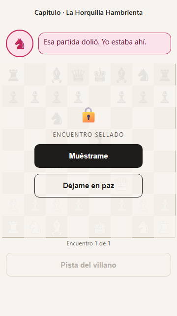
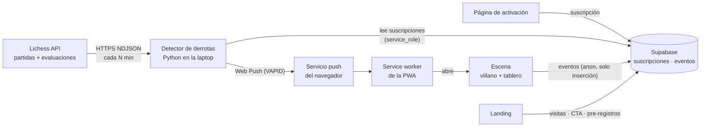
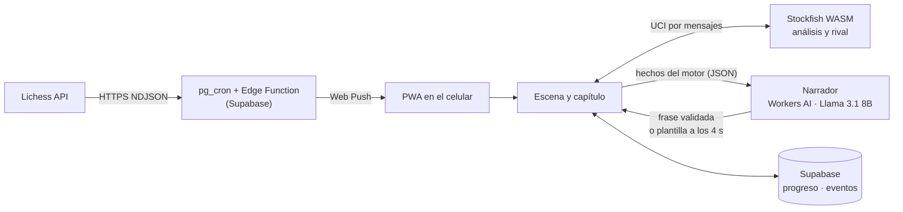
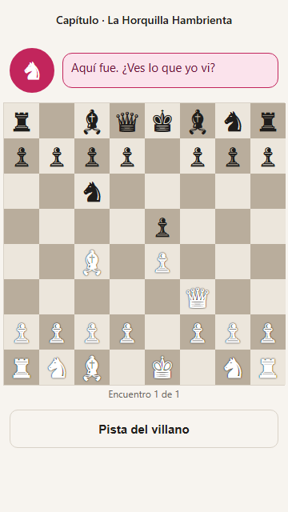

# Proyecto final: Zaqora

Esta página es la memoria del proyecto: la guía que se llenó semana a semana, el plan de negocio y la evidencia de cada criterio de la rúbrica. Cada sección sigue la misma plantilla: **versión y fecha, decisión, evidencia, qué cambió y qué falta**. El detalle está en las páginas de cada semana, enlazadas en cada sección. Lo que no tiene evidencia está marcado como **HIPÓTESIS** o **POR VERIFICAR**.

!!! info "Ruta de lectura de 10 minutos"
    [0. Resumen ejecutivo](#0-resumen-ejecutivo) → [5. Propuesta de valor](#5-propuesta-de-valor-y-oferta) → [13. Business Blueprint](#13-modelo-de-negocio-business-blueprint) → [17. Integración y pruebas](#17-integracion-y-pruebas-del-sistema) → [18. Pruebas con usuarios](#18-pruebas-con-usuarios) → [21. Uso de IA](#21-uso-de-ia-en-el-proyecto) → [20. Pitch y demo](#20-pitch-y-demo)

---

## 0. Resumen ejecutivo

**Zaqora** · equipo: David López Ramírez

> **«Cuando pierdes en Lichess y estás por cerrar la app, Zaqora valida tu frustración y la convierte en el próximo capítulo de tu historia.»** (23 palabras)

Minutos después de una derrota en Lichess, un villano que encarna el error recurrente del jugador le manda un aviso a su celular y lo invita a una escena construida sobre esa misma partida. Sin rating ni comparaciones.

| Cifra clave | Valor | Origen |
| :--- | :--- | :--- |
| Mercado alcanzable (SAM) | 65,952 jugadores en México | Semana 4 · HIPÓTESIS en 3 filtros |
| Precio | \$59 MXN al mes con IVA (\$44.92 netos) | Semana 7 |
| Economía unitaria | LTV ÷ inversión 0.72; payback 13.8 meses | Semana 9 · con supuestos |

{ width="240" }

**Enlaces:** [repositorio](https://github.com/Vidddda/Portafolio-193167) · [prototipo publicado](prototipo/activar.html) · landing (por publicar) · video del pitch (por grabar) · video de respaldo de la demo (por grabar)

**Estado en una oración:** el prototipo detecta una derrota real en Lichess, envía el aviso del villano y abre la escena con la posición del error, pero ningún jugador externo lo ha probado todavía y el narrador con IA solo existe en diseño.

| | |
| :--- | :--- |
| **Versión y fecha** | Versión 1, 23/11/2026 |
| **Qué falta** | Enlaces a la landing publicada y a los dos videos; reescribir el estado después de las pruebas con usuarios. |

---

## Parte I. Oportunidad y mercado

### 1. Equipo

| | |
| :--- | :--- |
| **Versión y fecha** | Versión 1, semana 1 (28/08/2026); actualizada el 23/11/2026 |
| **Decisión** | Equipo de una persona: **David López Ramírez**, ingeniero mecatrónico, desarrollador y maestro de ajedrez. Hace todos los roles: investigación, diseño, programación, modelo económico y pitch. |
| **Evidencia** | [Firma del syllabus (semana 1)](pi4_s1.md) · [página principal](index.md) |
| **Qué cambió** | El concepto de la semana 2 hablaba de «el equipo»; el modelo económico de la semana 8 dejó de contar sueldos porque el equipo es una sola persona. |
| **Qué falta** | Un compañero que opere la demo en la evaluación (un solo presentador no puede narrar y operar a la vez). |

### 2. Problema y oportunidad

| | |
| :--- | :--- |
| **Versión y fecha** | Versión 2, semana 3 (10/09/2026) |
| **Decisión** | Atacar el momento justo después de perder: el jugador amateur entra en una espiral de revancha o cierra la app sin aprender nada. |
| **Evidencia** | [Pain-Gain Map y reporte de oportunidad (semana 2)](pi4_s2.md): dolor principal, perder muchas partidas (40–60 %); ganancia principal, un plan con sus partidas reales. Concepto elegido: «La Campaña», con 5/5 señales de deseabilidad. |
| **Qué cambió** | La semana 2 decía que el dolor era el **juicio social**; las entrevistas de la semana 3 lo refutaron en parte: el dolor es el ***tilt***. |
| **Qué falta** | Medir con qué frecuencia ocurre el *tilt* y a cuántos jugadores describe (HIPÓTESIS). |

**La oportunidad en una oración:** existe una oportunidad para el jugador amateur de ajedrez en México que necesita dejar de perder partidas y aprender sin sentirse juzgado, porque hoy el aprendizaje viene con jerarquía o con el *feedback* frío de un motor.

### 3. Usuario y evidencia de campo

| | |
| :--- | :--- |
| **Versión y fecha** | Versión 2, semana 4 (17/09/2026) |
| **Decisión** | Segmento: jugadores amateur de ajedrez en línea en México, adultos, que juegan varias veces por semana en plataformas gratuitas y cierran la sesión tras dos o tres derrotas. El propio jugador paga. |
| **Evidencia** | [Síntesis de 3 entrevistas (semana 3, Paso 7)](pi4_s3.md#paso-7-sintesis-de-entrevistas-de-validacion): H1 parcialmente refutada (no es miedo al juicio, es *tilt*), H2 sin evidencia directa. Cita: *«No intenté analizar las partidas en ese momento porque sabía que iba a buscar excusas.»* Segmento en cuatro capas en el [Canvas de mercado (semana 4)](pi4_s4.md#4-entregable-canvas-de-mercado). |
| **Qué cambió** | De «evita la comparación social» a «cierra la app en plena racha»: el segmento se define por conducta, no por demografía. |
| **Qué falta** | Muestra de solo 3 entrevistas sin diversidad de perfiles. Disposición a pagar: **HIPÓTESIS**. |

| Capa | Dato | Estado |
| :--- | :--- | :--- |
| Demográfica | Adultos jóvenes en México que juegan en línea varias veces por semana | HIPÓTESIS |
| Conductual | Tras 2–3 derrotas cierran la app o se alejan 20 minutos | VERIFICADO en 3 entrevistas |
| Psicográfica | Frustración intensa; saben que deberían parar y siguen jugando | VERIFICADO en 3 entrevistas |
| Económica | Paga el propio jugador; clases particulares a \$200–220 MXN la hora como referencia | HIPÓTESIS (disposición a pagar no medida) |

### 4. Mercado y competencia

| | |
| :--- | :--- |
| **Versión y fecha** | Versión 1, semana 4 (17/09/2026) |
| **Decisión** | No competir por profundidad de análisis ni por ranking. El competidor más peligroso es un hábito: **cerrar la app después de dos derrotas**. |
| **Evidencia** | [TAM/SAM/SOM, mapa competitivo y lienzo Blue Ocean (semana 4)](pi4_s4.md#4-entregable-canvas-de-mercado). |
| **Qué cambió** | El SOM de 1,200 clientes suponía dos personas en ventas; con un equipo de una persona, el modelo a 5 años de la semana 8 usa 50 suscriptores al año 5. |
| **Qué falta** | Tres filtros del embudo (2 % juega en línea, 60 % se frustra, 10 % convierte) son supuestos propios sin fuente. |

| Nivel | Personas | Fuente y filtros |
| :--- | ---: | :--- |
| TAM | 82,440 | INEGI ENDUTIH 2024 (100.2 M usuarios de internet) y The CIU 2024; tres filtros supuestos |
| SAM | 65,952 | México, español y smartphone o navegador (80 %) |
| SOM | 1,200 en 2 años (supuesto de la semana 4) · 50 al año 5 (modelo vigente) | Capacidad de venta del equipo |

**Competencia:** directos (Chess Story, AI Dungeon + ajedrez, Story Time Chess), indirectos (Chess.com Game Review, apps de tácticas, coaching mental) y sustitutos (la regla de «2 derrotas = cerrar la app», el análisis manual en frío). **Cuatro acciones del lienzo:** eliminar el ranking interno; reducir la profundidad técnica del análisis; incrementar la integración con la sesión de juego; crear la validación emocional inmediata y la narrativa personalizada.

### 5. Propuesta de valor y oferta

| | |
| :--- | :--- |
| **Versión y fecha** | Versión 3, semana 4 (17/09/2026) |
| **Decisión** | *«Cuando pierdes en Lichess y estás por cerrar la app, Zaqora valida tu frustración y la convierte en el próximo capítulo de tu historia.»* (23 palabras) |
| **Evidencia** | [Paso 5 de la semana 4](pi4_s4.md) con el marco IDEO y la pirámide de Bain. |
| **Qué cambió** | La primera versión describía el producto («una aplicación con IA que genera una historia…»); la corrección fue cambiar el sujeto de la frase, del producto a la persona. |
| **Qué falta** | Que la validación de verdad haga actuar al jugador: es el supuesto que la prueba de la semana 8 no alcanzó a medir. |

| Oferta técnica | Nivel de Bain | Insightful · Unique · Targeted |
| :--- | :--- | :--- |
| PWA que detecta derrotas en Lichess, avisa con la voz de un villano y monta un capítulo con la posición del error | **Emocional** (alivio en el momento de la derrota); transformador solo si hay retención, todavía sin evidencia | Insightful: compite contra cerrar la app, no contra Chess.com · Unique: el villano sale de tus propias derrotas · Targeted: jugador de Lichess en plena racha |

### 6. Propiedad intelectual, marca y vigilancia

| | |
| :--- | :--- |
| **Versión y fecha** | Versión 1, semana 3 (10/09/2026) |
| **Decisión** | Nombre **Zaqora** (inventado, 3 sílabas, pronunciable en español e inglés). FTO **alta**. Estrategia: registrar la marca en las clases 9 y 41; no patentar por ahora. |
| **Evidencia** | [Semana 3](pi4_s3.md): sin registros de «Zaqora» en MARCANET en las clases 9 y 41; viabilidad digital 8.5/10; búsqueda en SIGA 2.0 del IMPI (10/09/2026), LATIPAT y Lens.org con la clasificación IPC A63F 13/00: sin anterioridades para ajedrez + IA + narrativa generada. |
| **Qué cambió** | Se descartaron Rookrise (marca existente en EE. UU.) y Pawnquest (descriptivo). |
| **Qué falta** | La búsqueda fonética formal y la solicitud ante el IMPI (**POR VERIFICAR** costo y plazo). Dominio: zaqora.com no se ha registrado. |

---

## Parte II. Producto

!!! note "Producto de software"
    Zaqora no tiene componente físico; así se acordó con el profesor desde el inicio del curso. En cada sección, la «carcasa» son los servicios que se integran, el «BOM» es el costo por usuario y la «manufactura» es construir y desplegar el software.

### 7. Especificación del producto (PDS)

| | |
| :--- | :--- |
| **Versión y fecha** | Versión 1.0, semana 5 (24/09/2026); estado actualizado el 23/11/2026 |
| **Decisión** | 16 requerimientos en cuatro categorías (4 por categoría), cada uno con su criterio de verificación. *First-iteration product:* una PWA en la que el jugador conecta su Lichess, recibe un capítulo con el villano de su error más frecuente y lo juega, sin que el equipo esté presente. |
| **Evidencia** | [PDS completo (semana 5)](pi4_s5.md#4-entregable-pds-de-zaqora) |
| **Qué cambió** | La revisión DFM (semana 8) movió el análisis del servidor al navegador: RI-01 cambia (Stockfish solo en el cliente) y el villano ya no cita el error exacto en el aviso. |
| **Qué falta** | Casi todos los requerimientos están pendientes: el prototipo prueba la entrada (aviso y escena), no el capítulo completo. |

| ID | Requerimiento (resumen) | Estado | Prueba |
| :--- | :--- | :---: | :--- |
| RF-01 | Análisis con Stockfish ≥ 16 y clasificación por caída de Win% | ⏳ | Hoy se usan las evaluaciones de Lichess |
| RF-02 | Taxonomía de 8–12 patrones, un villano por patrón | ⏳ | El prototipo usa un solo villano |
| RF-03 | Capítulo de 1 villano, ≥ 3 encuentros y jefe en ≤ 20 s | ⏳ | El prototipo tiene un encuentro |
| RF-04 | Evento narrativo tras derrotas, sin consejos fuera de la ficción | ✅ parcial | Escena del prototipo: solo voz del villano, sin Elo ni barra de evaluación |
| RD-01 | Bandas de dificultad del rival | ⏳ | — |
| RD-02 | Etiquetador de patrones con macro-F1 ≥ 0.70 | ⏳ | — |
| RD-03 | Jugada del villano en p95 ≤ 3 s | ⏳ | — |
| RD-04 | Diálogo del LLM con máximo 4 s y plantilla de respaldo | ⏳ | Prueba T5 |
| RI-01 | Stockfish WASM en el cliente | ⏳ | Revisión DFM (semana 8) |
| RI-02 | Lichess por API con espera tras HTTP 429 | ✅ parcial | El detector espera 60 s tras un 429; usa el nombre de usuario, sin OAuth |
| RI-03 | WCAG 2.2 AA, destinos táctiles ≥ 24 px | ✅ parcial | Escena con botones de 48 px y casillas de 44 px; falta auditoría con axe y lectores de pantalla |
| RI-04 | El LLM recibe solo hechos del motor, sin datos personales | ⏳ | — |
| RR-01 | Costo ≤ \$30 MXN por usuario activo al mes | ✅ | \$0.80 a 100 usuarios y \$4.00 a 20 ([semana 8](pi4_s8.md#3-revision-dfm-y-bom-actualizado)) |
| RR-02 | ≥ 60 % de las palabras desde plantillas | ✅ en el prototipo | 100 % plantillas |
| RR-03 | Licencia GPLv3 de Stockfish | ⏳ | Verificada la obligación ([semana 9](pi4_s9.md#paso-4-regulacion-minima-viable)); falta el enlace en la app |
| RR-04 | LFPDPPP: aviso de privacidad, ARCO, menores | ✅ parcial | Aviso de la landing y prueba solo con mayores; falta el aviso de la app completa |

### 8. Arquitectura del sistema

| | |
| :--- | :--- |
| **Versión y fecha** | Versión 3, semana 9 (23/11/2026) |
| **Decisión** | **Híbrido con el cómputo pesado en el teléfono**: (1) Stockfish corre en el navegador, así no se paga servidor por partida; (2) el narrador corre en la nube, porque un modelo que escribe bien no cabe en un celular; (3) la PWA se instala desde una URL, sin tienda. Consecuencia: el aviso no puede citar la jugada exacta, solo «ya sé dónde fue». |
| **Evidencia** | [Arquitectura de la semana 5](pi4_s5.md#diagrama-de-arquitectura) · [revisión DFM (semana 8)](pi4_s8.md#paso-4-revision-dfm-del-concepto) · prototipo funcionando de punta a punta (15/10/2026) |
| **Qué cambió** | Semana 5: monolito en FastAPI con Stockfish en servidor, Redis y Postgres (7 servicios). Semana 8: Stockfish al navegador, cron en Supabase, sin Railway (6 servicios). Semana 9: narrador en la capa gratuita de Cloudflare Workers AI. |
| **Qué falta** | El narrador y el análisis en el navegador no están construidos; el detector del prototipo corre en una laptop. |

**Por qué cada protocolo:** HTTPS con NDJSON para Lichess porque es lo que expone su API; Web Push con VAPID porque es la única forma de avisar a una PWA cerrada sin tienda; REST de Supabase porque permite insertar eventos desde el navegador con una clave pública y RLS de solo inserción.

**Prototipo actual (lo que funciona hoy):**

**Producto (siguiente versión):**

### 9. Diseño del producto

| | |
| :--- | :--- |
| **Versión y fecha** | Versión 2, semana 6 (01/10/2026) |
| **Decisión** | Concepto **C1 · Ghost Engine**: novela visual en PWA, aviso push en la voz del villano, vector plano en SVG, *tap* origen → destino. |
| **Evidencia** | [Tabla morfológica, 3 conceptos y matriz de Pugh (semana 6)](pi4_s6.md#4-entregable-conceptos-de-diseno-de-zaqora): Ghost Engine **+39** frente a –3 (Cazador Fricción-Cero) y 0 (datum, El Entrenador Invisible); deseabilidad con 55 % del peso. La segunda matriz, con prompt propio, da el mismo ganador. |
| **Qué cambió** | Del primer boceto (tablero que desbordaba, 947 px de alto) al presupuesto vertical de 568 px; tono del villano de burlón a validante; entrada sin OAuth, solo con el usuario de Lichess. |
| **Qué falta** | Bestiario único de villanos; estados de jugada incorrecta, sin partidas y sin conexión; probar el tono con usuarios. |

**Principios aplicados:** tecnología calmada (un solo aviso por derrota, sin recordatorios), omitir también es diseñar (sin Elo, barra de evaluación ni historial de derrotas), tarea primero e instalación después («Guarda a tu villano» aparece al terminar el primer encuentro). **Boceto con cotas:** encabezado 48 px, franja del villano 80 px, tablero 352 px con casillas de 44 px, pie 64 px ([vista frontal](pi4_s6.md#4-boceto-tecnico-del-concepto-elegido)).

### 10. Prototipos y evidencia

| | |
| :--- | :--- |
| **Versión y fecha** | Versión 1, semana 8 (15/10/2026) |
| **Decisión** | Probar primero el supuesto más riesgoso —que un jugador que acaba de perder abre el aviso del villano— con un prototipo de **experiencia** de **baja resolución** en modo «mago de Oz». |
| **Evidencia** | [Plan, construcción y reporte (semana 8)](pi4_s8.md#4-entregable-prototipo-y-dfm-de-zaqora). Prueba de funcionamiento del 15/10/2026: el aviso llega, la escena abre, los eventos se registran y la derrota se detecta. |
| **Qué cambió** | El aviso pasó de WhatsApp a notificación de la app para medir el canal real; los mensajes ya no dan el detalle de la jugada (revisión DFM). |
| **Qué falta** | **La prueba con usuarios no se realizó** (estaba programada del 16 al 18 de octubre). El supuesto sigue sin validar. |

| Fecha | Prototipo | Pregunta | Aprendizaje |
| :--- | :--- | :--- | :--- |
| 01/10/2026 | Boceto en Figma y prototipo navegable en v0 | ¿Cabe la escena en un celular y se entiende? | El tablero desbordaba la pantalla; faltaba el flujo de entrada |
| 01/10/2026 | Segunda iteración en Figma | ¿El flujo de entrada funciona sin cuenta? | Entrada con un solo campo; instalación como recompensa |
| 15/10/2026 | PWA con avisos push, escena y detector (mago de Oz) | ¿Abre el jugador el aviso tras perder? | Técnicamente factible y gratis; sin respuesta sobre el comportamiento |
| 23/11/2026 | Revisión del detector frontera por frontera | ¿Qué pasa si la partida no tiene análisis? | Se enviaba una posición de ejemplo; corregido para esperar el análisis ([semana 9](pi4_s9.md#paso-1-integracion-del-sistema)) |

### 11. Manufactura, DFM y circularidad

| | |
| :--- | :--- |
| **Versión y fecha** | Versión 3, semana 8 (actualización del 23/11/2026) |
| **Decisión** | Volumen objetivo: piloto de 20 usuarios y hasta 1,000 activos al año 5. «Manufactura» = despliegue en servicios con capa gratuita. Tres cambios DFM: Stockfish al navegador, narrador más barato (capa gratuita de Workers AI) y Supabase Free hasta el año 3. |
| **Evidencia** | [Revisión DFM y BOM actualizado (semana 8)](pi4_s8.md#3-revision-dfm-y-bom-actualizado) · [BOM verificado (semana 7)](pi4_s7.md#bom-verificado-08102026) · [Economía circular](pi4_s8.md#4-economia-circular) |
| **Qué cambió** | Costo por usuario activo de \$16.18 (semana 7) a \$4.72 (DFM) y a \$4.00 (IA gratuita) a 20 usuarios. Servicios de 7 a 6; cuentas de pago de 3 a 1. |
| **Qué falta** | Comprobar la calidad del español del modelo gratuito; decidir si se publica en Google Play (prueba cerrada de 12 testers durante 14 días y facturación de Google al 15 %). |

**BOM final (por mes, piloto):**

| Componente | Especificación | Precio unitario | Proveedor | Tiempo de entrega |
| :--- | :--- | :--- | :--- | :--- |
| Narrador | Llama 3.1 8B, 10,000 neurons al día gratis (~148 capítulos) | US\$0; excedente a precio de Haiku 5.5 (US\$0.10 / US\$0.50 por millón de tokens) | Cloudflare Workers AI | Inmediato |
| Análisis y rival | Stockfish WASM en el navegador | US\$0 | Código abierto (GPLv3) | — |
| Base de datos y cron | Supabase Free; Pro desde el año 4 | US\$0; Pro desde US\$25 al mes | Supabase | Inmediato |
| *Hosting* de la PWA y la landing | Plan gratuito | US\$0 | Cloudflare Pages (hoy, GitHub Pages) | Inmediato |
| Dominio | .com | US\$11.08 al año | Porkbun | Minutos |
| Cuenta de desarrollador | Pago único | US\$25 | Google Play | 1–2 semanas (supuesto) |
| Pasarela de pago | Tarjeta nacional | 3.6 % + \$3 MXN por cobro, sin IVA | Stripe México | Inmediato en modo de prueba |

**Cómo reproducir una unidad:** el [README del prototipo](#anexo-b-repositorio-readme-y-bitacoras) explica cómo crear las tablas en Supabase, generar las claves VAPID, publicar los archivos y correr el detector.

**Circularidad:** reparabilidad (cada servicio se cambia por su API), modularidad (villanos y capítulos como plantillas de datos), ciclo de vida (derechos ARCO y borrado; falta exportar el progreso) y atemporalidad (la PWA se actualiza sola y funciona en un celular de 4 GB).

### 12. Aplicación conectada

| | |
| :--- | :--- |
| **Versión y fecha** | Versión 1, semana 8 (15/10/2026); documentada el 23/11/2026 |
| **Decisión** | PWA instalable desde una URL, sin tienda: [página de activación](prototipo/activar.html) y [escena](prototipo/escena.html). Conexión con la «fuente de datos» (Lichess) por un detector que envía Web Push. |
| **Evidencia** | Wireframes y flujo de instalación ([semana 6](pi4_s6.md#5-wireframe-de-la-app)); capturas y prueba de funcionamiento ([semana 8](pi4_s8.md#paso-3-construccion-y-prueba-con-usuarios)); [repositorio](https://github.com/Vidddda/Portafolio-193167) con un commit por sesión de trabajo. |
| **Qué cambió** | Del prototipo navegable de v0 (datos inventados) a una escena que recibe la posición real por la URL (`?fen=&sol=&color=&villano=&jugada=`). |
| **Qué falta** | Estados de jugada incorrecta con reacción del villano, sin conexión y error; capítulo de 3 encuentros; narrador. |

**Formato del dato:** el detector arma el enlace de la escena con la posición antes del error (FEN), la mejor jugada (UCI), el color del jugador, el villano y el número de jugada. El aviso push lleva `{titulo, cuerpo, url, etiqueta}`; la etiqueta es el id de la partida, así que nunca se acumulan dos avisos de la misma derrota.

**Estados de la escena:**

| Estado | Qué se ve | ¿Existe? |
| :--- | :--- | :---: |
| Cargando | Villano en paleta «dormida» | ✅ |
| Normal (sellado) | Villano reconoce la derrota; tablero cerrado; «Muéstrame» y «Déjame en paz» | ✅ |
| Alerta (despierto) | Posición real antes del error; pista del villano | ✅ |
| Resuelto | Palomita en la jugada correcta | ✅ |
| Jugada incorrecta | Se registra el intento; falta la reacción del villano | ⚠️ parcial |
| Sin conexión | La escena ya cargada se juega sin red; el evento no se registra | ⚠️ sin mensaje visible |
| Error (enlace sin posición) | Posición de ejemplo | ⚠️ |

{ width="220" }

{ width="220" }

**Manual de usuario (beta):**

1. Abre en tu celular el enlace que te mandamos (por ejemplo, `…/prototipo/activar.html?p=P3`).
2. **Android:** toca «Activar avisos del villano» y acepta el permiso. **iPhone (iOS 16.4 o más reciente):** primero toca Compartir → «Agregar a pantalla de inicio», abre Zaqora desde el ícono y ahí activa los avisos.
3. Juega en Lichess como siempre. Cuando pierdas, en unos minutos te llegará un aviso del villano. Solo uno por derrota; si no lo abres, no insiste.
4. Toca el aviso. Elige «Muéstrame» para ver la posición antes de tu error, o «Déjame en paz» si no quieres verla ahora.
5. Encuentra la jugada que se te escapó tocando la pieza y luego la casilla. Si te atoras, usa «Pista del villano».
6. Para salir de la prueba, escribe ALTO o desactiva las notificaciones de Zaqora en tu navegador.

**Limitaciones conocidas:** el aviso solo llega si la derrota tiene análisis en Lichess (o en un máximo de 30 minutos con una posición de ejemplo); si el celular pasa más de 1 hora sin red, el aviso se pierde; en iPhone hay que instalar la app antes de activar los avisos.

---

## Parte III. Negocio

### 13. Modelo de negocio (Business Blueprint)

| | |
| :--- | :--- |
| **Versión y fecha** | Versión 2, semana 9 (23/11/2026) |
| **Decisión** | *Freemium* B2C con suscripción ligera; nunca se cobra en el momento de la derrota. |
| **Evidencia** | [Benchmarking de 5 empresas (semana 7)](pi4_s7.md#1-benchmarking-consolidado): Chess.com, Chessable, ChessMood, Duolingo y Habitica; el modelo predominante es *freemium* con suscripción. |
| **Qué cambió** | La semana 4 usaba \$300 MXN al mes, por encima de casi todo el mercado; la semana 7 lo bajó a \$59. |
| **Qué falta** | La disposición a pagar (HIPÓTESIS) y la carta de intención de una academia. |

| Caja | Contenido | Sustento |
| :--- | :--- | :--- |
| **Clientes** | Jugador amateur de Lichess en México que cierra la app tras perder | [§3](#3-usuario-y-evidencia-de-campo) |
| **Oferta** | Aviso del villano tras cada derrota y capítulo con la posición real | [§12](#12-aplicacion-conectada) |
| **Propuesta de valor** | Valida la frustración y la convierte en el próximo capítulo | [§5](#5-propuesta-de-valor-y-oferta) |
| **Modelo de ingresos y precio** | Primeros capítulos gratis; \$59 MXN al mes con IVA o temporada de \$149 | [§14](#14-costos-precio-y-viabilidad-financiera) |
| **Canales** | Venta directa (clubes y conocidos), landing con pre-registro, comunidades y *streamers* en español | [§15](#15-go-to-market-y-economia-unitaria) |
| **Costos** | Casi todos fijos y pequeños: dominio, cuenta de Play, Supabase Pro desde el año 4; IA en capa gratuita | [§11](#11-manufactura-dfm-y-circularidad) |
| **Socios** | Lichess (datos, sin acuerdo formal), Cloudflare, Supabase, Stripe; una academia piloto desde el mes 7 | [§16](#16-regulacion-y-aspectos-legales) |
| **Equipo y recursos** | Una persona; código abierto (Stockfish, python-chess) | [§1](#1-equipo) |

**Desafío de diseño del modelo:** cobrar sin hacerlo después de una derrota, con un tope de capítulos gratis que lleve la conversión del 5 % supuesto al 10 % que necesita la economía unitaria.

### 14. Costos, precio y viabilidad financiera

| | |
| :--- | :--- |
| **Versión y fecha** | Versión 3, semana 8 (actualización del 23/11/2026) |
| **Decisión** | Precio de **\$59 MXN al mes con IVA**: entre el *cost-plus* (\$33–40) y el *value-based* (hasta \$79). El año 1 es una validación; el negocio se evalúa a 5 años. |
| **Evidencia** | [Modelo económico (semana 7)](pi4_s7.md#3-modelo-economico) · [flujo a 5 años (semana 8)](pi4_s8.md#3-revision-dfm-y-bom-actualizado) · [hoja de cálculo con fórmulas](recursos/archivos/PI4_S8/Zaqora_Modelo_Economico_S8_DFM.xlsx) |
| **Qué cambió** | VPN a 12 meses de −\$2,636 (semana 7) a −\$299 (vigente); VPN a 5 años de +\$9,281. |
| **Qué falta** | **El costo de la IA no está medido con tokens reales**: es una estimación (20 capítulos al mes, 3,000 + 1,000 tokens por capítulo). Se mide cuando el narrador exista. |

| Concepto | Resultado |
| :--- | :--- |
| Costo unitario por usuario activo (con 15 % de overhead y 25 % de contingencia) | \$4.00 a 20 usuarios · \$0.80 a 100 |
| Clasificación de costos | Fijos: dominio, cuenta de Play, Supabase Pro (año 4+) · Variables: IA por encima de la capa gratuita, comisión de Stripe por cobro |
| Costo de desarrollo por ciclos | Integración del producto estimada en ~64 h (semana 8) · HIPÓTESIS |
| Inversión inicial | \$667.48 |
| Punto de equilibrio año 1 | 2 suscriptores (10 % de 20 usuarios) |
| VPN a 12 meses (15 %) | −\$299 |
| Flujo a 5 años | Recuperación en el mes 21; acumulado de +\$16,343 al año 5 |
| VPN a 5 años (15 %) | **+\$9,281** |

La tasa del 15 % anual es la del curso: el costo de oportunidad de un proyecto personal sin financiamiento, por encima de la tasa de un instrumento de bajo riesgo.

### 15. Go-to-market y economía unitaria

| | |
| :--- | :--- |
| **Versión y fecha** | Versión 1, semana 9 (23/11/2026) |
| **Decisión** | Primeros 20 por venta directa y landing con pre-registro; sin cobro anticipado durante el curso. |
| **Evidencia** | [Economía unitaria y palancas (semana 9)](pi4_s9.md#paso-3-go-to-market-y-economia-unitaria) |
| **Qué cambió** | Primera versión. |
| **Qué falta** | Conversión, churn y horas de activación son supuestos; ninguno está medido. |

| Métrica | Valor | Medido o supuesto |
| :--- | ---: | :--- |
| Contribución mensual por suscriptor | \$28.92 | Medido (precios verificados) sobre una conversión supuesta del 5 % |
| CAC | \$400 | Supuesto (0.25 h por usuario activado a \$80 la hora) |
| Churn mensual | 10 % | Supuesto |
| LTV | \$289 | Derivado |
| LTV ÷ inversión | **0.72** (meta: 3) | Derivado |
| Payback | **13.8 meses** (meta: < 12) | Derivado |

**Palancas:** conversión de 5 % a 10 % → 1.85; más churn de 6 % → **3.08**. La conversión mueve más que el churn y el CAC porque cambia los dos lados de la cuenta.

### 16. Regulación y aspectos legales

| | |
| :--- | :--- |
| **Versión y fecha** | Versión 1, semana 9 (23/11/2026) |
| **Decisión** | Durante el curso, solo pre-registro con aviso de privacidad y pruebas con consentimiento de mayores de edad. Antes de cobrar: RFC, CFDI, Stripe verificado y términos que cumplan el art. 76 BIS de la LFPC. |
| **Evidencia** | [Checklist regulatorio (semana 9)](pi4_s9.md#paso-4-regulacion-minima-viable), con texto vigente de la LFPDPPP y la LFPC, y licencias de Stockfish, Llama 3.1, Workers AI y Lichess. Aviso de privacidad de la landing (redactado, se publica con la landing). |
| **Qué cambió** | El PDS (semana 5) ya pedía aviso de privacidad y ARCO; ahora se suman los cobros recurrentes de la LFPC (reforma del 12/12/2025). |
| **Qué falta** | POR VERIFICAR: requisitos fiscales del SAT, alta en Stripe y costo del registro de marca. Domicilio del responsable en el aviso de privacidad. |

| Tema | Estatus |
| :--- | :--- |
| Datos personales (LFPDPPP, 2025) | VERIFICADO |
| Licencias: Stockfish GPLv3, Llama 3.1, Workers AI, API de Lichess | VERIFICADO |
| Comercio electrónico y suscripciones (LFPC, art. 76 BIS) | VERIFICADO |
| Google Play | VERIFICADO (semana 8) |
| Stripe, SAT y marca en el IMPI | POR VERIFICAR |
| Radio, NOM, baterías, REP, exportación | No aplica |

---

## Parte IV. Validación y lanzamiento

### 17. Integración y pruebas del sistema

| | |
| :--- | :--- |
| **Versión y fecha** | Versión 1, semana 9 (23/11/2026) |
| **Decisión** | Cuatro fronteras: F1 Lichess → detector, F2 detector → celular, F3 motor → narrador, F4 escena → jugador y registro. Seis pruebas T1 a T6 adaptadas a software. |
| **Evidencia** | [Fronteras, pruebas y degradación (semana 9)](pi4_s9.md#paso-1-integracion-del-sistema) · registro del 15/10/2026 (`registro_envios.csv`) |
| **Qué cambió** | Al revisar F1 se encontró que una derrota sin análisis se enviaba con una posición de ejemplo; se corrigió para esperar el análisis hasta 30 minutos. |
| **Qué falta** | T1, T3, T5 y T6. |

| Prueba | Resultado |
| :--- | :--- |
| T1 Activación sin ayuda (< 5 min) | ⏳ Pendiente con alguien externo |
| T2 Derrota → aviso (≤ 10 min) | ⚠️ No cumple con `--cada 15`; se corre con `--cada 5` |
| T3 Celular sin red | ⏳ Pendiente; el aviso dura 1 hora en el servicio push |
| T4 Autonomía de la capa gratuita | ✅ 222 usuarios activos a 20 capítulos al mes |
| T5 Falla de la API de IA | ⏳ Pendiente en el producto |
| T6 48 h continuas | ⏳ Pendiente |

| Checklist de listo | Estado |
| :--- | :---: |
| Funciona sin la laptop del equipo | ❌ |
| App desplegada | ✅ |
| Landing publicada | ⏳ |
| Flujo sin intervención | ❌ (análisis pedido a mano) |

### 18. Pruebas con usuarios

| | |
| :--- | :--- |
| **Versión y fecha** | Versión 1, semana 9 (23/11/2026) |
| **Decisión** | Protocolo de 30 minutos con tres tareas (activar los avisos; abrir el aviso y jugar el encuentro; encontrar el precio y pre-registrarse) más una prueba de campo de 3 a 5 días. |
| **Evidencia** | [Protocolo (semana 9)](pi4_s9.md#paso-2-pruebas-con-usuarios) |
| **Qué cambió** | La prueba de la semana 8 se suma a esta: misma pregunta, más la tarea de la landing. |
| **Qué falta** | **Las cinco sesiones** (tres del segmento y dos de otro equipo), la tabla por tarea con éxito sin ayuda, tiempo y SEQ, los hallazgos por severidad y la señal de negocio. **No hay ningún resultado todavía.** |

### 19. Landing page

| | |
| :--- | :--- |
| **Versión y fecha** | Versión 1, semana 9 (23/11/2026) |
| **Decisión** | Una página, una acción: pre-registro con correo para la beta, con el precio visible (\$59 MXN al mes con IVA, beta gratuita). |
| **Evidencia** | Landing construida en `docs/landing/` con headline, visual, tres beneficios, cita de las entrevistas, precio, CTA único, Open Graph y aviso de privacidad (se publican juntos). [Anatomía (semana 9)](pi4_s9.md#paso-3-go-to-market-y-economia-unitaria). |
| **Qué cambió** | Primera versión. |
| **Qué falta** | Publicarla (requiere crear la tabla `preregistros` en Supabase y completar el domicilio del aviso de privacidad); el video de 30 s; las métricas de visitas, clics y pre-registros. |

### 20. Pitch y demo

| | |
| :--- | :--- |
| **Versión y fecha** | Versión 1, semana 9 (23/11/2026) |
| **Decisión** | Pitch de 344 palabras (2:39) que abre con un jugador real de las entrevistas y cierra con el ask: cinco jugadores y un club o *streamer* para un piloto de 20. Demo de 7 minutos con una derrota en vivo contra la computadora de Lichess. |
| **Evidencia** | [Guion del pitch con la evidencia de cada cifra](pi4_s9.md#paso-5-el-pitch-de-3-minutos) · [guion de la demo con plan B](pi4_s9.md#paso-6-la-demo-de-7-minutos) |
| **Qué cambió** | Primera versión. |
| **Qué falta** | Grabar el pitch y verlo; tres ensayos de la demo con operador y el video de respaldo. |

---

## Parte V. Cierre

### 21. Uso de IA en el proyecto

| | |
| :--- | :--- |
| **Versión y fecha** | Versión 1, 23/11/2026 |
| **Decisión** | En el proceso, la IA generó insumos y el equipo eligió. En el producto, **el motor calcula y el LLM solo narra**, siempre con una plantilla de respaldo. |
| **Evidencia** | Prompts del profesor y de autoría propia con sus respuestas en cada semana ([2](pi4_s2.md) a [8](pi4_s8.md)). |
| **Qué cambió** | El narrador pasó de Claude Haiku 4.5 a Haiku 5.5 y después a la capa gratuita de Llama 3.1 en Workers AI. |
| **Qué falta** | Medir el costo real del narrador por usuario y la calidad de su español. |

**Los cinco prompts que más cambiaron el proyecto:**

| Prompt | Qué se pidió | Qué cambió | Qué corrigió el equipo |
| :--- | :--- | :--- | :--- |
| Síntesis de entrevistas (semana 3) | Verificar H1 y H2 con 3 entrevistas | El dolor pasó del juicio social al *tilt* | Se reconoció que 3 entrevistas no miden frecuencia |
| Propuesta de valor IDEO/Bain (semana 4) | Propuesta en ≤ 25 palabras | El sujeto pasó del producto a la persona | Se bajó el nivel de Bain a emocional por falta de evidencia de retención |
| PDS y arquitectura (semana 5) | Requerimientos verificables | «El LLM no juega ajedrez»: motor calcula, LLM narra | Se eligió un solo umbral donde tres documentos daban tres distintos |
| Matriz de Pugh (semana 6) | Elegir entre 3 conceptos | Ghost Engine (+39), con la advertencia del tono | Se descartó un criterio en el que todos empataban |
| Revisión DFM (semana 8) | Reducir costo y partes | Stockfish al navegador; costo de \$16 a \$4.72 | Se verificó cada precio en la página del proveedor |

**Un caso donde la IA se equivocó:** el modelo económico de la semana 7 con prompt propio armó una startup que necesitaba \$1.0 M MXN, porque reutilizó supuestos de la semana 4 (\$300 al mes, 1,200 clientes, sueldos). Además, ninguna respuesta de IA mencionó que Vercel Hobby prohíbe el uso comercial ni que existía Claude Haiku 5.5: los dos hallazgos salieron de verificar los precios a mano.

**En el producto:**

| | |
| :--- | :--- |
| Qué hace | Escribe la frase del villano a partir de los hechos del motor (patrón, jugada, pieza, casilla) |
| Dónde corre | Cloudflare Workers AI (Llama 3.1 8B); el análisis, Stockfish en el navegador |
| Qué recibe | Un JSON con hechos calculados, sin FEN crudo ni datos personales (RI-04) |
| Qué devuelve | `{line, emotion, hint_level}`, máximo 2 frases |
| Costo por usuario | \$0 dentro de la capa gratuita (hasta 222 usuarios activos); unos \$0.50 al mes por encima, a precio de Haiku 5.5 · **estimado, no medido** |
| Si falla | A los 4 s se usa una plantilla; nunca se muestra un texto inválido |
| Por qué sería peor sin IA | Sin el motor (Stockfish, una red neuronal) no hay posición del error. Sin el LLM, el villano repetiría plantillas y dejaría de sonar como alguien que vio *tu* partida: HIPÓTESIS, por probar con usuarios |

### 22. Reflexión y siguientes pasos

| | |
| :--- | :--- |
| **Versión y fecha** | Versión 1, 23/11/2026 |
| **Decisión** | El siguiente paso es la prueba con usuarios, no más diseño. |
| **Evidencia** | Reflexiones de cada semana ([5](pi4_s5.md#5-reflexion), [6](pi4_s6.md#5-reflexion), [7](pi4_s7.md#5-reflexion), [8](pi4_s8.md#5-reflexion), [9](pi4_s9.md#5-reflexion)). |
| **Qué cambió** | — |
| **Qué falta** | El párrafo firmado de aprendizaje del semestre (lo escribe David). |

**Aprendizaje más importante del semestre** (David López Ramírez):

> *[Pendiente: lo escribe David.]*

**Qué haría distinto:** conseguir a los participantes de la prueba antes de construir el prototipo; construir resultó más fácil que conseguir a cinco personas durante tres días.

**Hipótesis críticas sin verificar y cómo se verifican:**

| Hipótesis | Cómo se verifica | Umbral |
| :--- | :--- | :--- |
| Un jugador que acaba de perder abre el aviso del villano | Prueba de campo de 3 a 5 días con el prototipo publicado | 3 de 5 abren en < 30 min; 2 de 5 terminan |
| El tono validante retiene más que el burlón | Las dos variantes en las mismas personas | Mayor apertura en la variante A |
| 1 de cada 20 usuarios activos paga \$59 | Landing con precio y, después, preventa en el piloto | ≥ 5 % de pre-registros que aceptan pagar |
| El modelo gratuito escribe bien en español | La misma escena con Llama 3.1 8B y con Haiku 5.5, a ciegas | El jugador no distingue o prefiere la gratuita |

**Plan de 90 días:**

| Días | Qué | Resultado esperado |
| :--- | :--- | :--- |
| 1–14 | Cinco pruebas de usuario y prueba de campo; landing publicada | Respuesta al supuesto más riesgoso |
| 15–45 | Narrador conectado y análisis en el navegador; detector en Supabase (sin laptop) | Flujo sin intervención |
| 46–90 | Piloto de 20 usuarios con un club o *streamer*; tope de capítulos gratis | Conversión y churn medidos |

**Riesgos principales:** que nadie abra el aviso (el concepto entero cae); que la conversión se quede en 5 % o menos (la economía por cliente no cierra); que Lichess limite o revoque el acceso a su API sin aviso; que se acabe o cambie la capa gratuita de IA.

---

## Anexos

### Anexo A. BOM completo con cotizaciones

[BOM verificado del 08/10/2026 (semana 7)](pi4_s7.md#bom-verificado-08102026), con enlaces a cada proveedor, y [BOM actualizado (semana 8)](pi4_s8.md#3-revision-dfm-y-bom-actualizado).

### Anexo B. Repositorio, README y bitácoras

- **Repositorio:** [github.com/Vidddda/Portafolio-193167](https://github.com/Vidddda/Portafolio-193167), con el [README del prototipo](https://github.com/Vidddda/Portafolio-193167/blob/main/zaqora/README.md).
- **Bitácora de entregables semanales:**

| Semana | Fecha | Entregable |
| :---: | :--- | :--- |
| 1 | 28/08/2026 | [Firma del syllabus y SCAMPER](pi4_s1.md) |
| 2 | 03/09/2026 | [Reporte de oportunidad](pi4_s2.md) |
| 3 | 10/09/2026 | [Marca, vigilancia tecnológica y entrevistas](pi4_s3.md) |
| 4 | 17/09/2026 | [Canvas de mercado y propuesta de valor](pi4_s4.md) |
| 5 | 24/09/2026 | [PDS y arquitectura](pi4_s5.md) |
| 6 | 01/10/2026 | [Conceptos, Pugh y boceto](pi4_s6.md) |
| 7 | 08/10/2026 | [Viabilidad técnica y económica](pi4_s7.md) |
| 8 | 15/10/2026 | [Prototipo y DFM](pi4_s8.md) |
| 9 | 23/11/2026 | [Integración, go-to-market y pitch](pi4_s9.md) |

- **Bitácora de commits:** [historial del repositorio](https://github.com/Vidddda/Portafolio-193167/commits/main).

### Anexo C. Archivos de diseño y código

- Boceto en Figma ([primera](recursos/imgs/PI4_S6/boceto_figma.png) y [segunda iteración](recursos/imgs/PI4_S6/flujo_instalacion_figma.png)) y [prototipo de v0 en video](recursos/archivos/PI4_S6/prototipo_v0.mp4).
- Código público del prototipo: [activación](prototipo/activar.html), [escena](prototipo/escena.html), `sw.js`, `manifest.webmanifest`, `config.js` (en `docs/prototipo/` del repositorio).
- El detector de derrotas, las claves privadas y los datos de participantes se guardan fuera del repositorio; el README explica cómo reproducirlos.

### Anexo D. Datos crudos

- Notas de las entrevistas: [semana 3, Paso 7](pi4_s3.md#paso-7-sintesis-de-entrevistas-de-validacion).
- Notas de las pruebas de usuario: pendientes. Se publicarán sin nombres ni usuarios de Lichess, solo con alias y con consentimiento.

### Anexo E. Hojas de cálculo

- [Modelo económico de la semana 7](recursos/archivos/PI4_S7/Zaqora_Modelo_Economico_S7.xlsx).
- [Modelo económico vigente (semana 8, actualizado el 23/11/2026)](recursos/archivos/PI4_S8/Zaqora_Modelo_Economico_S8_DFM.xlsx), con flujo a 5 años y fórmulas visibles.

### Anexo F. Bibliografía y fuentes de datos

- INEGI, ENDUTIH 2024; The CIU, 2024 (mercado, semana 4).
- Páginas de precios de Anthropic, Cloudflare, Supabase, Railway, Porkbun, Stripe México, Google Play Console y Banxico (BOM, semanas 7 y 8).
- [Ley Federal de Protección de Datos Personales en Posesión de los Particulares](https://www.diputados.gob.mx/LeyesBiblio/ref/lfpdppp.htm), DOF 20-03-2025, última reforma DOF 14-11-2025.
- [Ley Federal de Protección al Consumidor](https://www.diputados.gob.mx/LeyesBiblio/pdf/LFPC.pdf), última reforma DOF 12-12-2025.
- [Licencia de Stockfish (GPLv3)](https://github.com/official-stockfish/Stockfish/blob/master/Copying.txt) · [Llama 3.1 Community License](https://www.llama.com/llama3_1/license/) · [Uso de datos de Workers AI](https://developers.cloudflare.com/workers-ai/platform/data-usage/) · [Términos de servicio de Lichess](https://lichess.org/terms-of-service).
- Ulrich, K. T., Eppinger, S. D. y Yang, M. C. (2026). *Product Design and Development* (7.ª ed.). McGraw-Hill.
- Nielsen, J. (2000). *Why You Only Need to Test with 5 Users*. Nielsen Norman Group.
- Skok, D. *SaaS Metrics 2.0*. For Entrepreneurs.
