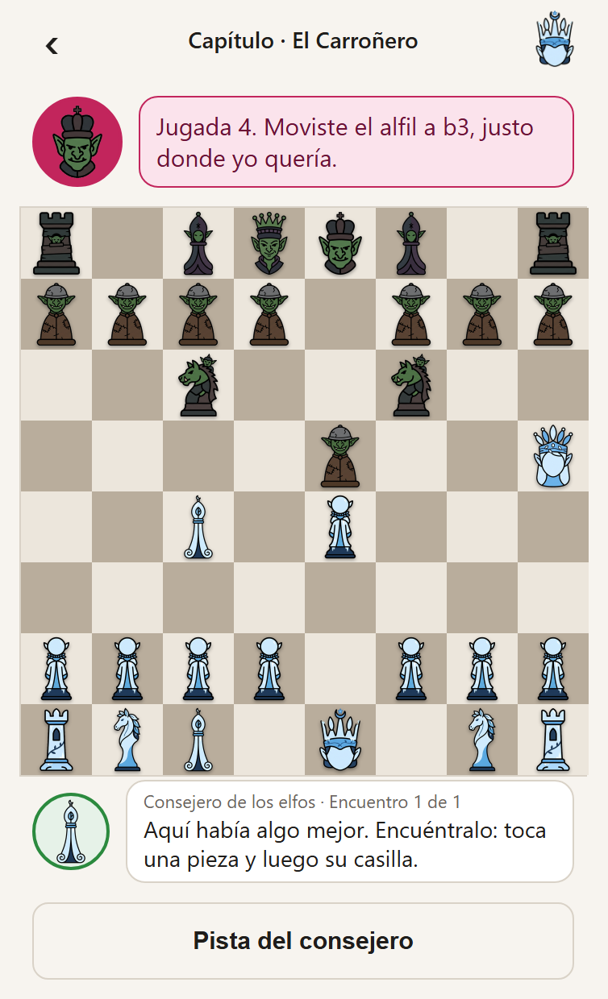
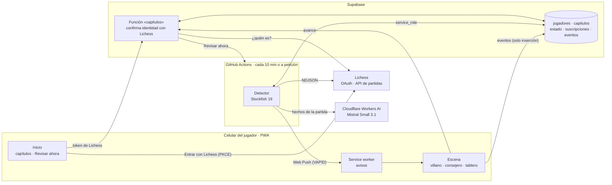

# Proyecto final: Zaqora

Esta página es la memoria del proyecto: la guía que se llenó semana a semana, el plan de negocio y la evidencia de cada criterio de la rúbrica. Cada sección sigue la misma plantilla: **versión y fecha, decisión, evidencia, qué cambió y qué falta**. El detalle está en las páginas de cada semana, enlazadas en cada sección. Lo que no tiene evidencia está marcado como **HIPÓTESIS** o **POR VERIFICAR**.

!!! info "Ruta de lectura de 10 minutos"
    [0. Resumen ejecutivo](#0-resumen-ejecutivo) → [5. Propuesta de valor](#5-propuesta-de-valor-y-oferta) → [13. Business Blueprint](#13-modelo-de-negocio-business-blueprint) → [17. Integración y pruebas](#17-integracion-y-pruebas-del-sistema) → [18. Pruebas con usuarios](#18-pruebas-con-usuarios) → [21. Uso de IA](#21-uso-de-ia-en-el-proyecto) → [20. Pitch y demo](#20-pitch-y-demo)

---

## 0. Resumen ejecutivo

**Zaqora** · equipo: David López Ramírez

> **«Cuando pierdes en Lichess y estás por cerrar la app, Zaqora valida tu frustración y la convierte en el próximo capítulo de tu historia.»** (23 palabras)

Minutos después de una derrota en Lichess, un villano que encarna el error recurrente del jugador le manda un aviso a su celular y lo invita a una escena construida sobre esa misma partida. Sin rating ni comparaciones.

| Cifra clave | Valor | Origen |
| :--- | :--- | :--- |
| Mercado alcanzable (SAM) | 65,952 jugadores en México | Semana 4 · HIPÓTESIS en 3 filtros |
| Precio | \$59 MXN al mes con IVA (\$44.92 netos) | Semana 7 |
| Economía unitaria | LTV ÷ inversión 0.72; payback 13.8 meses | Semana 9 · con supuestos |

{ width="240" }

**Enlaces:** [repositorio](https://github.com/Vidddda/Portafolio-193167) · [Zaqora (prototipo publicado)](prototipo/inicio.html) · [landing](landing/index.html) · [video de respaldo de la demo](videos/zaqora-demo-respaldo.mp4)

**Estado en una oración:** el jugador entra con su cuenta de Lichess, sus últimas 5 derrotas se vuelven capítulos con historia de IA y cada derrota nueva le llega sola como un reto, sin la laptop del equipo; cinco personas lo probaron y sus observaciones cambiaron el producto, pero todavía no se sabe si alguien que acaba de perder abre el reto.

| | |
| :--- | :--- |
| **Versión y fecha** | Versión 3, 27/11/2026 |
| **Qué falta** | Los resultados de la prueba de campo, que ya está en curso. Las cinco sesiones de prueba están hechas. La [landing](landing/index.html) ya está publicada. |

---

## Parte I. Oportunidad y mercado

### 1. Equipo

| | |
| :--- | :--- |
| **Versión y fecha** | Versión 1, semana 1 (28/08/2026); actualizada el 27/11/2026 |
| **Decisión** | Equipo de una persona: **David López Ramírez**, ingeniero mecatrónico, desarrollador y maestro de ajedrez. Hace todos los roles: investigación, diseño, programación, modelo económico y pitch. |
| **Evidencia** | [Firma del syllabus (semana 1)](pi4_s1.md) · [página principal](index.md) |
| **Qué cambió** | El concepto de la semana 2 hablaba de «el equipo»; el modelo económico de la semana 8 dejó de contar sueldos porque el equipo es una sola persona. |
| **Qué falta** | Nada para la evaluación: un compañero opera la demo mientras David narra, y la ensayaron tres veces el 25/11/2026. |

### 2. Problema y oportunidad

| | |
| :--- | :--- |
| **Versión y fecha** | Versión 2, semana 3 (10/09/2026) |
| **Decisión** | Atacar el momento justo después de perder: el jugador amateur entra en una espiral de revancha o cierra la app sin aprender nada. |
| **Evidencia** | [Pain-Gain Map y reporte de oportunidad (semana 2)](pi4_s2.md): dolor principal, perder muchas partidas (40–60 %); ganancia principal, un plan con sus partidas reales. Concepto elegido: «La Campaña», con 5/5 señales de deseabilidad. |
| **Qué cambió** | La semana 2 decía que el dolor era el **juicio social**; las entrevistas de la semana 3 lo refutaron en parte: el dolor es el ***tilt***. |
| **Qué falta** | Medir con qué frecuencia ocurre el *tilt* y a cuántos jugadores describe (HIPÓTESIS). |

**La oportunidad en una oración:** existe una oportunidad para el jugador amateur de ajedrez en México que necesita dejar de perder partidas y aprender sin sentirse juzgado, porque hoy el aprendizaje viene con jerarquía o con el *feedback* frío de un motor.

### 3. Usuario y evidencia de campo

| | |
| :--- | :--- |
| **Versión y fecha** | Versión 2, semana 4 (17/09/2026) |
| **Decisión** | Segmento: jugadores amateur de ajedrez en línea en México, adultos, que juegan varias veces por semana en plataformas gratuitas y cierran la sesión tras dos o tres derrotas. El propio jugador paga. |
| **Evidencia** | [Síntesis de 3 entrevistas (semana 3, Paso 7)](pi4_s3.md#paso-7-sintesis-de-entrevistas-de-validacion): H1 parcialmente refutada (no es miedo al juicio, es *tilt*), H2 sin evidencia directa. Cita: *«No intenté analizar las partidas en ese momento porque sabía que iba a buscar excusas.»* Segmento en cuatro capas en el [Canvas de mercado (semana 4)](pi4_s4.md#4-entregable-canvas-de-mercado). |
| **Qué cambió** | De «evita la comparación social» a «cierra la app en plena racha»: el segmento se define por conducta, no por demografía. |
| **Qué falta** | Muestra de solo 3 entrevistas sin diversidad de perfiles. Disposición a pagar: **HIPÓTESIS**. |

| Capa | Dato | Estado |
| :--- | :--- | :--- |
| Demográfica | Adultos jóvenes en México que juegan en línea varias veces por semana | HIPÓTESIS |
| Conductual | Tras 2–3 derrotas cierran la app o se alejan 20 minutos | VERIFICADO en 3 entrevistas |
| Psicográfica | Frustración intensa; saben que deberían parar y siguen jugando | VERIFICADO en 3 entrevistas |
| Económica | Paga el propio jugador; clases particulares a \$200–220 MXN la hora como referencia | HIPÓTESIS (disposición a pagar no medida) |

### 4. Mercado y competencia

| | |
| :--- | :--- |
| **Versión y fecha** | Versión 1, semana 4 (17/09/2026) |
| **Decisión** | No competir por profundidad de análisis ni por ranking. El competidor más peligroso es un hábito: **cerrar la app después de dos derrotas**. |
| **Evidencia** | [TAM/SAM/SOM, mapa competitivo y lienzo Blue Ocean (semana 4)](pi4_s4.md#4-entregable-canvas-de-mercado). |
| **Qué cambió** | El SOM de 1,200 clientes suponía dos personas en ventas; con un equipo de una persona, el modelo a 5 años de la semana 8 usa 50 suscriptores al año 5. |
| **Qué falta** | Tres filtros del embudo (2 % juega en línea, 60 % se frustra, 10 % convierte) son supuestos propios sin fuente. |

| Nivel | Personas | Fuente y filtros |
| :--- | ---: | :--- |
| TAM | 82,440 | INEGI ENDUTIH 2024 (100.2 M usuarios de internet) y The CIU 2024; tres filtros supuestos |
| SAM | 65,952 | México, español y smartphone o navegador (80 %) |
| SOM | 1,200 en 2 años (supuesto de la semana 4) · 50 al año 5 (modelo vigente) | Capacidad de venta del equipo |

**Competencia:** directos (Chess Story, AI Dungeon + ajedrez, Story Time Chess), indirectos (Chess.com Game Review, apps de tácticas, coaching mental) y sustitutos (la regla de «2 derrotas = cerrar la app», el análisis manual en frío). **Cuatro acciones del lienzo:** eliminar el ranking interno; reducir la profundidad técnica del análisis; incrementar la integración con la sesión de juego; crear la validación emocional inmediata y la narrativa personalizada.

### 5. Propuesta de valor y oferta

| | |
| :--- | :--- |
| **Versión y fecha** | Versión 3, semana 4 (17/09/2026) |
| **Decisión** | *«Cuando pierdes en Lichess y estás por cerrar la app, Zaqora valida tu frustración y la convierte en el próximo capítulo de tu historia.»* (23 palabras) |
| **Evidencia** | [Paso 5 de la semana 4](pi4_s4.md) con el marco IDEO y la pirámide de Bain. |
| **Qué cambió** | La primera versión describía el producto («una aplicación con IA que genera una historia…»); la corrección fue cambiar el sujeto de la frase, del producto a la persona. |
| **Qué falta** | Que la validación de verdad haga actuar al jugador: es el supuesto que la prueba de la semana 8 no alcanzó a medir. |

| Oferta técnica | Nivel de Bain | Insightful · Unique · Targeted |
| :--- | :--- | :--- |
| PWA que detecta derrotas en Lichess, avisa con la voz de un villano y monta un capítulo con la posición del error | **Emocional** (alivio en el momento de la derrota); transformador solo si hay retención, todavía sin evidencia | Insightful: compite contra cerrar la app, no contra Chess.com · Unique: el villano sale de tus propias derrotas · Targeted: jugador de Lichess en plena racha |

### 6. Propiedad intelectual, marca y vigilancia

| | |
| :--- | :--- |
| **Versión y fecha** | Versión 1, semana 3 (10/09/2026) |
| **Decisión** | Nombre **Zaqora** (inventado, 3 sílabas, pronunciable en español e inglés). FTO **alta**. Estrategia: registrar la marca en las clases 9 y 41; no patentar por ahora. |
| **Evidencia** | [Semana 3](pi4_s3.md): sin registros de «Zaqora» en MARCANET en las clases 9 y 41; viabilidad digital 8.5/10; búsqueda en SIGA 2.0 del IMPI (10/09/2026), LATIPAT y Lens.org con la clasificación IPC A63F 13/00: sin anterioridades para ajedrez + IA + narrativa generada. |
| **Qué cambió** | Se descartaron Rookrise (marca existente en EE. UU.) y Pawnquest (descriptivo). |
| **Qué falta** | La búsqueda fonética formal y la solicitud ante el IMPI (**POR VERIFICAR** costo y plazo). Dominio: zaqora.com no se ha registrado. |

---

## Parte II. Producto

!!! note "Producto de software"
    Zaqora no tiene componente físico; así se acordó con el profesor desde el inicio del curso. En cada sección, la «carcasa» son los servicios que se integran, el «BOM» es el costo por usuario y la «manufactura» es construir y desplegar el software.

### 7. Especificación del producto (PDS)

| | |
| :--- | :--- |
| **Versión y fecha** | Versión 1.0, semana 5 (24/09/2026); estado actualizado el 24/11/2026 |
| **Decisión** | 16 requerimientos en cuatro categorías (4 por categoría), cada uno con su criterio de verificación. *First-iteration product:* una PWA en la que el jugador conecta su Lichess, recibe un capítulo con el villano de su error más frecuente y lo juega, sin que el equipo esté presente. |
| **Evidencia** | [PDS completo (semana 5)](pi4_s5.md#4-entregable-pds-de-zaqora) |
| **Qué cambió** | La revisión DFM (semana 8) movió el análisis del servidor al navegador: RI-01 cambia (Stockfish solo en el cliente) y el villano ya no cita el error exacto en el aviso. |
| **Qué falta** | El rival que juega contra el jugador (RD-01, RD-03, RI-01) y las mediciones formales (RD-02, RI-03). El 24/11/2026 se cumplieron, en parte o por completo, el análisis, los villanos por patrón, los capítulos de varios encuentros y la plantilla de respaldo. |

| ID | Requerimiento (resumen) | Estado | Prueba |
| :--- | :--- | :---: | :--- |
| RF-01 | Análisis con Stockfish ≥ 16 y clasificación por caída de Win% | ✅ parcial | Stockfish 19 analiza cada derrota y clasifica por caída de Win% con los umbrales del PDS (≥ 30 / 20 / 10); falta medir el F1 contra profundidad 24 |
| RF-02 | Taxonomía de 8–12 patrones, un villano por patrón | ✅ parcial | 5 patrones con su villano (tiempo, pieza sin defensa, apertura, final, medio juego); faltan 3 a 7 más |
| RF-03 | Capítulo de 1 villano, ≥ 3 encuentros y jefe en ≤ 20 s | ✅ parcial | Hasta 3 encuentros por capítulo (los errores más grandes); falta el «jefe» y medir el tiempo (el análisis tarda unos 3 s por partida) |
| RF-04 | Evento narrativo tras derrotas, sin consejos fuera de la ficción | ✅ | El villano reta y el consejero del bando guía, siempre dentro de la ficción; sin Elo ni barra de evaluación |
| RD-01 | Bandas de dificultad del rival | ⏳ | — |
| RD-02 | Etiquetador de patrones con macro-F1 ≥ 0.70 | ⏳ | — |
| RD-03 | Jugada del villano en p95 ≤ 3 s | ⏳ | — |
| RD-04 | Diálogo del LLM con plantilla de respaldo | ✅ | Prueba T5 con una falla real: Cloudflare retiró el modelo y Zaqora siguió con plantillas. El diálogo se genera antes de enviar el aviso, así que no bloquea la escena |
| RI-01 | Stockfish WASM en el cliente | ⏳ | Revisión DFM (semana 8) |
| RI-02 | Lichess por OAuth 2.0 + PKCE, NDJSON y espera tras HTTP 429 | ✅ | «Entrar con Lichess» con PKCE y sin permisos extra; el detector espera 60 s tras un 429 y se identifica ante Lichess |
| RI-03 | WCAG 2.2 AA, destinos táctiles ≥ 24 px | ✅ parcial | Escena con botones de 48 px y casillas de 44 px; falta auditoría con axe y lectores de pantalla |
| RI-04 | El LLM recibe solo hechos del motor, sin datos personales | ✅ | La IA recibe color, ritmo, apertura, jugada, pieza y casilla; nunca el usuario ni el FEN. El validador rechaza casillas inventadas y soluciones reveladas |
| RR-01 | Costo ≤ \$30 MXN por usuario activo al mes | ✅ | \$0.80 a 100 usuarios y \$4.00 a 20 ([semana 8](pi4_s8.md#3-revision-dfm-y-bom-actualizado)) |
| RR-02 | ≥ 60 % de las palabras desde plantillas | ❌ por decisión | Con la historia de IA, la mayoría del texto ya no es de plantilla. Se cambió porque el primer participante pidió una historia; el tope de costo (RR-01) se sigue cumpliendo. Hay que reescribir este requerimiento |
| RR-03 | Licencia GPLv3 de Stockfish | ✅ | Inicio muestra el aviso de licencia GPLv3 con enlace al código fuente de Stockfish (27/11/2026). Stockfish corre en GitHub Actions y no se distribuye al celular ([semana 9](pi4_s9.md#paso-4-regulacion-minima-viable)) |
| RR-04 | LFPDPPP: aviso de privacidad, ARCO, menores | ✅ | [Aviso de privacidad de la app](prototipo/privacidad.html) publicado (24/11/2026), ARCO por correo y solo mayores de edad |

### 8. Arquitectura del sistema

| | |
| :--- | :--- |
| **Versión y fecha** | Versión 4, 24/11/2026 |
| **Decisión** | **Todo en servicios gratuitos, sin servidor propio y sin la laptop del equipo**: (1) el análisis (Stockfish 19) y el detector corren en **GitHub Actions** cada 10 minutos o a petición del jugador; (2) el narrador corre en **Cloudflare Workers AI** (Mistral Small 3.1), con plantilla de respaldo; (3) cuentas, capítulos y estado en **Supabase**, con una función que confirma la identidad con Lichess; (4) la PWA se instala desde una URL. Consecuencia: el reto llega entre segundos y unos 20 minutos después de perder, no al instante. |
| **Evidencia** | [Arquitectura de la semana 5](pi4_s5.md#diagrama-de-arquitectura) · [revisión DFM (semana 8)](pi4_s8.md#paso-4-revision-dfm-del-concepto) · [integración del 24/11/2026 (semana 9)](pi4_s9.md#paso-1-integracion-del-sistema) |
| **Qué cambió** | Semana 5: monolito en FastAPI con Stockfish en servidor (7 servicios). Semana 8: Stockfish al navegador y cron en Supabase, en diseño; el prototipo era un script en la laptop. 24/11/2026: el análisis se quedó en el detector (Stockfish 19, unos 3 s por partida) y el detector pasó a GitHub Actions, porque Supabase no puede correr Stockfish; entrada con OAuth de Lichess. |
| **Qué falta** | El rival en el navegador (Stockfish WASM) para jugar contra el villano; ver si el retraso de GitHub Actions es aceptable para los jugadores. |

**Por qué cada protocolo:** HTTPS con NDJSON para Lichess porque es lo que expone su API; OAuth 2.0 con PKCE porque Lichess acepta aplicaciones sin registro y así Zaqora nunca ve la contraseña; Web Push con VAPID porque es la única forma de avisar a una PWA cerrada sin tienda; REST de Supabase con RLS y una función (*Edge Function*) para que cada jugador lea solo sus capítulos.

**Arquitectura actual (24/11/2026):**

### 9. Diseño del producto

| | |
| :--- | :--- |
| **Versión y fecha** | Versión 2, semana 6 (01/10/2026) |
| **Decisión** | Concepto **C1 · Ghost Engine**: novela visual en PWA, aviso push en la voz del villano, vector plano en SVG, *tap* origen → destino. |
| **Evidencia** | [Tabla morfológica, 3 conceptos y matriz de Pugh (semana 6)](pi4_s6.md#4-entregable-conceptos-de-diseno-de-zaqora): Ghost Engine **+39** frente a –3 (Cazador Fricción-Cero) y 0 (datum, El Entrenador Invisible); deseabilidad con 55 % del peso. La segunda matriz, con prompt propio, da el mismo ganador. |
| **Qué cambió** | Del primer boceto (tablero que desbordaba, 947 px de alto) al presupuesto vertical de 568 px; tono del villano de burlón a validante. El 24/11/2026: **dos personajes** (el villano reta y reacciona; un consejero del bando del jugador guía y da las pistas, en una franja bajo el tablero), **bandos** con assets propios (elfos, goblins, hombres lobo, humanos) y un **bestiario** de 5 villanos por patrón de error. |
| **Qué falta** | Ampliar el bestiario a 8–12 patrones; probar el tono y los personajes con más jugadores. |

**Principios aplicados:** tecnología calmada (un solo aviso por derrota, sin recordatorios), omitir también es diseñar (sin Elo, barra de evaluación ni historial de derrotas), tarea primero e instalación después («Guarda a tu villano» aparece al terminar el primer encuentro). **Boceto con cotas:** encabezado 48 px, franja del villano 80 px, tablero 352 px con casillas de 44 px, pie 64 px ([vista frontal](pi4_s6.md#4-boceto-tecnico-del-concepto-elegido)).

### 10. Prototipos y evidencia

| | |
| :--- | :--- |
| **Versión y fecha** | Versión 2, 24/11/2026 |
| **Decisión** | Probar primero el supuesto más riesgoso —que un jugador que acaba de perder abre el aviso del villano— con un prototipo de **experiencia** de **baja resolución** en modo «mago de Oz». |
| **Evidencia** | [Plan, construcción y reporte (semana 8)](pi4_s8.md#4-entregable-prototipo-y-dfm-de-zaqora). Prueba de funcionamiento del 15/10/2026: el aviso llega, la escena abre, los eventos se registran y la derrota se detecta. |
| **Qué cambió** | El aviso pasó de WhatsApp a notificación de la app para medir el canal real; los mensajes ya no dan el detalle de la jugada (revisión DFM). |
| **Qué falta** | La prueba de la semana 8 no se realizó en su fecha. Del 23 al 25/11/2026 se hicieron las cinco sesiones con usuarios, que cambiaron el producto (ver la línea de tiempo y la [§18](#18-pruebas-con-usuarios)), pero el supuesto central —que abre el reto justo después de perder— sigue sin validar: la prueba de campo ya está en curso con los participantes que tienen acceso. |

| Fecha | Prototipo | Pregunta | Aprendizaje |
| :--- | :--- | :--- | :--- |
| 01/10/2026 | Boceto en Figma y prototipo navegable en v0 | ¿Cabe la escena en un celular y se entiende? | El tablero desbordaba la pantalla; faltaba el flujo de entrada |
| 01/10/2026 | Segunda iteración en Figma | ¿El flujo de entrada funciona sin cuenta? | Entrada con un solo campo; instalación como recompensa |
| 15/10/2026 | PWA con avisos push, escena y detector (mago de Oz) | ¿Abre el jugador el aviso tras perder? | Técnicamente factible y gratis; sin respuesta sobre el comportamiento |
| 23/11/2026 | Revisión del detector frontera por frontera | ¿Qué pasa si la partida no tiene análisis? | Se enviaba una posición de ejemplo; corregido para esperar el análisis ([semana 9](pi4_s9.md#paso-1-integracion-del-sistema)) |
| 23/11/2026 | Primera sesión con un jugador externo (P1) | ¿Se entiende y se usa sin ayuda? | Seis observaciones, dos críticas (pedir el análisis a mano, instrucciones de iPhone); todas se corrigieron al día siguiente ([semana 9](pi4_s9.md#paso-2-pruebas-con-usuarios)) |
| 24/11/2026 | Bandos con assets propios | ¿Se puede elegir personaje y que el rival cambie? | El rival cambia por derrota entre los bandos que existan; las piezas pasaron de 39 MB a 1.9 MB |
| 24/11/2026 | Stockfish local, capítulos de 3 encuentros e historia con IA | ¿Puede llegar el capítulo sin que nadie pida el análisis y con una historia? | Sí: unos 3 s de análisis por partida; la IA escribe historia y diálogos y la plantilla cubre si falla |
| 24/11/2026 | Villano y consejero separados | ¿Quién ayuda al jugador? | El villano no puede enseñar a vencerlo; las pistas pasan al consejero del bando |
| 24/11/2026 | Entrar con Lichess, Inicio y detector en GitHub Actions | ¿Funciona sin la laptop y con el historial del jugador? | El primer contacto convierte sus últimas 5 derrotas en capítulos; «Revisar ahora» corre el detector en 31 s |
| 24/11/2026 | Segunda sesión (P2), ya con la versión nueva | ¿Se usa sin ayuda? | Tampoco pudo usarla solo; el análisis «tardaba mucho»; «Jugar en Lichess» distraía; pidió ver la partida completa. Inicio ahora muestra el avance de la revisión y el botón pasó a secundario |
| 25/11/2026 | Sesiones P3, P4 y P5 | ¿Se entiende el reto? ¿Pagarían? | Los que juegan entendieron el reto solos; «Revisar ahora» dio error 500 y se corrigió ese día; P3 pagaría «porque quiero aprender». P3 y P4 no tenían cuenta de Lichess, así que el aviso no se midió |

### 11. Manufactura, DFM y circularidad

| | |
| :--- | :--- |
| **Versión y fecha** | Versión 4, 24/11/2026 |
| **Decisión** | Volumen objetivo: piloto de 20 usuarios y hasta 1,000 activos al año 5. «Manufactura» = despliegue en servicios con capa gratuita. Tres cambios DFM: Stockfish al navegador, narrador más barato (capa gratuita de Workers AI) y Supabase Free hasta el año 3. |
| **Evidencia** | [Revisión DFM y BOM actualizado (semana 8)](pi4_s8.md#3-revision-dfm-y-bom-actualizado) · [BOM verificado (semana 7)](pi4_s7.md#bom-verificado-08102026) · [Economía circular](pi4_s8.md#4-economia-circular) |
| **Qué cambió** | Costo por usuario activo de \$16.18 (semana 7) a \$4.72 (DFM) y a \$4.00 (IA gratuita) a 20 usuarios. Servicios de 7 a 6; cuentas de pago de 3 a 1. |
| **Qué falta** | Confirmar en el piloto el consumo de IA medido el 27/11/2026 (38 neurons por capítulo); publicar en Google Play **después de concretar la prueba piloto** (decisión del 24/11/2026; exige una prueba cerrada de 12 testers durante 14 días y la facturación de Google al 15 %). Mientras tanto, Zaqora se usa como app web desde el navegador. |

**BOM final (por mes, piloto):**

| Componente | Especificación | Precio unitario | Proveedor | Tiempo de entrega |
| :--- | :--- | :--- | :--- | :--- |
| Narrador | Mistral Small 3.1 (Apache 2.0), dentro de la capa gratuita de 10,000 neurons al día (~263 capítulos al día; 38 neurons por capítulo, medido el 27/11/2026) | US\$0; excedente a US\$0.351 / US\$0.555 por millón de tokens | Cloudflare Workers AI | Inmediato |
| Análisis | Stockfish 19 en el detector | US\$0 | Código abierto (GPLv3) | — |
| Detector | GitHub Actions cada 10 minutos y a petición | US\$0 (repositorio público) | GitHub | Inmediato |
| Rival (siguiente versión) | Stockfish WASM en el navegador | US\$0 | Código abierto (GPLv3) | — |
| Base de datos y cron | Supabase Free; Pro desde el año 4 | US\$0; Pro desde US\$25 al mes | Supabase | Inmediato |
| *Hosting* de la PWA y la landing | Plan gratuito | US\$0 | GitHub Pages (Cloudflare Pages si se vuelve comercial) | Inmediato |
| Dominio | .com | US\$11.08 al año | Porkbun | Minutos |
| Cuenta de desarrollador | Pago único | US\$25 | Google Play | 1–2 semanas (supuesto) |
| Pasarela de pago | Tarjeta nacional | 3.6 % + \$3 MXN por cobro, sin IVA | Stripe México | Inmediato en modo de prueba |

**Cómo reproducir una unidad:** el [README del prototipo](#anexo-b-repositorio-readme-y-bitacoras) explica cómo crear las tablas y la función en Supabase, generar las claves VAPID, guardar los secretos en GitHub y activar el detector.

**Circularidad:** reparabilidad (cada servicio se cambia por su API), modularidad (villanos y capítulos como plantillas de datos), ciclo de vida (derechos ARCO y borrado; falta exportar el progreso) y atemporalidad (la PWA se actualiza sola y funciona en un celular de 4 GB).

### 12. Aplicación conectada

| | |
| :--- | :--- |
| **Versión y fecha** | Versión 2, 24/11/2026 |
| **Decisión** | PWA instalable desde una URL, sin tienda: [Inicio](prototipo/inicio.html), [activación](prototipo/activar.html) y escena. El jugador entra con Lichess; los capítulos llegan como aviso y quedan en Inicio, ligados a su cuenta. |
| **Evidencia** | Wireframes y flujo de instalación ([semana 6](pi4_s6.md#5-wireframe-de-la-app)); prueba de funcionamiento ([semana 8](pi4_s8.md#paso-3-construccion-y-prueba-con-usuarios)); integración y primera sesión ([semana 9](pi4_s9.md#paso-1-integracion-del-sistema)); [repositorio](https://github.com/Vidddda/Portafolio-193167) con un commit por cambio. |
| **Qué cambió** | De una escena de un ejercicio a una app con navegación: activación por pasos, Inicio con el historial, capítulos de hasta 3 encuentros, consejero, bandos y cuenta de Lichess. |
| **Qué falta** | Jugar contra el villano (rival con Stockfish en el navegador); un mensaje visible sin conexión. |

**Pantallas:**

| Pantalla | Qué hace |
| :--- | :--- |
| **Activación** | Introducción, (en iPhone) agregar a la pantalla de inicio con instrucciones ilustradas, elegir bando, entrar con Lichess y activar los avisos |
| **Inicio** | «Comienza tu historia con tu cuenta de Lichess»; con sesión: último capítulo con su avance, capítulos anteriores, «Revisar mis partidas ahora», «Jugar en Lichess», cambiar de bando y «Salir» (borra los capítulos del teléfono y deja de recibir avisos) |
| **Escena** | Historia en 3 partes → «Muéstrame» → encuentros con el villano arriba y el consejero abajo → «Siguiente encuentro» → «Capítulo superado» → «Jugar en Lichess» |

**Formato del dato:** cada capítulo es un enlace con un parámetro `c` (JSON en base64url) que lleva la historia y, por encuentro, la posición (FEN), la solución (UCI), la jugada, el color y los diálogos del villano y del consejero. El aviso push lleva `{titulo, cuerpo, url, etiqueta}`. La tabla `capitulos` guarda ese mismo enlace con el usuario de Lichess y el avance.

**Estados de la escena:**

| Estado | Qué se ve | ¿Existe? |
| :--- | :--- | :---: |
| Elegir bando | Cuatro bandos con sus piezas | ✅ |
| Historia | 3 partes con «Continuar» | ✅ |
| Normal (sellado) | Tablero cerrado; «Muéstrame» y «Déjame en paz» | ✅ |
| Encuentro | Posición real; el villano reta y el consejero guía | ✅ |
| Jugada incorrecta | El villano se burla y el consejero anima; tras 3 fallos, «Muéstrame la jugada» | ✅ |
| Encuentro superado | Palomita y «Siguiente encuentro» | ✅ |
| Capítulo superado | Despedida del villano y «Jugar en Lichess» | ✅ |
| Sin historial | «Tu historia aún no empieza» y «Comienza tu historia» (abre Lichess) | ✅ |
| Sin conexión | La escena ya cargada se juega sin red; el avance se guarda en el teléfono | ⚠️ sin mensaje visible |

{ width="230" }

{ width="230" }

{ width="230" }

*Versión del 24/11/2026, a 360 px de ancho: activación, historia del capítulo y encuentro (el jugador juega con elfos y el villano llega con goblins). El capítulo es un ejemplo armado para la captura, con la posición de la amenaza de mate del pastor; no es la partida de ningún participante.*

**Manual de usuario:**

1. Abre Zaqora en tu celular: `vidddda.github.io/Portafolio-193167/prototipo/activar.html`. En iPhone, sigue los pasos para agregarla a tu pantalla de inicio y ábrela desde el ícono.
2. Elige tu bando y toca **Entrar con Lichess**. Autoriza a Zaqora en Lichess: solo confirma quién eres; nunca ve tu contraseña.
3. En Inicio, toca **Activar** y permite las notificaciones.
4. En unos minutos llega un aviso: tus **últimas 5 derrotas** ya son capítulos. Si aún no tienes partidas, te invita a jugar en Lichess.
5. Abre un capítulo: lee la historia, toca **Muéstrame** y encuentra la jugada que se te escapó (toca la pieza y luego la casilla). Si te atoras, pide **Pista del consejero**.
6. Juega en Lichess como siempre. Cada derrota nueva te llega como un reto; si no quieres esperar, toca **Revisar mis partidas ahora** en Inicio.
7. Para dejar de recibir avisos en un teléfono, toca **Salir** en Inicio.

**Limitaciones conocidas:** el capítulo de una derrota llega cuando corre el detector (cada 10 minutos, con posibles retrasos de GitHub) o al tocar «Revisar ahora»; si el celular pasa más de 1 hora sin red, el aviso se pierde; en iPhone hay que instalar la app antes de activar los avisos y entrar con Lichess desde la app.

---

## Parte III. Negocio

### 13. Modelo de negocio (Business Blueprint)

| | |
| :--- | :--- |
| **Versión y fecha** | Versión 2, semana 9 (23/11/2026) |
| **Decisión** | *Freemium* B2C con suscripción ligera; nunca se cobra en el momento de la derrota. |
| **Evidencia** | [Benchmarking de 5 empresas (semana 7)](pi4_s7.md#1-benchmarking-consolidado): Chess.com, Chessable, ChessMood, Duolingo y Habitica; el modelo predominante es *freemium* con suscripción. |
| **Qué cambió** | La semana 4 usaba \$300 MXN al mes, por encima de casi todo el mercado; la semana 7 lo bajó a \$59. |
| **Qué falta** | La disposición a pagar (HIPÓTESIS) y la carta de intención de una academia. |

| Caja | Contenido | Sustento |
| :--- | :--- | :--- |
| **Clientes** | Jugador amateur de Lichess en México que cierra la app tras perder | [§3](#3-usuario-y-evidencia-de-campo) |
| **Oferta** | Aviso del villano tras cada derrota y capítulo con la posición real | [§12](#12-aplicacion-conectada) |
| **Propuesta de valor** | Valida la frustración y la convierte en el próximo capítulo | [§5](#5-propuesta-de-valor-y-oferta) |
| **Modelo de ingresos y precio** | Primeros capítulos gratis; \$59 MXN al mes con IVA o temporada de \$149 | [§14](#14-costos-precio-y-viabilidad-financiera) |
| **Canales** | Venta directa (clubes y conocidos), landing con pre-registro, comunidades y *streamers* en español | [§15](#15-go-to-market-y-economia-unitaria) |
| **Costos** | Casi todos fijos y pequeños: dominio, cuenta de Play, Supabase Pro desde el año 4; IA en capa gratuita | [§11](#11-manufactura-dfm-y-circularidad) |
| **Socios** | Lichess (cuenta y datos, sin acuerdo formal), Cloudflare (IA), Supabase (datos), GitHub (detector y página), Stripe; una academia piloto desde el mes 7 | [§16](#16-regulacion-y-aspectos-legales) |
| **Equipo y recursos** | Una persona; código abierto (Stockfish, python-chess) | [§1](#1-equipo) |

**Desafío de diseño del modelo:** cobrar sin hacerlo después de una derrota, con un tope de capítulos gratis que lleve la conversión del 5 % supuesto al 10 % que necesita la economía unitaria.

### 14. Costos, precio y viabilidad financiera

| | |
| :--- | :--- |
| **Versión y fecha** | Versión 3, semana 8 (actualización del 23/11/2026) |
| **Decisión** | Precio de **\$59 MXN al mes con IVA**: entre el *cost-plus* (\$5.87 a 100 usuarios y \$12.37 a 20, con el modelo vigente; era \$33–40 en la semana 7) y el *value-based* (hasta \$79). El año 1 es una validación; el negocio se evalúa a 5 años. |
| **Evidencia** | [Modelo económico (semana 7)](pi4_s7.md#3-modelo-economico) · [flujo a 5 años (semana 8)](pi4_s8.md#3-revision-dfm-y-bom-actualizado) · [hoja de cálculo con fórmulas](recursos/archivos/PI4_S8/Zaqora_Modelo_Economico_S8_DFM.xlsx) |
| **Qué cambió** | VPN a 12 meses de −\$2,636 (semana 7) a −\$299 (vigente); VPN a 5 años de +\$9,281. |
| **Qué falta** | Confirmar los tokens medidos con el consumo del piloto en el panel de Cloudflare. |

**Costo de la IA medido (27/11/2026).** Seis llamadas reales a Mistral Small 3.1 en Workers AI con el prompt del detector ([cálculo y rangos](pi4_s9.md#paso-1-integracion-del-sistema), prueba T4):

| Medida | Valor |
| :--- | :--- |
| Tokens por capítulo de 3 encuentros | 666 de entrada + 334 de salida (promedio de 4 llamadas) |
| Neurons por capítulo | 38 (de 35 a 42) |
| Costo por capítulo, sin capa gratuita | US\$0.00042 ≈ \$0.008 MXN |
| Costo por usuario al mes (20 capítulos) | \$0 dentro de la capa gratuita · \$0.16 MXN si se pagara todo |
| Capa gratuita | 10,000 neurons al día ≈ 263 capítulos ≈ 390 usuarios activos |

El modelo económico sigue usando el costo de IA de Claude Haiku 5.5 (\$0.50 al mes por usuario) para el excedente, como criterio conservador: es tres veces lo medido.

| Concepto | Resultado |
| :--- | :--- |
| Costo unitario por usuario activo (con 15 % de overhead y 25 % de contingencia) | \$4.00 a 20 usuarios · \$0.80 a 100 |
| Clasificación de costos | Fijos: dominio, cuenta de Play, Supabase Pro (año 4+) · Variables: IA por encima de la capa gratuita, comisión de Stripe por cobro |
| Costo de desarrollo por ciclos | Mínimo 48 h (\$3,840) · promedio 64 h (\$5,120) · máximo 96 h (\$7,680), a \$80 la hora · HIPÓTESIS: el promedio es la estimación de la semana 8; el mínimo es −25 % y el máximo +50 % |
| Inversión inicial | \$667.48 |
| Precio *cost-plus* (40 % de margen, con IVA y comisión) | \$12.37 a 20 usuarios · \$5.87 a 100 (Excel vigente, hoja «Costo unitario») |
| Punto de equilibrio año 1 | 2 suscriptores (10 % de 20 usuarios) |
| VPN a 12 meses (15 %) | −\$299 |
| Flujo a 5 años | Recuperación en el mes 21; acumulado de +\$16,343 al año 5 |
| VPN a 5 años (15 %) | **+\$9,281** |

La tasa del 15 % anual es la del curso: el costo de oportunidad de un proyecto personal sin financiamiento, por encima de la tasa de un instrumento de bajo riesgo.

### 15. Go-to-market y economía unitaria

| | |
| :--- | :--- |
| **Versión y fecha** | Versión 1, semana 9 (23/11/2026) |
| **Decisión** | Primeros 20 por venta directa y landing con pre-registro; sin cobro anticipado durante el curso. |
| **Evidencia** | [Economía unitaria y palancas (semana 9)](pi4_s9.md#paso-3-go-to-market-y-economia-unitaria) |
| **Qué cambió** | Primera versión. |
| **Qué falta** | Conversión, churn y horas de activación son supuestos; ninguno está medido. |

| Métrica | Valor | Medido o supuesto |
| :--- | ---: | :--- |
| Contribución mensual por suscriptor | \$28.92 | Medido (precios verificados) sobre una conversión supuesta del 5 % |
| CAC | \$400 | Supuesto (0.25 h por usuario activado a \$80 la hora) |
| Churn mensual | 10 % | Supuesto |
| LTV | \$289 | Derivado |
| LTV ÷ inversión | **0.72** (meta: 3) | Derivado |
| Payback | **13.8 meses** (meta: < 12) | Derivado |

**Palancas:** conversión de 5 % a 10 % → 1.85; más churn de 6 % → **3.08**. La conversión mueve más que el churn y el CAC porque cambia los dos lados de la cuenta.

### 16. Regulación y aspectos legales

| | |
| :--- | :--- |
| **Versión y fecha** | Versión 2, 24/11/2026 |
| **Decisión** | Durante el curso, solo pre-registro con aviso de privacidad y pruebas con consentimiento de mayores de edad. Antes de cobrar: RFC, CFDI, Stripe verificado y términos que cumplan el art. 76 BIS de la LFPC. |
| **Evidencia** | [Checklist regulatorio (semana 9)](pi4_s9.md#paso-4-regulacion-minima-viable), con texto vigente de la LFPDPPP y la LFPC, y licencias de Stockfish, Mistral Small 3.1, Workers AI, Lichess (API y OAuth). [Aviso de privacidad de la app](prototipo/privacidad.html), publicado el 24/11/2026. |
| **Qué cambió** | El PDS (semana 5) ya pedía aviso de privacidad y ARCO; se suman los cobros recurrentes de la LFPC (reforma del 12/12/2025). Desde que se entra con Lichess, Supabase guarda el usuario de Lichess con sus capítulos y GitHub analiza las partidas: el aviso lo declara. |
| **Qué falta** | POR VERIFICAR: requisitos fiscales del SAT, alta en Stripe y costo del registro de marca. |

| Tema | Estatus |
| :--- | :--- |
| Datos personales (LFPDPPP, 2025) | VERIFICADO |
| Licencias: Stockfish GPLv3, Mistral Small 3.1 (Apache 2.0), Workers AI, API y OAuth de Lichess | VERIFICADO |
| Comercio electrónico y suscripciones (LFPC, art. 76 BIS) | VERIFICADO |
| Google Play | VERIFICADO (semana 8) |
| Stripe, SAT y marca en el IMPI | POR VERIFICAR |
| Radio, NOM, baterías, REP, exportación | No aplica |

---

## Parte IV. Validación y lanzamiento

### 17. Integración y pruebas del sistema

| | |
| :--- | :--- |
| **Versión y fecha** | Versión 2, 24/11/2026 |
| **Decisión** | Cinco fronteras: F1 Lichess → detector, F2 detector → celular, F3 motor → narrador, F4 escena → jugador y registro, F5 cuenta → capítulos. Seis pruebas T1 a T6 adaptadas a software. |
| **Evidencia** | [Fronteras, pruebas, fallas encontradas y degradación (semana 9)](pi4_s9.md#paso-1-integracion-del-sistema) · registros de las corridas en [GitHub Actions](https://github.com/Vidddda/Portafolio-193167/actions) |
| **Qué cambió** | El detector pasó a la nube, el análisis a Stockfish y la entrada a OAuth. Se encontraron y corrigieron seis fallas de frontera el mismo día (clave VAPID mal pegada, modelo de IA retirado, ícono de iPhone sin código, entre otras). |
| **Qué falta** | T1 con alguien nuevo, T2 con una derrota nueva y T3. Lanzar el detector desde Supabase para que corra de verdad cada 10 minutos. |

| Prueba | Resultado |
| :--- | :--- |
| T1 Activación sin ayuda (< 5 min) | ⚠️ No cumplió en P1 («complicado de seguir») ni en P2, ya con la activación rehecha; falta ubicar el paso donde se atoran. En P3 y P4 no se midió (sin cuenta de Lichess) |
| T2 Derrota → aviso (≤ 10 min) | ⚠️ Parcial: «Revisar ahora» tarda 31 s; solo, el detector está programado cada 10 min, pero GitHub lo corre cada 6 a 9 horas; falta medir con una derrota nueva |
| T3 Celular sin red | ⏳ Pendiente; el aviso dura 1 hora en el servicio push |
| T4 Autonomía de la capa gratuita | ✅ Unos 390 usuarios activos a 20 capítulos al mes (38 neurons por capítulo, medido el 27/11/2026) |
| T5 Falla de la API de IA | ✅ Con una falla real: el modelo se retiró y Zaqora siguió con plantillas |
| T6 48 h continuas | ✅ 19 de 19 corridas sin error en 67 h (24 al 27/11/2026), sin la laptop. ⚠️ La frecuencia no cumple: GitHub corrió las programadas cada 6 a 9 horas |

| Checklist de listo | Estado |
| :--- | :---: |
| Funciona sin la laptop del equipo | ✅ |
| App desplegada | ✅ |
| Landing publicada | ✅ [landing](landing/index.html) (24/11/2026) |
| Flujo sin intervención | ✅ |

### 18. Pruebas con usuarios

| | |
| :--- | :--- |
| **Versión y fecha** | Versión 2, 27/11/2026 |
| **Decisión** | Protocolo de 30 minutos con tres tareas (activar los avisos; abrir el aviso y jugar el encuentro; encontrar el precio y pre-registrarse) más una prueba de campo de 3 a 5 días. |
| **Evidencia** | [Protocolo (semana 9)](pi4_s9.md#paso-2-pruebas-con-usuarios) |
| **Qué cambió** | La prueba de la semana 8 se suma a esta. **23/11/2026: primera sesión con un jugador externo (P1)**: seis observaciones, dos críticas, todas corregidas al día siguiente ([detalle](pi4_s9.md#paso-2-pruebas-con-usuarios)). Las tareas se adaptaron a la versión nueva (entrar con Lichess; primer contacto con las 5 derrotas). **Segunda sesión (P2)**, con la versión nueva: no pudo usarla solo, el análisis le pareció lento y pidió ver la partida completa. **25/11/2026: P3, P4 y P5**: entendieron el reto, «Revisar ahora» falló con error 500 (corregido ese día) y salieron dos peticiones: pistas más graduales e iluminar las jugadas posibles. |
| **Qué falta** | El SEQ y los tiempos completos (solo P2 los tiene), una sesión con aviso real en P3 y P4, y los resultados de la prueba de campo (en curso). |

| # | Hallazgo (1–6: P1; 7–10: P2; 11–15: P3 a P5) | Severidad (propuesta) | Cambio |
| :---: | :--- | :--- | :--- |
| 1 | «Complicado de seguir» | Mayor | Activación por pasos |
| 2 | Falta una introducción | Mayor | Pantalla de introducción |
| 3 | Instrucciones de iPhone «no intuitivas» | Crítico | Instrucciones ilustradas en 4 pasos |
| 4 | Hay que pedir el análisis a mano | Crítico | Stockfish analiza cada derrota |
| 5 | «Solo es un ejercicio»; quiere una historia | Mayor | Hasta 3 encuentros e historia con IA |
| 6 | El ícono del villano se repite | Menor | El villano cambia entre bandos rivales |
| 7 | No pudo usar la app solo | Mayor | Pendiente: ubicar el paso donde se atora |
| 8 | El análisis «tardaba mucho» | Mayor | Avance de la revisión por etapas; el capítulo aparece en cuanto llega |
| 9 | «Jugar en Lichess» distraía | Menor | Botón secundario en Inicio |
| 10 | Quiere ver la partida completa | Petición | Pendiente: visor de la partida |
| 11 | «Revisar ahora» dio error 500 (P3, P4) | Crítico | Corregido el 25/11/2026 |
| 12 | Sin cuenta de Lichess no hay aviso que probar (P3, P4) | Menor | Reclutar solo a quien juega en Lichess |
| 13 | Los encuentros costaron demasiado (P3) | Mayor | Pendiente: pistas más graduales |
| 14 | Iluminar las jugadas posibles (P4) | Petición | Pendiente |
| 15 | No juega ajedrez y no la entendió (P5) | Fuera del segmento | Ninguno |

**Resultados por tarea (P1 a P5).** Formato: ¿sin ayuda? · tiempo · SEQ (facilidad de 1 a 7, preguntada al terminar la tarea). «—» = no se registró. En P3 y P4 los tiempos son aproximados (audios y registros de la app) y el SEQ no se preguntó.

| Tarea | P1 (23/11) | P2 (24/11) | P3 (25/11) | P4 (25/11) | P5 (25/11) |
| :--- | :--- | :--- | :--- | :--- | :--- |
| T1 Empezar | No · — · — | No · 3 min · 5 | No (sin cuenta de Lichess) · ~0.5 min · — | No (sin cuenta de Lichess) · ~0.5 min · — | — |
| T2 Primer capítulo | No · — · — | No · 3 min · 5 | No (vio la solución en 2 de 3 encuentros) · ~3 min · — | **Sí** · ~2 min · — | No (no juega ajedrez) · — · — |
| T3 Revisar ahora | No existía (versión de la semana 8) | No · 3 min · 5 | Falló (error 500) | Falló (error 500) | — |
| T4 Precio en la landing | Landing sin publicar | — | **Sí** · ~1 min · — | **Sí** · ~0.5 min · — | — |

**Éxito sin ayuda:** T1, 0 de 4 · T2, 1 de 5 · T4, 2 de 2. **SEQ** solo en P2 (5 de 7 en sus tres tareas).

**Señal de negocio.** Compromisos reales, de la tabla `eventos` de Supabase al 27/11/2026: **8 visitas a la landing, 4 clics en «Quiero entrar a la beta» y 1 pre-registro**. Tres de esos clics y el pre-registro son de una misma sesión de la noche del 24/11, que puede ser una prueba del equipo; P3 visitó la landing y tocó el botón, pero no dejó su correo. Opiniones (no cuentan como compromiso): P3 «sí, pagaría… porque quiero aprender»; P4, fuera del segmento, «la verdad no»; P1 le mandaría la página a un conocido «si pudiera».

### 19. Landing page

| | |
| :--- | :--- |
| **Versión y fecha** | Versión 1, semana 9 (23/11/2026) |
| **Decisión** | Una página, una acción: pre-registro con correo para la beta, con el precio visible (\$59 MXN al mes con IVA, beta gratuita). |
| **Evidencia** | Landing construida en `docs/landing/` con headline, visual, tres beneficios, cita de las entrevistas, precio, CTA único, Open Graph y aviso de privacidad (se publican juntos). [Anatomía (semana 9)](pi4_s9.md#paso-3-go-to-market-y-economia-unitaria). |
| **Qué cambió** | 24/11/2026: publicada en [landing/](landing/index.html), con el video real del prototipo (35 s) en lugar de la captura de la semana 8, capturas nuevas del capítulo y el consejero en vez del villano como guía. |
| **Qué falta** | Más tráfico: al 27/11/2026 hay 8 visitas, 4 clics en el CTA y 1 pre-registro, que puede ser una prueba del equipo ([§18](#18-pruebas-con-usuarios)). |

### 20. Pitch y demo

| | |
| :--- | :--- |
| **Versión y fecha** | Versión 2, 24/11/2026 |
| **Decisión** | Pitch de 352 palabras (2:42) que abre con un jugador real de las entrevistas y cierra con el ask: cinco jugadores y un club o *streamer* para un piloto de 20. Demo de 7 minutos: entrar con Lichess, capítulos de las últimas derrotas, una derrota en vivo contra la computadora y «Revisar mis partidas ahora». |
| **Evidencia** | Preguntas difíciles con su respuesta (abajo) · [Guion del pitch con la evidencia de cada cifra](pi4_s9.md#paso-5-el-pitch-de-3-minutos) · [guion de la demo con plan B](pi4_s9.md#paso-6-la-demo-de-7-minutos) · [video de respaldo de la demo](videos/zaqora-demo-respaldo.mp4) (1:49: entrar con Lichess, derrota real, «Revisar mis partidas ahora» y el capítulo; esperas aceleradas y marcadas) |
| **Qué cambió** | La tracción ahora cuenta las cinco sesiones y una respuesta de P1 («cerrar la aplicación»); la confesión pasó a ser «todavía no sabemos si abren el reto justo después de perder». La demo ya no usa la laptop. |
| **Qué falta** | Nada obligatorio. La demo ya se ensayó tres veces (25/11/2026). El video del pitch es opcional y no se grabó: el pitch se presenta en vivo con este guion. |

**Preguntas difíciles de inversionista:**

| Pregunta | Respuesta corta | Dónde se sostiene |
| :--- | :--- | :--- |
| ¿Por qué alguien usaría esto y no el análisis de Chess.com? | Justo después de perder nadie quiere un análisis frío: los tres entrevistados cierran la app. Zaqora compite contra cerrar la app, no contra Chess.com. | [§3](#3-usuario-y-evidencia-de-campo), [§4](#4-mercado-y-competencia) |
| Tu LTV ÷ CAC es 0.72. ¿No funciona el negocio? | Con los supuestos de hoy no cierra. El problema no es el costo (\$0.80 por usuario), es que cada suscriptor cuesta 20 activaciones. Con conversión de 10 % y churn de 6 % llega a 3.08; eso mide el piloto. | [§15](#15-go-to-market-y-economia-unitaria) |
| ¿Por qué \$59? | El costo está muy por debajo (*cost-plus* de \$5.87–12.37) y el techo estimado es \$79; es menos que Chess.com o Duolingo. La disposición a pagar sigue siendo HIPÓTESIS. | [§14](#14-costos-precio-y-viabilidad-financiera) |
| ¿Y si se acaba la capa gratuita de IA? | Alcanza para unos 390 usuarios activos. Pagando, un capítulo cuesta menos de un centavo (\$0.008, medido): \$0.16 al mes por usuario contra \$44.92 de ingreso neto. | [§14](#14-costos-precio-y-viabilidad-financiera), [§21](#21-uso-de-ia-en-el-proyecto) |
| ¿Qué pasa si Lichess cambia su API? | Es el riesgo de plataforma principal. Sus términos permiten el uso comercial con límites razonables, y Zaqora los respeta (una petición a la vez, espera tras un 429). | [§16](#16-regulacion-y-aspectos-legales), [§22](#22-reflexion-y-siguientes-pasos) |
| ¿Alguien abrió el aviso justo después de perder? | Todavía no se sabe: es el supuesto que decide todo y lo mide la prueba de campo, en curso. Por eso el ask son cinco jugadores durante una semana. | [§18](#18-pruebas-con-usuarios), [§22](#22-reflexion-y-siguientes-pasos) |
| ¿Es rentable? | El año 1 es validación (VPN de −\$299). A 5 años, VPN de +\$9,281 y recuperación en el mes 21, con usuarios supuestos. | [§14](#14-costos-precio-y-viabilidad-financiera) |
| Eres una sola persona. ¿Lo puedes sostener? | Todo corre en servicios automáticos y gratuitos: el detector y el análisis no dependen de la laptop (19 de 19 corridas sin error en 67 h). | [§1](#1-equipo), [§17](#17-integracion-y-pruebas-del-sistema) |

---

## Parte V. Cierre

### 21. Uso de IA en el proyecto

| | |
| :--- | :--- |
| **Versión y fecha** | Versión 3, 27/11/2026 |
| **Decisión** | En el proceso, la IA generó insumos y el equipo eligió. En el producto, **el motor calcula y el LLM solo narra**, siempre con una plantilla de respaldo. |
| **Evidencia** | Prompts del profesor y de autoría propia con sus respuestas en cada semana ([2](pi4_s2.md) a [8](pi4_s8.md)). |
| **Qué cambió** | El narrador pasó de Claude Haiku 4.5 a Haiku 5.5, después a Llama 3.1 en la capa gratuita de Workers AI y, cuando Cloudflare lo retiró, a **Mistral Small 3.1** (elegido tras probar 5 modelos con la misma partida). Ahora escribe la historia y los diálogos del villano y del consejero. |
| **Qué falta** | Confirmar el costo medido con el consumo del piloto; comparar con jugadores la historia de IA contra la de plantilla (la escena registra cuál vio cada uno). |

**Los cinco prompts que más cambiaron el proyecto:**

| Prompt | Qué se pidió | Qué cambió | Qué corrigió el equipo |
| :--- | :--- | :--- | :--- |
| Síntesis de entrevistas (semana 3) | Verificar H1 y H2 con 3 entrevistas | El dolor pasó del juicio social al *tilt* | Se reconoció que 3 entrevistas no miden frecuencia |
| Propuesta de valor IDEO/Bain (semana 4) | Propuesta en ≤ 25 palabras | El sujeto pasó del producto a la persona | Se bajó el nivel de Bain a emocional por falta de evidencia de retención |
| PDS y arquitectura (semana 5) | Requerimientos verificables | «El LLM no juega ajedrez»: motor calcula, LLM narra | Se eligió un solo umbral donde tres documentos daban tres distintos |
| Matriz de Pugh (semana 6) | Elegir entre 3 conceptos | Ghost Engine (+39), con la advertencia del tono | Se descartó un criterio en el que todos empataban |
| Revisión DFM (semana 8) | Reducir costo y partes | Stockfish al navegador; costo de \$16 a \$4.72 | Se verificó cada precio en la página del proveedor |

**Un caso donde la IA se equivocó:** el modelo económico de la semana 7 con prompt propio armó una startup que necesitaba \$1.0 M MXN, porque reutilizó supuestos de la semana 4 (\$300 al mes, 1,200 clientes, sueldos). Además, ninguna respuesta de IA mencionó que Vercel Hobby prohíbe el uso comercial ni que existía Claude Haiku 5.5: los dos hallazgos salieron de verificar los precios a mano. **En el producto:** la IA del narrador malinterpretó un dato del resumen («solo analizaste la mitad» de las derrotas, cuando era un dato interno del detector) y en otra prueba dijo «seis veces» cuando eran cinco; se quitó ese dato de lo que recibe y los números del aviso se escriben sin IA.

**En el producto:**

| | |
| :--- | :--- |
| Qué hace | Escribe la historia del capítulo (3 partes) y, por encuentro, el reto del villano, la guía del consejero y la reacción del villano |
| Dónde corre | Cloudflare Workers AI (Mistral Small 3.1); el análisis, Stockfish 19 en el detector (GitHub Actions) |
| Qué recibe | Un JSON con hechos calculados (color, ritmo, apertura, jugada, pieza, casilla, gravedad), sin FEN ni datos personales (RI-04) |
| Qué devuelve | `{historia: [3], encuentros: [{antes, consejo, despues}]}`, con largos máximos; el validador rechaza casillas inventadas y soluciones reveladas |
| Costo por usuario | \$0 dentro de la capa gratuita (unos 390 usuarios activos). Por encima: US\$0.00042 por capítulo (666 + 334 tokens, 38 neurons), unos \$0.16 MXN al mes por usuario · **medido el 27/11/2026** con llamadas reales ([§14](#14-costos-precio-y-viabilidad-financiera)) |
| Si falla | Se usa la plantilla; nunca se muestra un texto inválido. Pasó de verdad cuando Cloudflare retiró Llama 3.1 |
| Por qué sería peor sin IA | Sin el motor (Stockfish, una red neuronal) no hay posición del error. Sin el LLM, el villano repetiría plantillas y dejaría de sonar como alguien que vio *tu* partida: HIPÓTESIS, por probar con usuarios |

### 22. Reflexión y siguientes pasos

| | |
| :--- | :--- |
| **Versión y fecha** | Versión 2, 24/11/2026 |
| **Decisión** | El siguiente paso es la prueba con usuarios, no más diseño. La primera sesión lo confirmó: una hora con un jugador cambió más que una semana de diseño. |
| **Evidencia** | Reflexiones de cada semana ([5](pi4_s5.md#5-reflexion), [6](pi4_s6.md#5-reflexion), [7](pi4_s7.md#5-reflexion), [8](pi4_s8.md#5-reflexion), [9](pi4_s9.md#5-reflexion)). |
| **Qué cambió** | Se agregó el aprendizaje del semestre a partir de las reflexiones semanales. |
| **Qué falta** | Los resultados de la prueba de campo (en curso). |

**Aprendizaje más importante del semestre** (David López Ramírez):

> Lo más importante que aprendí este semestre es que el producto lo deciden las personas, no mis documentos. Cada giro de Zaqora vino de alguien real: una sola frase de una entrevista, «sabía que iba a buscar excusas», cambió el problema de «no sé qué estudiar» al *tilt*; el análisis de competencia no terminó en otra app, sino en un hábito, cerrar la sesión después de perder; y una hora con el primer jugador que lo probó cambió más que una semana de diseño. También aprendí que construir es más fácil que preguntar: en la semana 8 tenía un prototipo funcionando y ninguna respuesta al supuesto que decide todo. Por eso ahora cada cifra que presento lleva su fuente o dice que está pendiente, y por eso el siguiente paso no es agregar funciones, sino saber si alguien que acaba de perder abre el reto.

**Qué haría distinto:** conseguir a los participantes de la prueba antes de construir el prototipo; construir resultó más fácil que conseguir a cinco personas durante tres días.

**Hipótesis críticas sin verificar y cómo se verifican:**

| Hipótesis | Cómo se verifica | Umbral |
| :--- | :--- | :--- |
| Un jugador que acaba de perder abre el aviso del villano | Prueba de campo de 3 a 5 días con el prototipo publicado | 3 de 5 abren en < 30 min; 2 de 5 terminan |
| El tono validante retiene más que el burlón | Las dos variantes en las mismas personas | Mayor apertura en la variante A |
| 1 de cada 20 usuarios activos paga \$59 | Landing con precio y, después, preventa en el piloto | ≥ 5 % de pre-registros que aceptan pagar |
| La historia con IA retiene más que la de plantilla | La escena registra cuál vio cada jugador (`historia_leida` con su fuente) | Más encuentros superados con la de IA |

**Plan de 90 días:**

| Días | Qué | Resultado esperado |
| :--- | :--- | :--- |
| 1–14 | Prueba de campo con jugadores de Lichess (las cinco sesiones y la landing ya están hechas); detector lanzado desde Supabase cada 10 minutos | Respuesta al supuesto más riesgoso |
| 15–45 | Jugar contra el villano (rival con Stockfish en el navegador); ampliar el bestiario a 8–12 patrones | El capítulo completo del PDS |
| 46–90 | Piloto de 20 usuarios con un club o *streamer*; tope de capítulos gratis | Conversión y churn medidos |

**Riesgos principales:** que nadie abra el aviso (el concepto entero cae); que la conversión se quede en 5 % o menos (la economía por cliente no cierra); que Lichess limite o revoque el acceso a su API sin aviso; que se acabe o cambie la capa gratuita de IA (ya pasó una vez: Cloudflare retiró el modelo); que GitHub retrase o pause las corridas programadas.

---

## Anexos

### Anexo A. BOM completo con cotizaciones

[BOM verificado del 08/10/2026 (semana 7)](pi4_s7.md#bom-verificado-08102026), con enlaces a cada proveedor, y [BOM actualizado (semana 8)](pi4_s8.md#3-revision-dfm-y-bom-actualizado).

### Anexo B. Repositorio, README y bitácoras

- **Repositorio:** [github.com/Vidddda/Portafolio-193167](https://github.com/Vidddda/Portafolio-193167), con el [README del prototipo](https://github.com/Vidddda/Portafolio-193167/blob/main/zaqora/README.md).
- **Bitácora de entregables semanales:**

| Semana | Fecha | Entregable |
| :---: | :--- | :--- |
| 1 | 28/08/2026 | [Firma del syllabus y SCAMPER](pi4_s1.md) |
| 2 | 03/09/2026 | [Reporte de oportunidad](pi4_s2.md) |
| 3 | 10/09/2026 | [Marca, vigilancia tecnológica y entrevistas](pi4_s3.md) |
| 4 | 17/09/2026 | [Canvas de mercado y propuesta de valor](pi4_s4.md) |
| 5 | 24/09/2026 | [PDS y arquitectura](pi4_s5.md) |
| 6 | 01/10/2026 | [Conceptos, Pugh y boceto](pi4_s6.md) |
| 7 | 08/10/2026 | [Viabilidad técnica y económica](pi4_s7.md) |
| 8 | 15/10/2026 | [Prototipo y DFM](pi4_s8.md) |
| 9 | 23/11/2026 | [Integración, go-to-market y pitch](pi4_s9.md) |

- **Bitácora de commits:** [historial del repositorio](https://github.com/Vidddda/Portafolio-193167/commits/main).

### Anexo C. Archivos de diseño y código

- Boceto en Figma ([primera](recursos/imgs/PI4_S6/boceto_figma.png) y [segunda iteración](recursos/imgs/PI4_S6/flujo_instalacion_figma.png)) y [prototipo de v0 en video](recursos/archivos/PI4_S6/prototipo_v0.mp4).
- Código público del prototipo: [Inicio](prototipo/inicio.html), [activación](prototipo/activar.html), escena, `sesion.js`, `sw.js`, `manifest.webmanifest`, `config.js` y las piezas de los bandos (en `docs/prototipo/` del repositorio).
- Detector de derrotas (`zaqora/detector/`) y flujo de GitHub Actions (`.github/workflows/detector.yml`). Las claves privadas viven en los secretos de GitHub y de Supabase; nunca en el repositorio.

### Anexo D. Datos crudos

- Notas de las entrevistas: [semana 3, Paso 7](pi4_s3.md#paso-7-sintesis-de-entrevistas-de-validacion).
- Notas de las pruebas de usuario: hallazgos, citas y resultados por tarea de P1 a P5 en la [semana 9, Paso 2](pi4_s9.md#paso-2-pruebas-con-usuarios) y en la [§18](#18-pruebas-con-usuarios), solo con alias. Las hojas de sesión completas se guardan fuera del repositorio porque tienen datos personales.

### Anexo E. Hojas de cálculo

- [Modelo económico de la semana 7](recursos/archivos/PI4_S7/Zaqora_Modelo_Economico_S7.xlsx).
- [Modelo económico vigente (semana 8, actualizado el 23/11/2026)](recursos/archivos/PI4_S8/Zaqora_Modelo_Economico_S8_DFM.xlsx), con flujo a 5 años y fórmulas visibles.

### Anexo F. Bibliografía y fuentes de datos

- INEGI, ENDUTIH 2024; The CIU, 2024 (mercado, semana 4).
- Páginas de precios de Anthropic, Cloudflare, Supabase, Railway, Porkbun, Stripe México, Google Play Console y Banxico (BOM, semanas 7 y 8).
- [Ley Federal de Protección de Datos Personales en Posesión de los Particulares](https://www.diputados.gob.mx/LeyesBiblio/ref/lfpdppp.htm), DOF 20-03-2025, última reforma DOF 14-11-2025.
- [Ley Federal de Protección al Consumidor](https://www.diputados.gob.mx/LeyesBiblio/pdf/LFPC.pdf), última reforma DOF 12-12-2025.
- [Licencia de Stockfish (GPLv3)](https://github.com/official-stockfish/Stockfish/blob/master/Copying.txt) · [Mistral Small 3.1 (Apache 2.0)](https://huggingface.co/mistralai/Mistral-Small-3.1-24B-Instruct-2503) · [OAuth de la API de Lichess](https://lichess.org/api#tag/oauth) · [Uso de datos de Workers AI](https://developers.cloudflare.com/workers-ai/platform/data-usage/) · [Términos de servicio de Lichess](https://lichess.org/terms-of-service).
- Ulrich, K. T., Eppinger, S. D. y Yang, M. C. (2026). *Product Design and Development* (7.ª ed.). McGraw-Hill.
- Nielsen, J. (2000). *Why You Only Need to Test with 5 Users*. Nielsen Norman Group.
- Skok, D. *SaaS Metrics 2.0*. For Entrepreneurs.
